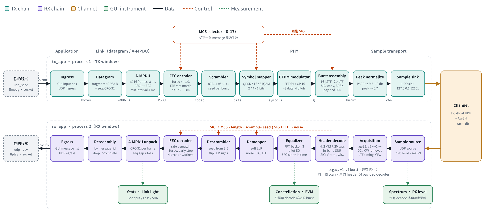

# 1. 系統架構

這篇先用很短的篇幅說明幾個名詞各自在解決什麼問題，再說明這個專案怎麼把它們接起來。
想邊看邊點的話，請開[互動導覽](https://s87315teve.github.io/ofdm-message-link/guide/)。

## 1.1 先備觀念：每一塊在解決什麼問題

一條無線 link 要做的事只有一件：**把一段 bytes 從 A 送到 B，而且 B 要能確定收到的是對的**。
下面每個名詞都是為了解決途中的一個具體問題。

| 名詞 | 要解決的問題 | 這個專案的做法 |
|---|---|---|
| **Modulation**（QPSK、16QAM、64QAM） | Radio 只能送連續的波形，不能直接送 0 和 1 | 把 2 個 bit（QPSK）、4 個 bit（16QAM）或 6 個 bit（64QAM）對應到複數平面上的一個點，叫 symbol。點越密，一次送越多 bit，但也越容易被 noise 推到隔壁的點 |
| **OFDM** | 訊號經過多條路徑（multipath）到達時，前一個 symbol 的回音會蓋到下一個 symbol | 把頻寬切成 64 個很窄的 subcarrier，每個 subcarrier 各自慢慢送自己的 symbol。symbol 變長了，回音相對就短。TX 用 IFFT 一次產生全部 subcarrier，RX 用 FFT 分開 |
| **Cyclic prefix（CP）** | 即使 symbol 變長，回音還是會落進下一個 symbol 的開頭 | 每個 OFDM symbol 前面先重複自己最後 16 個 sample。回音只會落在這段 CP 裡，RX 直接丟掉它 |
| **Preamble** | RX 不知道 burst 什麼時候開始，兩台 radio 的頻率也有一點差（CFO） | 每個 burst 開頭放一段 RX 事先知道、會重複的訊號。RX 找「重複」的地方就是起點，重複之間的相位差就是頻率偏移（Schmidl–Cox 方法）。Wire v5 用 802.11a 的 STF（每 16 個 sample 重複一次）與 LTF |
| **Training symbol 與 pilot** | Channel 會改變每個 subcarrier 的振幅與相位 | Training symbol 是整個已知的 OFDM symbol，RX 用它算出每個 subcarrier 被改變了多少（channel estimation），再除回來（equalization）。v5 的 LTF 有兩個相同的 training symbol，平均之後雜訊少一半。之後每個 symbol 裡還有 4 個已知的 pilot subcarrier，用來追蹤慢慢漂移的相位 |
| **FEC**（Turbo、convolutional code） | Noise 會讓某些 bit 判斷錯誤 | 送出去之前加上冗餘的 bit。Code rate 1/3 表示每 1 個資料 bit 送 3 個 bit。RX 利用冗餘把錯的 bit 修回來。代價是速率變成三分之一。v5 用 rate matching 從同一個 Turbo code 刪掉或重複一些 bit，得到 1/3 到 3/4 的 code rate |
| **CRC** | FEC 修不回來時，RX 需要知道「這包是壞的」 | 每個 frame 尾端加上 32-bit 的檢查碼。算出來不一樣就整包丟掉，絕不交付錯的資料。v5 的 burst 尾端另有一個 CRC-32（FCS），檢查整個 burst |
| **MCS** | SNR 高的時候想送快一點，SNR 低的時候想送穩一點 | 把 modulation 和 FEC 的組合編號。TX 送 MCS 8（QPSK、Turbo 1/3）最穩最慢，到 MCS 17（64QAM、3/4）最快但需要很高的 SNR。MCS 0–7 是舊的格式，RX 仍然收 |
| **Burst** | 資料不是連續不斷的，RX 需要知道一包的邊界 | 一包資料加上 preamble、training、header 之後，在時間上是獨立的一小段訊號，前後是靜音。一個 v5 burst 可以帶好幾個 datagram（aggregation） |
| **Scrambler** | 全零或重複的資料會讓波形變得很尖，peak 縮放之後發射功率就低了 | 送出之前把 bits 和一個已知的虛擬亂數序列做 XOR，RX 再做一次就還原。每個 burst 換一個 seed |

一個觀念貫穿全部：**速率和可靠度是交換來的。** 點放得密（16QAM、64QAM）、冗餘加得少（rate 3/4），
同一段時間送的 bit 就多，但需要的 SNR 也高。這個專案讓你在 TX 視窗用一個選單切換這個取捨，
並在 RX 視窗直接看到後果。

## 1.2 三層架構

一段 bytes 從左上進、左下出，中間經過三層。**應用程式只認得 bytes 和 UDP socket**，
完全不知道底下的 MCS、FEC 或是否有 radio：



| 層 | 發送端（上排，左 → 右） | 接收端（下排，右 → 左） | 程式 |
|---|---|---|---|
| Application | Ingress：GUI input box 或 UDP `:52001` | Egress：GUI message list 與 UDP `:52002` | `tx_app.py`、`rx_app.py` |
| Link | Datagram：加 28 B header，大於 968 B 就 fragment | Reassembly：依 `message_id` 組回，缺 fragment 就整則丟 | `datagram.py` |
| | PHY frame：16-bit sequence number + CRC-32 | Frame check：CRC、sequence gap = loss | `link.py` |
| | Aggregation：排隊中的 frames 組成一個 A-MPDU | A-MPDU 拆回 frames | `aggregation.py`、`phy/ampdu.py` |
| PHY | FEC encoder → rate matching → scrambler → symbol mapper → OFDM modulator → burst assembly | Acquisition → SIG decode → equalizer → demapper → descrambler → FEC decoder | `ofdm_link.phy` |
| Sample transport | Peak normalize → UDP sink、UHD sink 或 Pluto sink | UDP source、UHD source 或 Pluto source | `transport.py`、`pluto.py` |

模擬與實機**只有 sample transport 與 channel 不同**，其餘全是同一份程式碼、同一套 GUI、同一組量測。
這就是為什麼你可以先在沒有硬體的情況下把整條 link 弄懂。

## 1.3 一個 burst 長什麼樣子

TX 只送 wire v5 的 burst（單位：sample，5 MS/s 時 1 sample = 0.2 µs）：

```
┌───────┬─────────┬─────────┬────────────┬───────────────────────────┬───────┐
│ guard │   STF   │   LTF   │  SIG × 3   │ payload × N OFDM symbols  │ guard │
│  16   │   160   │   160   │ BPSK, 240  │ N 由 MCS 與長度決定        │  64   │
└───────┴─────────┴─────────┴────────────┴───────────────────────────┴───────┘
          acquisition  channel   MCS、length、        A-MPDU：一個或多個 frame
          CFO          estimate  scrambler seed       + FCS
                       SNR
```

- 每個 OFDM symbol 是 80 個 sample：64 個（FFT 大小）加上 16 個 cyclic prefix。
- 64 個 subcarrier 裡用了 52 個：48 個放資料、4 個是 pilot（第 −21、−7、+7、+21 個），
  中間的 DC 和兩側邊緣留空。
- **STF**（short training field）是 802.11a 的 L-STF：每 16 個 sample 重複一次，共 160 個。RX 用它找 burst
  的起點與粗略的頻率偏移。
- **LTF**（long training field）是 802.11a 的 L-LTF：32 個 sample 的 guard 加上兩個相同的 64-sample symbol。
  RX 用它找精確的起點、估 channel 與 SNR。兩個 symbol 相同的部分是訊號，不同的部分是雜訊。
- **SIG** 是 header：3 個 OFDM symbol，BPSK，K=7 的 convolutional code 加 CRC-16，帶 MCS index、
  PSDU 長度與 scrambler seed。它比最穩的 payload 還耐雜訊。
- **Payload** 的 OFDM symbol 數 `N = ⌈8 × PSDU bytes ÷ (code rate × 48 × 每個 symbol 的 bit 數)⌉`。
  Rate matching 剛好填滿 N 個 symbol，沒有 padding。
- Guard 是前後的 zero sample。STF 吸收 radio 開始發射時的 transient，所以前面只要 16 個。
- 900-byte datagram 一個 burst 時：MCS 8 是 19 600 samples（3.92 ms），MCS 14 是 4 880 samples（0.98 ms）。

**接收端先解 SIG 才知道 payload 用哪種 MCS，所以 RX 不必預先設定 MCS。** 但 sample rate 不在
header 裡：兩端 sample rate 不同，等於對「一個 sample 代表多少時間」有不同解讀，連 preamble 都
對不上。所以兩端**必須一致的只有 sample rate**。

舊的 wire v1–v4 burst（v1.0.0 與 `improve-rx` 的 TX 送的）長這樣，RX 仍然收：

```
│ guard 256 │ preamble 80 │ training 80 │ header × 3（QPSK，重複 3 次）│ payload × N │ guard 256 │
```

## 1.4 RX 怎麼同時收兩種 burst

RX 不知道下一個 burst 是 v5 還是舊格式，所以兩種都找。兩種 preamble 都有「相隔 32 個 sample 重複」
的性質，所以 RX 只算一次 lag-32 的相關（最花時間的部分），再用兩個不同寬度的 window 去看：

| | 舊格式（v1–v4） | v5 |
|---|---|---|
| Window | 32 個 product | 128 個 product（STF 長，雜訊平均得多） |
| 確認 | Chirp preamble 的 coherent 相關 ≥ 0.30 | STF 的 coherent 相關 ≥ 0.20，LTF 兩個 symbol 的相關 ≥ 0.25 |
| 擋掉另一種 | — | LTF 的兩個 symbol 都要像；舊格式的 training symbol 只像第一個 |
| 之後 | 舊的 header 與 payload decoder | SIG decoder、v5 payload decoder |

兩種 candidate 落得太近時，留下比自己門檻高最多的那一個。`phy.rx.legacy_acquisition: false` 或
`v5_acquisition: false` 可以關掉其中一種。兩種都開時，舊格式的 candidate 仍與 `improve-rx` 逐 bit 相同（有測試）。

## 1.5 Payload：rate matching 與 aggregation

**Rate matching**（`phy/rate_match.py`，照 3GPP TS 36.212 §5.1.4.1）：原本的 Turbo encoder 永遠輸出
rate 1/3。Rate matching 把三個輸出 stream 交錯排進一個環形 buffer，再依需要的 bit 數讀出：讀得比較少
就是刪掉一些 bit（rate 1/2、2/3、3/4），讀超過一圈就是重複。RX 把收到的 LLR 放回原位，刪掉的位置填 0。
所以一個 C++ decoder 就能解全部的 code rate。

**Aggregation**（`aggregation.py`、`phy/ampdu.py`，802.11n 的 A-MPDU）：

```
PSDU = │ delimiter │ frame 1 │ pad │ delimiter │ frame 2 │ pad │ … │ delimiter │ frame n │ FCS │
         4 B         序號 + CRC-32               序號 + CRC-32                               CRC-32
```

- TX 的 radio 可以接下一個 burst 時，把 queue 裡的 datagram 依序放進去，最多 16 個、8192 bytes、
  8 ms airtime。Queue 只有一個 datagram 時不會等，直接送。
- 每個 frame 保留自己的 sequence number 與 CRC-32，所以 RX 仍然以 datagram 計算遺失。
- 整個 burst 的 FCS 失敗時，CRC-32 正確的 frame **照樣交付**；一個壞掉的 frame 只損失它自己。
- Delimiter 帶下一個 frame 的長度、CRC-8 與固定的 signature。Delimiter 壞了，RX 每 4 byte 找下一個。

## 1.6 Process 怎麼分

兩個 app 預設 `--engine process`：

- Qt 視窗在主 process。
- Radio、encode／decode 與 UDP 入出口在子 process，所以 GUI 繪圖不會卡住 sample path。
- RX 另外預設 `--decode-workers 4`，把 payload decode 分到 4 個 process。Preamble acquisition 與
  header（SIG）仍由單一 owner 依序處理，交付順序不變。一個 burst 由一個 worker 解，所以 burst 越長，
  交付越一陣一陣的；這是 aggregation 有 airtime 上限的原因之一。

雙向的 `node_app` 一個 Pluto 一個 process，TX 與 RX 在**同一個** engine 子 process：一個 Pluto
只能開一個 libiio context，兩個方向共用 `pluto.SharedPlutoContext`。Payload decode 預設 3 個
process（兩個 node 在同一台 PC 時的 CPU 預算）。見 [7.9 節](07-reference.md#79-node_app雙向-node-的命令列)。

為什麼用 process 而不是 thread：Python 的 interpreter lock 讓多個 thread 無法同時跑 Python 程式碼，
decode 分到 thread 上幾乎不會變快；分到 process 才能真的用到多個 CPU 核心。

## 1.7 檔案對照

應用程式，在 `src/ofdm_message_link/`：

| 檔案 | 負責 |
|---|---|
| `tx_app.py` / `rx_app.py` | 兩個視窗、UDP ingress / egress、發送與接收 thread |
| `datagram.py` | 28 B header、fragmentation、reassembly、不完整訊息丟棄 |
| `link.py` | bytes ⇄ burst 的兩半；sequence gap、EVM/SNR 量測、A-MPDU 的交付與計數 |
| `aggregation.py` | 決定下一個 burst 放幾個 datagram（subframe、byte、airtime 三個上限） |
| `transport.py` | UDP 與 UHD 兩種 sample transport、peak normalization、TX 定時發射 |
| `pluto.py` | ADALM-Pluto：經 libiio 列舉、probe，以及 Pluto 的 sample sink／source |
| `engine.py` | 把 radio 路徑放進子 process |
| `options.py` | 兩端共用的命令列參數、設定檔解析、RF 授權檢查 |
| `devices.py` / `radio_panel.py` | 列舉與 probe radio、Radio panel |
| `dashboard.py` | Link light 規則與滑動視窗統計（不 import Qt，可 headless 測試） |
| `dashboard_widgets.py` / `plots.py` | Cards、trend、constellation、spectrum |
| `qt_runtime.py` / `window_layout.py` | Qt 啟動、Ctrl-C、`--geometry` 與影像 demo 視窗排列 |
| `log_limits.py` | log 大小上限與輪替、清舊 run 目錄 |
| `node_app.py` / `node_options.py` | 雙向 node：命令列、headless 迴圈、control socket、stats line |
| `node_engine.py` | 雙向 node 的子 process：TX 與 RX 共用一個 radio、link controller |
| `node_window.py` | 雙向 node 的視窗：TX、RX、LA 三排 cards 與 MCS 軌跡 |
| `control.py` / `la/` | Control／feedback wire format；可替換的 link adaptation |
| `udp_send.py` / `udp_recv.py` | 最小的 socket 生產者／消費者範例 |

PHY library，在 `src/ofdm_link/`：

| 檔案 | 負責 |
|---|---|
| `phy/codec.py` | Frame 的格式與 CRC；symbol mapping（QPSK、16QAM、64QAM） |
| `phy/fec.py` / `phy/turbo.py` / `phy/turbo_native.cpp` | Convolutional code 與 Turbo code；C++ 寫的 decoder |
| `phy/ofdm.py` | Subcarrier 配置、IFFT／FFT、cyclic prefix、pilot |
| `phy/sync.py` | 舊格式 preamble 的產生與偵測、CFO 估計；兩種 acquisition 共用的掃描（`acquire_all`） |
| `phy/sync_v5.py` | v5 的 STF／LTF、acquisition、LTF 的 channel 與 SNR 量測 |
| `phy/channel.py` | Channel estimation 與 equalization |
| `phy/burst_header.py` | 舊格式 burst header 的編碼與保護 |
| `phy/header_v5.py` | v5 的 SIG header |
| `phy/scrambler.py` | 802.11 scrambler |
| `phy/rate_match.py` / `phy/psdu_codec.py` | TS 36.212 rate matching；PSDU 的 FCS、Turbo encode／decode |
| `phy/ampdu.py` | A-MPDU 的 delimiter、打包與拆解 |
| `phy/burst.py` / `phy/burst_v5.py` | 把上面全部組成一個 burst，以及反過來解一個 burst（舊格式／v5） |
| `phy/streaming.py` | 從連續的 sample stream 裡找出一個個 burst |
| `phy/mcs_table.py` | MCS 的定義：舊格式 0–7、v5 8–17 |
| `radio/uhd.py` | 建立 UHD（USRP）的 source 與 sink，以及 RF 授權閘門 |
| `radio/simulation.py` | 測試用的 channel 模型（multipath、CFO、sample clock offset） |
| `runtime/factory.py` | 依設定挑選成對的 encoder／decoder |
| `runtime/segment_decode_pool.py` | 多 process 的 payload decode |
| `runtime/airtime.py` | Burst 的 sample 數與 airtime |
| `config.py` | 讀取並驗證 YAML 設定檔 |

**建議的閱讀順序**：`link.py`（最短，看得到整條路徑）→ `phy/burst_v5.py` 的 `encode_burst_v5` 與
`_decode_v5_acquired`（`phy/burst.py` 的 `decode_burst` 依 acquisition 的種類分派到這裡）→ 你有興趣的那一層。

## 1.8 這個範例刻意不做的事

- **TCP**：TCP 的 handshake 與 ACK 需要反向路徑，單向 link 做不起來。
- **ARQ / TDD**：需要 MAC layer 來排程誰在什麼時候發射與重送，這裡沒有。雙向只有 FDD 的
  `node_app`（兩個頻率，各自發射），語意仍是 UDP：掉了的 burst 不會重送。
- **完整的 channel model**：`--snr-db` 只加 AWGN，沒有 fading、CFO 或 sample clock offset。
  （`ofdm_link.radio.simulation` 有比較完整的模型，測試會用到，但 GUI 沒有接上它。）

下一篇：[看懂 GUI](02-gui.md)。
