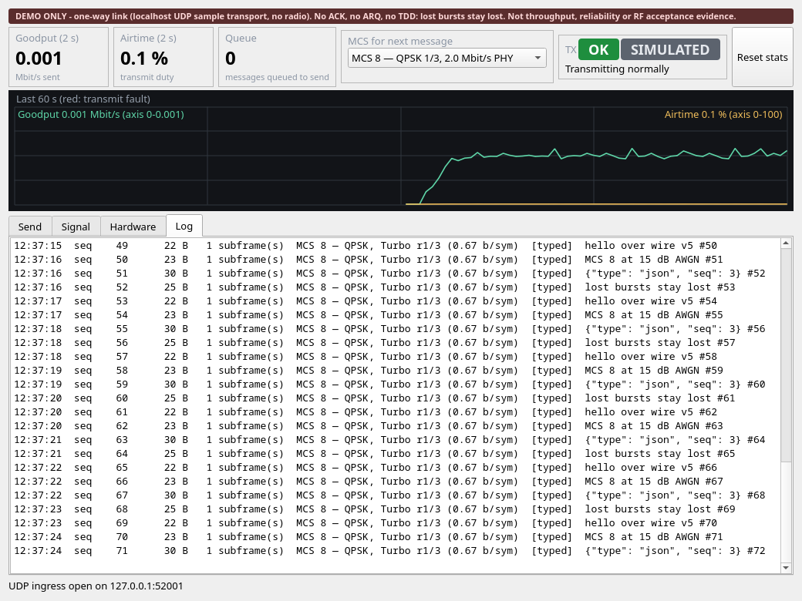
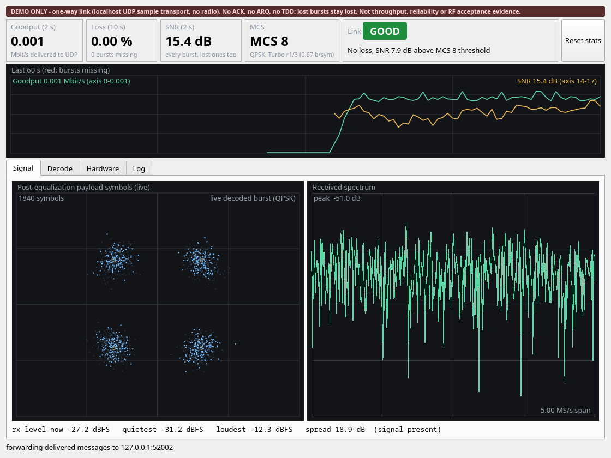

# 2. 看懂 GUI

GUI 的文字全部是英文。這篇說明每個區域在顯示什麼，以及怎麼從畫面判斷 link 的狀態。

## 2.1 視窗版面

兩個視窗都分兩層：**上層**固定在視窗頂端，一眼看出 link 好不好；**下層**是 tab，用來查問題。

| 發送端（停在 `Log` tab） | 接收端（停在 `Signal` tab） |
|---|---|
|  |  |

| 區域 | 接收端（RX） | 發送端（TX） |
|---|---|---|
| 最上方一行 | 提醒這是單向 demo（完整文字在 tooltip） | 同左 |
| 上層 cards | `Goodput (2 s)`、`Loss (10 s)`、`SNR (2 s)`、`MCS`、`Link` light | `Goodput (2 s)`、`Airtime (2 s)`、`Queue`、`MCS for next message` 下拉選單、`TX` light（`RF ON` 或 `SIMULATED`） |
| 60 秒 trend | Goodput 與 SNR，有 burst 遺失的時段紅底 | Goodput 與 Airtime |
| Tabs | `Signal`（constellation、spectrum、RX level）、`Decode`（decode funnel）、`Hardware`（Radio panel、UHD faults、engine 與 transport 資訊）、`Log` | `Send`（輸入框、Loss test、MCS 說明）、`Signal`、`Hardware`、`Log` |

- Light 右側是 **Reset stats**：只把畫面歸零（以目前計數當新基準），不重啟 radio。
- 打字聊天的流量只有每秒幾百 bytes，所以 `Goodput (2 s)` 顯示 `0.000`（單位是 Mbit/s）。
  影像 demo 時才會看到約 0.8。
- 視窗高度小於 600 px 時自動收起 tab，只留 cards 與 trend。
- `--geometry WxH+X+Y` 指定視窗位置與大小。

## 2.2 RX 的 cards 與 Link light

| Card | 內容 |
|---|---|
| `Goodput (2 s)` | 最近 2 秒送達 UDP 的 application bytes，Mbit/s |
| `Loss (10 s)` | 最近 10 秒遺失率 = missing ÷（decoded + missing）；10 秒內沒有預期中的 burst 時顯示 `—` |
| `SNR (2 s)` | 最近 2 秒**每一個抓到 preamble 的 burst**（包括後來沒解出來的）的平均 SNR，由 preamble（v5 是 LTF）估計；2 秒內沒有 burst 時顯示 `—` |
| `MCS` | 最後一個解出 burst 的 header（v5 是 SIG）所帶的 MCS index |
| `Link` | 燈號加一行原因或建議 |

燈號依序判斷，第一個成立者勝出。規則集中在
[`dashboard.py`](../src/ofdm_message_link/dashboard.py)，不 import Qt，所以可以直接讀、直接測。

| 燈號 | 條件 | 原因文字範例 |
|---|---|---|
| 灰 `WAITING` | 從未解出任何 burst | `Waiting for the first burst` |
| 灰 `IDLE` | 超過 10 秒沒有 burst | `No bursts for 14 s — transmitter stopped or link lost` |
| 紅 `DOWN` | 超過 2 秒沒有 burst | `No bursts for 3 s` |
| 紅 `LOSSY` | 最近 10 秒遺失率 ≥ 1 % | `Loss 4.2 % in the last 10 s` |
| 黃 `LOSS` | 最近 10 秒遺失率 > 0 | `Loss 0.3 % in the last 10 s` |
| 黃 `MARGINAL` | SNR < 門檻 + 1 dB | `SNR 14.6 dB is within 1 dB of 14 dB needed for MCS 12` |
| 綠 `GOOD` | 其餘 | `No loss, SNR 2.3 dB above MCS 12 threshold` |

**黃燈 `LOSS` 在真的 radio 上很常見，不代表設定有問題。** 規則是「10 秒內掉 1 個 burst 就變黃」，
而影像 demo 每 10 秒約有 1,400 個 burst；2.4 GHz 又和 Wi-Fi 共用，偶爾被蓋掉一個是正常的。
實測中遺失率 0.05% 時燈號有一半時間是黃的，畫面看起來完全正常。需要處理的是紅燈 `LOSSY`
（≥ 1%），或是畫面持續破圖。模擬環境沒有干擾，所以在模擬裡看到黃燈就值得追查。

SNR 門檻來自 Pluto 對 Pluto 的實測，規則是「遺失 < 1% 的最低 SNR + 1 dB，四捨五入到 0.5 dB」。
門檻定義在 `dashboard.py` 的 `SNR_THRESHOLD_DB`：

| MCS | 格式 | 門檻 | 來源 |
|---:|---|---:|---|
| 8 | QPSK 1/3 | 7.5 dB | [8.8](08-measurements.md#88-wire-v5pluto--pluto245-ghz) |
| 9 | QPSK 1/2 | 9.0 dB | 8.8 |
| 10 | QPSK 2/3 | 11.0 dB | 8.8 |
| 12 | 16QAM 1/2 | 14.0 dB | 8.8 |
| 13 | 16QAM 2/3 | 15.5 dB | 8.8 |
| 14 | 16QAM 3/4 | 17.5 dB | 8.8 |
| 15 | 64QAM 1/2 | 16.5 dB | 8.8 |
| 16 | 64QAM 2/3 | 21.0 dB | 8.8 |
| 17 | 64QAM 3/4 | 22.0 dB | 8.8 |
| 0（舊格式） | QPSK Turbo 1/3 | 9.0 dB | [8.7](08-measurements.md#87-改進-rx-之後pluto--pluto245-ghz) |
| 4（舊格式） | 16QAM Turbo 1/3 | 15.0 dB | 8.7 |

- MCS 0 與 4 只用在 RX 收到舊版 TX 的 burst 時。
- **v5 與舊格式的門檻不能直接比。** v5 的 SNR 由 LTF 估計，同一個 TX gain 下比舊格式的讀數高約 3 dB：
  v5 的波形 PAPR 比較低，peak 縮放之後真的多出約 3 dB 的發射功率。用同樣的 SNR 比，MCS 8 比 MCS 0
  少需要約 3 dB；用 TX gain 比，少發約 6 dB。
- MCS 15 的門檻比 MCS 14 低：同樣 3 bit/symbol，64QAM 1/2 比 16QAM 3/4 耐雜訊。
- v1.0.0 的門檻是 11 dB（MCS 4）與 8 dB（MCS 0），但那是舊的 SNR 定義（見 2.6），比現在的低 2–4 dB。

表中沒有的 MCS（11、1–3、5–7）只依遺失率判斷，原因會註明 `no SNR threshold measured for MCS N`。
紅燈或黃燈且 SNR 已低於目前 MCS 的門檻時，原因後面會附上 `— try MCS N`：只建議同一種格式（v5 或舊格式）
而且 TX 選單裡有的 MCS，因為舊版 TX 不能改送 v5。

## 2.3 TX 的 cards 與 light

TX 不知道 RX 有沒有收到（單向），所以不顯示遺失或 SNR。

| Card | 內容 |
|---|---|
| `Goodput (2 s)` | 最近 2 秒送出去的 application bytes，應與 RX 相近 |
| `Airtime (2 s)` | 最近 2 秒發射時間佔比 |
| `Queue` | 等待發送的訊息數，應維持在個位數 |
| `MCS for next message` | 下拉選單，可現場切換（下一則訊息起生效）。列出 v5 的 MCS 8、9、10、12–17，例如 `MCS 10 — QPSK 2/3, 4.0 Mbit/s PHY`：格式、code rate，以及目前 sample rate 下的 PHY rate。MCS 11 只能用 `--mcs-index 11` 選，選單會標 `[experiment]` |
| `TX` | 燈號，旁邊是 `RF ON`（真的 radio）或 `SIMULATED`（udp） |

`Send` tab 的 MCS 說明列出 spectral efficiency、一個完整 frame 的 burst 長度，以及 aggregation 的上限
（例如 `up to 16 datagrams share a burst of at most 8 ms`）。`Hardware` tab 的 `subframes/burst` 是
平均每個 burst 帶幾個 datagram，後面括號是目前的上限與 `max_wait`。負載低時接近 1；送得越快，
queue 越長，這個數字越大（見[參考資料 7.2](07-reference.md#72-設定檔)的 `mac.aggregation`）。

TX 燈號：灰 `OFF` = radio 尚未啟動；紅 `FAULT` = 最近 10 秒 UHD 的 `tx_time_error`、underflow 或
sequence error 有增加（只有 USRP 會回報這些；用 Pluto 或模擬時不會出現紅燈，trend 的標題也只寫
`transmit fault`）；黃 `BUSY` = queue 連續 3 次刷新增加，或 airtime > 90 %；其餘綠 `OK`。

## 2.4 Spectrum 與 constellation 怎麼看

| | Spectrum | Constellation |
|---|---|---|
| 回答的問題 | 「外面有沒有東西？」 | 「解出來的 burst 品質如何？」 |
| 資料來源 | 每個收到的 raw sample chunk | 成功解出的 burst 的 equalized payload symbols |
| 什麼時候更新 | 固定 UI timer，**不論有沒有解出 burst** | 只在有 decoded burst 時；超過 3 秒沒有新的就轉灰並標示 `stale, last burst N s ago` |

- **Spectrum 在動、但 constellation 顯示 `no decoded burst yet` 或 `stale`**：samples 有進來，但近期沒有
  burst 通過 synchronization 與 CRC。
- **兩張圖都沒資料**：根本還沒收到 samples。
- Constellation 在 idle 時不會拿 raw noise 來畫。繞著原點的 noise cloud 看起來像訊號，會誤導判斷。
- 黃色參考點依實際 decoded burst 切換成 QPSK 的 4 點、16QAM 的 16 點或 64QAM 的 64 點。
- GUI 預設每秒刷新 15 次（`--ui-fps` 調整）。統計文字每 0.5 秒更新。

**怎麼從 constellation 看 SNR：** 每一團點越小、越集中在黃色參考點上，SNR 越高。點團開始互相
碰到時，demapper 就會把某些 symbol 判到隔壁去，這時就要靠 FEC 修回來。16QAM 的點比 QPSK 密，
所以同樣大小的點團在 16QAM 會先互相碰到。這就是 16QAM 需要較高 SNR 的原因；64QAM 又更密。

### RX level

`Signal` tab 下方有一行讀數：

```
rx level now -64.7 dBFS   quietest -65.2 dBFS   loudest -43.9 dBFS   spread 21.3 dB  (signal present)
```

**`spread` 才是關鍵。** 沒接東西的 antenna port 會一直停在自己的 noise floor，spread 接近 0；
有 signal 的 port 會隨發射開關明顯跳動。用法見[排錯清單](06-troubleshooting.md)。

## 2.5 量測 packet loss（PER）

發送端 `Send` tab 有 **Loss test**：填數量後按 **Send batch**，會連續送出編號訊息。接收端的
`burst loss ratio`（在 `Decode` tab）就是 packet error rate，來源是 PHY frame sequence number 的缺口。

Send batch 不會因為 queue 塞滿而丟包。發送 thread 會等到有空位才送下一個 burst，所以統計上的
遺失一定來自 link，不是來自介面。

**一個可以做的小實驗：** 用模擬 transport，固定 MCS，把 `--snr-db` 從 20 每次降 1 dB，每個點用
Loss test 送 1000 則並記錄 loss。畫出 loss 對 SNR 的曲線，你會看到 FEC 的 waterfall：loss 在某個
SNR 附近突然從接近 0 升到接近 100%。換一個 MCS 再做一次，比較兩條曲線的位置。

## 2.6 統計數字的意義與限制

在 `Decode` tab，分「最近 10 秒」與「reset 後累計」兩欄。

| 欄位 | 意義 | 限制 |
|---|---|---|
| `frames decoded` | 通過 CRC-32 的 frame 數，一個 datagram 一個 | 一個 v5 burst 可以帶好幾個 frame，所以這不是 burst 數 |
| `frames missing` | 由 PHY sequence gap 推得的遺失 frame | **無法區分**「preamble 沒偵測到」與「CRC 失敗」，單向 link 本來就分不出來 |
| `burst loss ratio` | missing ÷ (decoded + missing)，以 frame 計 | 即 PER |
| `PSDUs received` | 解出 SIG、跑完 payload decode 的 v5 burst | 只算 v5 |
| `PSDU FCS failed` | 整個 burst 的 FCS 失敗 | 其中 CRC-32 正確的 frame 照樣交付 |
| `subframes OK` / `subframes CRC bad` | v5 burst 裡 CRC-32 正確／錯誤的 frame | 每個 CRC 錯誤的 frame 是一個 sequence gap |
| `bad delimiters` / `delimiter resyncs` | 壞掉的 A-MPDU delimiter；之後找到下一個 delimiter 的次數 | 只在 FCS 失敗的 burst 出現 |
| `incomplete messages` | 缺 fragment 而被丟棄的訊息 | 永遠無法修復 |
| `foreign bursts` | CRC 有效但不是這個專案的格式 | 同一 channel 上的其他應用，不是 link 故障 |
| `mean SNR` | 由 preamble 估計：兩個重複的部分（舊格式是 preamble 的兩個半段，v5 是 LTF 的兩個 symbol）相同的部分是訊號，不同的部分是雜訊，只看資料 carrier 所在的頻帶 | 每個 burst 單獨估約有 ±1 dB 的誤差，畫面上的 2 秒平均穩定得多。量的是熱雜訊，IQ imbalance、相位雜訊之類的失真不算在內，所以實機上同樣的 SNR 會比模擬難解 |
| `mean EVM` | Decision-directed：以最近的 constellation 點為參考算出的誤差 | Error rate 一高就**會飽和**。只從解得出來的 burst 計算 |
| `mean one-way latency` | End-to-end latency | **只在收發同機時顯示**。跨主機沒有共同時間基準，所以直接顯示 `n/a` 而不是給假數字 |
| `delivered goodput` | Application bits ÷ wall clock | 包含打字等待時間，只是觀察用 |

**SNR 的定義在 `improve-rx` 之後改了。** 以前畫面上的 SNR 是由 EVM 推算的，只從成功解出的 burst
計算，所以 link 很差時反而偏樂觀，而且比真實 SNR 低 3–5 dB。現在的 SNR 由每個 burst 的 preamble
估計，**沒解出來的 burst 也算**，在模擬中 0–20 dB 與真實 SNR 的差距在 ±0.62 dB 內。
它只看資料 carrier 所在的頻帶：Pluto 在頻帶邊緣的雜訊是資料 carrier 上的 10 倍，用整個頻寬估會低估約 4 dB。
定義是「burst 的平均 sample 功率 ÷ noise variance」，和 udp transport 的 `--snr-db` 相同，
所以模擬時畫面上的數字會接近你設定的值。

## 2.7 `--stats-log`：把統計存成檔案

RX 加上 `--stats-log PATH` 之後，每次統計刷新（0.5 秒）附加一行 JSON，內容與畫面同一次計算：
`receiver`、`decoder`、`transport` 的累計計數（`receiver` 裡有上面的 `psdus_received`、`psdus_fcs_failed`、
`subframes_ok`、`subframes_bad`、`bad_delimiters`、`delimiter_resyncs`），以及 `link_state`、`link_reason`、`loss_10s`
（比例，不是 %）、`snr_2s`、`mcs_index`。做實驗時用這個取數據，比看畫面抄數字可靠。

`snr_2s` 與 `mean_effective_snr_db` 是 preamble 估計的 SNR，同一行的 `"snr_method": "preamble"`
標明這一點。沒有這個欄位的舊 log 用的是 EVM 推算的舊定義，兩者不要混在一起比。

```bash
python -m ofdm_message_link.rx_app --snr-db 12 --stats-log rx_stats.jsonl
```

事後分析的例子：

```bash
python - rx_stats.jsonl <<'EOF'
import collections, json, sys
rows = [json.loads(line) for line in open(sys.argv[1])]
rows = [r for r in rows if "event" not in r]          # 略過 reset 事件
last = rows[-1]
print("decoded", last["receiver"]["bursts_decoded"],
      "missing", last["receiver"]["missing_bursts"])
print("light:", collections.Counter(r.get("link_state") for r in rows))
EOF
```

檔案預設到 16 MiB 就輪替成 `PATH.1`（`--stats-log-max-mb`、`--stats-log-backups` 可調）。
計數欄位是從視窗開啟起累計，所以最新一行永遠是總數。

## 2.8 雙向 node 的視窗（`node_app`）

標題是 `OFDM node 1`（或 2）。最上面是 demo banner 與一行 profile（node、TX／RX 頻率、sample rate、
LA 演算法、ports），下面三排 cards：

| 排 | Cards |
|---|---|
| TX | TX light、Queue、Airtime（2 s）、Sent goodput |
| RX | Link light、SNR（2 s）、Loss（10 s）、Rx goodput |
| LA | 目前的 TX MCS 與最後一次決定的原因；SNR_eff 與 offset；peer 回報的 loss（10 s）；feedback age（< 0.2 s 綠、< 0.5 s 黃、其他紅 = stale） |

Cards 下方的 60 秒圖：主軸是 TX MCS index，副軸是 LA 用的 filtered peer SNR；feedback stale 的時段
塗紅。Tabs：**Live**（RX spectrum、constellation、RX goodput）、**Send**（輸入訊息、batch）、
**Link adaptation**（auto／fixed 切換、fixed 時的 MCS 選單、threshold 表、最近 20 個決定）、
**Log**、**Hardware**（RX 的 Radio panel、TX gain、profile 的 TX 頻率、原始統計）。
`--gain-profile` 在視窗模式也有效；`--stats-log` 每 0.5 s 一行，格式見 [7.9 節](07-reference.md#79-node_app雙向-node-的命令列)。

下一篇：[用 UDP 傳資料與傳影像](03-your-own-app.md)。
