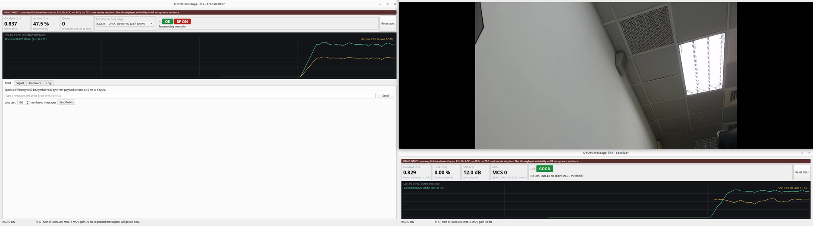

# 3. 用 UDP 傳資料與傳影像

這條 link 對應用程式來說就是兩個 UDP port：把 bytes 送進 TX 的 `:52001`，從 RX 的 `:52002` 拿出來。
你的程式不需要知道底下有 OFDM。影像串流只是其中一種用法：ffmpeg 把影像切成 UDP datagram 送進去，
ffplay 從另一端收。

## 3.1 用 UDP 傳資料：最小範例

發送端一直開著 UDP ingress（預設 `127.0.0.1:52001`），接收端一直把解出來的訊息轉發到
`127.0.0.1:52002`。先照 [README](../README.md#三步上手不需要硬體) 把 `rx_app` 與 `tx_app` 開起來，
再開兩個終端機：

```bash
# 終端機 3：消費者
python -m ofdm_message_link.udp_recv

# 終端機 4：生產者
python -m ofdm_message_link.udp_send "Hello over OFDM!"
python -m ofdm_message_link.udp_send '{"altitude": 150.3, "velocity": 18.7}'
python -m ofdm_message_link.udp_send --file /path/to/photo.jpg
```

自己寫也只要幾行：

```python
import socket
socket.socket(socket.AF_INET, socket.SOCK_DGRAM).sendto(b"hi", ("127.0.0.1", 52001))
```

[`udp_send.py`](../src/ofdm_message_link/udp_send.py) 與
[`udp_recv.py`](../src/ofdm_message_link/udp_recv.py) 都很短，可以直接當你程式的起點。
`udp_recv` 每收到一則就立刻輸出，所以可以直接接 pipe 或存檔：
`python -m ofdm_message_link.udp_recv | tee received.txt`。

## 3.2 設計你的應用時要知道的三件事

1. **一個 UDP datagram 是一則 message。** 大於單一 frame payload（預設 968 bytes）的 message 會自動
   fragment 成多個 frame，並在接收端 reassemble。TX 忙的時候，排隊中的多個 frame 會放進同一個 burst
   （aggregation），每個 frame 仍有自己的 sequence number 與 CRC。所以文字、JSON、二進位檔都走同一條路徑。
2. **不完整的 message 會被丟棄並計數，不會截斷後交付。** 單向 link 沒有辦法去要回缺掉的 fragment。
   Message 越大、fragment 越多，任何一個 burst 掉了整則就沒了。對 loss 敏感的資料請盡量讓每則
   message 小於 968 bytes。
3. **發送端不會告訴你丟包。** 送得比 link 能承載的還快時，多出來的 datagram 會在 TX 的 ingress
   queue（256 格）被默默丟掉，只能從接收端的序號缺口看出來。請在你的程式裡自己限速。每種 MCS
   的上限見 [throughput 實驗報告](../experiments/ota_udp_throughput/README.md)。

## 3.3 Webcam 影像串流

```
webcam → ffmpeg ─UDP :52001→ tx_app ─channel→ rx_app ─UDP :52012→ ffplay
```

影像是很好的 demo：掉一個 packet 畫面就破一塊，link 品質一眼就看得出來。

### 先用模擬跑（不需要 SDR）

開四個終端機，每個都先 `conda activate ofdm-message-link`。

```bash
# 終端機 1：接收端（先開）；解出的 datagram 轉發到 52012
python -m ofdm_message_link.rx_app --snr-db 20 --egress-port 52012

# 終端機 2：發送端
python -m ofdm_message_link.tx_app --mcs-index 10

# 終端機 3：播放端
ffplay -fflags nobuffer -flags low_delay -framedrop \
    "udp://127.0.0.1:52012?fifo_size=100000&overrun_nonfatal=1"

# 終端機 4：攝影機 → H.264 CBR + intra-refresh → MPEG-TS 752-byte datagram
ffmpeg -nostdin -f v4l2 -input_format mjpeg -video_size 1280x720 -framerate 15 -i /dev/video0 \
    -vf format=yuv420p -c:v libx264 -preset ultrafast -tune zerolatency \
    -b:v 1300k -maxrate 1300k -minrate 1300k -bufsize 650k \
    -x264-params "nal-hrd=cbr:force-cfr=1:intra-refresh=1:keyint=30:repeat-headers=1" \
    -muxrate 1440k -f mpegts "udp://127.0.0.1:52001?pkt_size=752"
```

停止順序：ffmpeg → TX app → RX app → ffplay，各按 Ctrl-C。

ffmpeg 剛啟動的半秒會一次送出一批 datagram，模擬 transport 來不及收，通常會掉幾十個 burst、
畫面開頭破一下。之後應該是 0 遺失（看 RX 的 `Loss (10 s)`）。

沒有 webcam 的話，把 `-f v4l2 ... -i /dev/video0` 換成 `-re -f lavfi -i testsrc=size=1280x720:rate=15`
就會送出測試圖樣。`v4l2-ctl --list-formats-ext` 可以查你的攝影機支援哪些格式。

### 參數為什麼這樣設

- **`pkt_size=752`**：一個 UDP datagram 是一個 PHY frame，所以必須小於單一 frame 可攜帶的
  968 bytes，否則會被切成兩個 fragment，掉任何一個整則就沒了。752 是 4 個 188-byte 的 MPEG-TS packet。
- **固定 bitrate**（`-b:v`、`-maxrate`、`-minrate`、`nal-hrd=cbr`、`-muxrate`）：單向 link 沒有重傳，
  遺失一個 datagram 就是一塊破圖，所以要讓發送速率平穩、而且留足餘裕。
- **`intra-refresh=1`**：把 I-frame 攤到每張 frame 上。否則每次 I-frame 會一次湧入幾十個 burst。
  破圖之後畫面也會在約 2 秒內自行恢復。
- **`-nostdin`**：一定要加。在背景執行時 ffmpeg 若讀終端機會被暫停（`ps` 狀態 `T`），看起來在跑，
  其實一個 packet 都不送。
- **`52012`**：`52002` 是 `udp_recv` 範例的預設 port；影片改用 `52012` 就不會和它搶。

### 選 MCS 與 bitrate

以下可以當作起點。SNR 門檻來自 Pluto 對 Pluto 的實測（[8.8](08-measurements.md#88-wire-v5pluto--pluto245-ghz)），
都是 5 MS/s：

| 接收端 `SNR (2 s)` | 設定 | 建議影片 bitrate |
|---|---|---|
| ≥ 12 dB | **MCS 10**（QPSK 2/3，門檻 11 dB）或更快的 MCS | **1.3 Mbit/s**（mux 1.44） |
| 約 8.5–12 dB | **MCS 8**（QPSK 1/3，門檻 7.5 dB） | 0.75 Mbit/s（mux 0.83） |

**v5 的影像 demo 還沒有實測過，這兩個 bitrate 是用 airtime 推出來的。** 一個 frame 一個 burst 時，
MCS 8 的 burst 是 4.19 ms，和舊格式 MCS 0 的 4.16 ms 差不多；MCS 10 是 2.16 ms，和舊格式 MCS 4 的 2.13 ms
差不多。舊格式的建議值是 MCS 0 配 0.75 Mbit/s、MCS 4 配 1.3 Mbit/s，依據是 B210 → NI USRP-2901 的上限量測（8.2）。
Aggregation 只會讓同樣的 bitrate 佔用更少的 airtime。

SNR 低於門檻時退回 `--mcs-index 8 --video-kbps 750`（Link light 會提示 `try MCS N`）。長時間請讓 bitrate
留在上限的 60% 左右。這裡的 SNR 是 v5 由 LTF 估計的值（定義見 [2.6](02-gui.md#26-統計數字的意義與限制)）。

### 用真的 SDR：一鍵腳本

> ⚠️ 這會讓 SDR 發射。請先讀完[用真的 SDR 發射](04-ota-hardware.md)，並且已經用訊息 demo 確認過
> 兩台 radio 之間的 link 是通的。

```bash
scripts/run_ota_video_demo.sh --enable-rf                  # 在 GUI 選硬體，一直跑，Ctrl-C 停止
scripts/run_ota_video_demo.sh --enable-rf --duration 180   # 影片開始後 3 分鐘自動停止
scripts/run_ota_video_demo.sh --enable-rf --layout none    # 不排列視窗

# 兩台 ADALM-Pluto 不用另外指定：沒有 USRP 時腳本自己改用 pluto，並預選兩台的 serial。
# 要跳過視窗裡的選擇（--auto-start）才需要自己給 serial；gain 是 Pluto 的範圍：
scripts/run_ota_video_demo.sh --enable-rf --transport pluto --auto-start \
    --tx-serial <TX_PLUTO_SERIAL> --rx-serial <RX_PLUTO_SERIAL> \
    --tx-gain -5 --rx-gain 15 --mcs-index 8 --video-kbps 750
```

腳本做的事：

1. 檢查有沒有上一次留下來的 process，並用 `xrandr` 決定視窗排列。
2. 同時開啟 RX 和 TX 兩個視窗，兩者都停在 `Hardware` tab。Radio 還沒啟動，**不會有任何發射**。
3. 你在每個視窗的 Radio panel 選好裝置、antenna、gain，按 **Start radio**（先 RX、後 TX）。
4. 等到兩邊的 radio 都啟動之後，才開啟 ffplay 並開始 ffmpeg 串流。
5. 結束時（時間到、Ctrl-C 或任何錯誤）一律依 ffmpeg → TX → RX → ffplay 的順序關閉。

常用選項：

| 選項 | 預設 | 用途 |
|---|---|---|
| `--enable-rf` | 必填 | 確認這會讓 SDR 發射；沒帶就拒絕執行 |
| `--transport T` | `auto` | `auto`、`uhd`（USRP）或 `pluto`（ADALM-Pluto）。`auto` 看接了什麼：有 USRP 就用 `uhd`，否則有 Pluto 就用 `pluto`；剛好兩台 Pluto 時會預選成 TX 與 RX（要對調就給 `--tx-serial`／`--rx-serial`）。兩端共用：一端 USRP、一端 Pluto 時不能用這支腳本，請照上面「先用模擬跑」的四個終端機做法，各自帶 `--transport` |
| `--overlay PATH` | app 的預設 | 傳給兩個 app 的設定 profile，可重複 |
| `--auto-start` | 關 | 不等你選，直接用 `--tx-serial`／`--rx-serial` 指定的裝置啟動 |
| `--duration SEC` | 不限 | 影片開始後 SEC 秒自動停止 |
| `--mcs-index N` | 8 | v5 的 MCS（8–17）。SNR 夠時可改 10 或 12。TX 視窗的 MCS 選單也能現場切換 |
| `--video-kbps N` | 750 | 影片 bitrate；MCS 10 以上可用 1300 |
| `--tx-serial` / `--rx-serial` | 無 | 視窗中預選的裝置 |
| `--tx-gain` / `--rx-gain` | 裝置最低值 / 15 | 預選的 gain（dB），執行中仍可在視窗裡調整。Pluto 的 TX 是 −89.75 到 0，見 [Gain 的定義](04-ota-hardware.md#gain-的定義) |
| `--camera DEV` | `/dev/video0` | 攝影機裝置 |
| `--layout MODE` | `auto` | 視窗排列：`auto`、`single`、`dual`、`none` |
| `--out DIR` | `/tmp/ofdm_ota_video_demo/<時間>` | log 與 `rx_stats.jsonl` 存放位置 |

### 視窗排列

| 模式 | 排法 |
|---|---|
| `dual` | 螢幕 1 整個放 TX；螢幕 2 上方 2/3 放 ffplay、下方 1/3 放 RX |
| `single` | RX 佔主螢幕左半邊全高；右上 ffplay、右下 TX |
| `auto`（預設） | 偵測到兩個以上螢幕用 `dual`，一個用 `single`；偵測失敗用 `none` |
| `none` | 不指定位置與大小，由視窗管理員決定 |

座標由 [`window_layout.py`](../src/ofdm_message_link/window_layout.py) 計算。

`dual` 的實際畫面（兩個螢幕並排；左邊是 TX，右邊上方是 ffplay、下方是 tab 已收起的 RX）：



### Log 的上限與清理

Demo 可以連續跑好幾個小時，所以每一種 log 都有上限，到了上限就丟掉最舊的內容：

| Log | 上限 | 調整方式 |
|---|---|---|
| GUI `Log` tab | 最後 2000 行 | app 的 `--log-lines N` |
| `rx_stats.jsonl` | 16 MiB ＋ 1 份舊檔 | 腳本 `--stats-max-mb`；app 的 `--stats-log-max-mb` |
| `rx.log`、`tx.log`、`ffplay.log`、`ffmpeg.log` | 各 4 MiB ＋ 1 份舊檔 | 腳本 `--log-max-mb` |
| Run 目錄 | 最新 5 個 | 腳本 `--keep-runs N` |

想保留完整紀錄就用 `--out` 指定目錄（不會被清理），並加 `--stats-max-mb 0 --log-max-mb 0`。

### 影像 demo 的排錯

| 症狀 | 原因 | 處理 |
|---|---|---|
| ffplay 視窗全黑，TX `Goodput (2 s)` 為 0 | ffmpeg 被暫停（狀態 `T`）或沒啟動 | `ps -o stat -C ffmpeg`；加 `-nostdin` 重跑 |
| 畫面偶爾破一小塊、約 2 秒內自己恢復，RX 燈號黃 `LOSS` | OTA 的零星掉包，遺失率低於 1% | 正常，不用處理；想更乾淨就調高 TX gain（Pluto 往 0 dB） |
| 畫面持續破圖，RX 燈號紅 `LOSSY` | SNR 不夠或速率太高 | 先調高 TX gain；再看燈號原因後的 `try MCS N` 建議，改 `--mcs-index 8 --video-kbps 750` |
| TX `Queue` 一直增加、燈號黃 `BUSY` | 影片 bitrate 超過 link 容量 | 降低 `--video-kbps` |
| 腳本說 `an earlier demo is still running` | 上一次的 process 沒清乾淨 | 見下方 |
| 終端機停在 `Video starts once both radios are on` | 還有一個視窗沒按 Start radio，或啟動失敗 | 看該視窗 Radio panel 下方的紅字 |

清掉殘留的 process（依這個順序，先停資料來源，最後停播放）：

```bash
pgrep -af "ofdm_message_link|ffmpeg|ffplay"                      # 先看有什麼
pkill -TERM -x ffmpeg
pkill -TERM -f '^python -m ofdm_message_link[.]tx_app'
pkill -TERM -f '^python -m ofdm_message_link[.]rx_app'
pkill -TERM -x ffplay
```

GUI 主程式結束後，偶爾會留下 `multiprocessing.forkserver` 子 process，它們會佔住 radio。
用 `pgrep -af forkserver` 檢查，確認命令列含 `ofdm_message_link` 後再 `kill -TERM <pid>`。

## 3.4 寫你自己的 link adaptation 模組

雙向的 `node_app`（[7.9 節](07-reference.md#79-node_app雙向-node-的命令列)）依 peer 回報的
feedback 為每個 data burst 選 MCS。選 MCS 的演算法與 RX 端的量測方式都是可替換的模組：
不必改 `node_app`，在命令列指定 class 即可。兩個模組在 node 裡的位置見
[1.7 節的架構圖](01-architecture.md#17-雙向-nodenode_app)：`LinkController` 擁有它們，並把它們接到 TX worker
（BurstPolicy）、收到的 CONTROL frame（ControlHandler）與 RX worker（ReceiveObserver）。

### 兩個模組、一條資料流

| 模組 | 在哪一端 | 做什麼 | 命令列 |
|---|---|---|---|
| `LinkAdaptation` | TX | 把 feedback 變成下一個 burst 的 MCS | `--link-adaptation SPEC`、`--link-adaptation-arg K=V` |
| `FeedbackReporter` | RX | 決定量什麼、多久回報一次 | `--feedback-reporter SPEC`、`--feedback-reporter-arg K=V` |

```
peer 的 RX                                   這個 node 的 TX
FeedbackReporter.on_preambles / on_burst      LinkAdaptation.on_feedback(report)
  / on_rx_health（每個 RX chunk）                     │
FeedbackReporter.due() → build() ──FEEDBACK──▶  LinkAdaptation.decide(now) → Decision(mcs)
  （附在下一個 burst，或單獨的 control burst）   LinkAdaptation.on_sent(burst)（每個送出的 burst）
```

Wire format 見 [7.8 節](07-reference.md#78-雙向-link-的-control-與-feedback-wire-format)。
所有 interface 與資料結構都在
[`ofdm_message_link/la/api.py`](../src/ofdm_message_link/la/api.py)。

### `SPEC` 與參數的寫法

| `SPEC` | 意義 |
|---|---|
| `olla`（`node_app` 預設） | 內建：LTE 式的 inner／outer loop，追 1 % 的 subframe loss |
| `fixed` | 固定在 `--mcs-index`；GUI 與 control socket 的 `set_mcs` 可以改 |
| `arf` | 內建範例：Auto Rate Fallback（`la/examples.py`） |
| `package.module:Class` | 可以 import 的 module 裡的 class |
| `path/to/file.py:Class` | 一個檔案裡的 class，不需要安裝 |

`--link-adaptation-arg K=V` 可以重複。`V` 先當 Python literal 解析（`5`、`0.02`、`True`、
`"text"`），失敗就當字串。同一個 `K` 給兩次、或少了 `=`，程式啟動時就停止並說明原因。
`node_app` 用 `Class(context, **kwargs)` 建立 instance，再檢查它是否實作 interface；
不符合時一樣在啟動時停止，不會等到第一個 burst。Reporter 的 `SPEC` 內建只有 `default`。

### `LinkAdaptation` interface

不需要繼承任何 base class，有這四個 method 就可以：

| Method | 何時呼叫 | 回傳 |
|---|---|---|
| `on_sent(burst: SentBurst)` | 每個 burst 送出後（含 control-only burst） | 無 |
| `on_feedback(report: FeedbackReport)` | 收到 peer 的每份 feedback | 無 |
| `decide(now_s: float)` | 每個 data burst 之前 | `Decision(mcs_index, reason, snr_eff_db, offset_db)` |
| `snapshot()` | Engine 每次回報 stats（GUI 與 stats line），以及每份 feedback 寫進 `--la-log` 時 | 可以轉成 JSON 的 dict |
| `on_mode(mode)`（選用） | 操作員固定 MCS 時（`"fixed"`），交回演算法時（`"auto"`） | 無；內建演算法在 fixed mode 凍結學習 |

建構時拿到的 `LaContext`：`ladder`（可用的 v5 entries，PHY rate 由低到高，dominated 的
entry 已移除）、`thresholds_db`（MCS index → 1 % loss 需要的 preamble SNR，來自
`configs/la/thresholds_pluto_v5.yaml`）、`initial_mcs_index`、`sample_rate`、`node_id`。

`FeedbackReport` 最常用的欄位：`report_seq`、`snr_mean_db`／`snr_p10_db`／`snr_last_db`
（沒有量到時為 `None`）、`data_ok_total`／`data_lost_total`（**累計**的 DATA subframe 數）、
`rx_overflow_total`、`bursts`（最近的 DATA bursts，每個有 MCS、SNR、ok／lost）、
`received_t_s`（本地收到的時間）。

### 範例：一個 threshold 演算法

```python
# my_la.py
from ofdm_message_link.la.api import Decision, FeedbackTracker, LaContext


class Threshold:
    """選 reported SNR 夠用的最高 rung。"""

    def __init__(self, context: LaContext, margin_db: float = 0.0):
        self.ladder = context.ladder              # PHY rate 由低到高
        self.thresholds = context.thresholds_db   # MCS index -> dB
        self.margin_db = float(margin_db)
        self.mcs = context.initial_mcs_index
        self.tracker = FeedbackTracker()          # 處理重複、舊的 report 與 peer 重新啟動

    def on_sent(self, burst):                     # SentBurst；不用可以忽略
        pass

    def on_feedback(self, report):
        if self.tracker.update(report) is None:
            return                                # 舊的或重複的 report
        if report.snr_mean_db is None:
            return
        fits = [e.index for e in self.ladder
                if self.thresholds[e.index] + self.margin_db <= report.snr_mean_db]
        self.mcs = fits[-1] if fits else self.ladder[0].index

    def decide(self, now_s):
        return Decision(self.mcs, reason="threshold")

    def snapshot(self):
        return {"mcs_index": self.mcs}
```

```bash
python -m ofdm_message_link.node_app --node-id 1 \
    --link-adaptation my_la.py:Threshold --link-adaptation-arg margin_db=1.5
```

不開 radio 也能先試：自己造 `FeedbackReport` 餵給它。

```python
from ofdm_message_link.la.api import FeedbackReport, LaContext
from ofdm_message_link.la.loader import build_link_adaptation
from ofdm_message_link.la.thresholds import build_ladder, load_thresholds

thresholds = load_thresholds()
context = LaContext(ladder=build_ladder(thresholds), thresholds_db=thresholds,
                    initial_mcs_index=8, sample_rate=5e6, node_id=1)
la = build_link_adaptation("my_la.py:Threshold", context, ["margin_db=1.5"])
report = FeedbackReport(version=1, reporter_id=0, report_seq=1, window_s=0.02, age_s=0.0,
                        preambles=10, snr_mean_db=16.0, snr_p10_db=15.0, snr_last_db=16.0,
                        data_ok_total=40, data_lost_total=0, last_data_seq=None,
                        psdu_fcs_fail_total=0, header_fail_total=0, rx_overflow_total=0,
                        last_mcs_index=8)
la.on_feedback(report)
print(la.decide(0.0))   # 用目前的 thresholds，16 dB 選 MCS 12
```

兩個 node 不開 radio 也能整條跑：`--transport udp`（預設）時，兩個 `node_app` 在同一台
PC 上經 UDP 交換 samples，`--la-log PATH` 會記下每個 decision 與 feedback。

### 規則

- `decide` 在每個 data burst 之前呼叫，要快。回傳 `context.ladder` 裡的 index；其他
  transmit-visible 的 v5 index 也接受，不合法的 index 會換成較慢的最近 rung，並記錄在 log。
- 計數器是累計值，而且會 wrap。不要自己比 `report_seq` 或相減：用 `FeedbackTracker`。`update(report)` 對晚到或重複的
  report 回傳 `None`（忽略）；否則回傳 `FeedbackDelta`，裡面是這份 report 相對於上一份新增的 `ok`、`lost`
  （已處理 u32 wrap）。Peer 重新啟動時（`session_id` 不同、超過 `rebaseline_after_s` 沒收到 report，或計數器倒退），
  它的第一份 report 只當新的基準，`rebaselined` 會說明原因（`"first"`、`"session"`、`"gap"`、`"backwards"`），`ok` 與
  `lost` 是 0。只比 `report_seq` 的寫法會在 peer 重新啟動後（序號從 0 開始）忽略它約 11 分鐘。掉幾份 feedback 不會遺失
  資訊。純粹的 `counter_delta(new, old)` 與 `is_newer_seq(new, old)` 仍在 `la.api`，但自訂演算法應該用 `FeedbackTracker`。
- 第一份 report 只當基準：沒有前一份可以相減（`FeedbackTracker` 會回傳 `rebaselined="first"`）。
- `snapshot` 只回傳可以轉成 JSON 的值；GUI 的 Link adaptation tab 與 `--la-log` 會顯示。
- Method 不會同時被呼叫（controller 持有一把 lock），不需要自己加 lock。時間都是
  `time.monotonic()` 的秒數。
- 沒有 feedback（例如反方向的 SNR 太低）時，`on_feedback` 就不會被呼叫。演算法要自己決定
  feedback 太舊時怎麼辦；`olla` 在 0.5 s 沒有 feedback 後每 0.5 s 降一階，最低到 MCS 8。Feedback 還在來、
  但沒有一份聽到 0.5 s 前送出的 burst（forward link 斷了）時，`olla` 也一樣降階。
- Fixed mode（GUI 或 control socket 的 `set_mcs`）時，controller 不呼叫 `decide`，但 feedback 照樣送到
  `on_feedback`：它描述的是操作員選的 MCS。需要分辨時實作 `on_mode`。

### 內建範例：ARF

[`la/examples.py`](../src/ofdm_message_link/la/examples.py) 的 `ArfLinkAdaptation` 是一個不到
一百行的完整演算法，可以當範本複製。它不看 SNR：連續 `up_after` 份沒有 loss 的 report 就升一階，
連續 `down_after` 份有 loss 就降一階；`probe_fail_down=True` 時，升階後的第一份 report 有 loss
就立刻降回去。沒有 DATA subframe 的 report（peer 閒置）不改變任何狀態。

```bash
python -m ofdm_message_link.node_app --node-id 1 --link-adaptation arf
python -m ofdm_message_link.node_app --node-id 1 \
    --link-adaptation ofdm_message_link.la.examples:ArfLinkAdaptation \
    --link-adaptation-arg up_after=5 --link-adaptation-arg probe_fail_down=False
```

### 自訂 reporter

RX 端的 reporter 用同樣的方式寫與載入：`Class(context: ReporterContext, **kwargs)`，
`ReporterContext` 有 `node_id`、`peer_node_id`、`max_entries`（≤ 16）。

| Method / 屬性 | 何時呼叫 | 做什麼 |
|---|---|---|
| `reporter_id` | 屬性 | 非 0 的 id（0 是內建 reporter），peer 用它分辨 report 的來源 |
| `on_preambles(now_s, snr_db, *, control_only)` | 每個 RX chunk | 這段 chunk 裡每個 peer preamble 的 SNR |
| `on_burst(report: BurstReport)` | 每個收到的 DATA burst | 累計 ok／lost，記下最近的 bursts |
| `on_rx_health(now_s, health: RxHealth)` | 每個 RX chunk | overflow、header／FCS 失敗、clipping、decode backlog |
| `due(now_s)` / `next_due_s(now_s)` | TX 準備下一個 burst 時 | 是否該回報；下一次何時該回報（閒置的 node 會在那時醒來送 control burst） |
| `build(now_s)` | `due` 為真時 | 回傳 `FeedbackReport` 並結束這個量測窗 |

內建 reporter 在收到 peer 的 DATA burst、或有 PSDU 的 FCS 失敗時，讓下一份 report 在 `period_ms`
後到期；其他時候每 `keepalive_ms` 一份。Control-only burst 只更新 SNR 統計，不讓 report 到期，否則
兩個閒置的 node 會互相觸發 control burst。閒置時，TX worker 只在 `next_due_s` 的時間到了才問 `due` 並送
control-only burst（它最多睡 reporter 的 `period_s` 屬性，沒有這個屬性時 20 ms），所以 `next_due_s` 要與
`due` 一致；回傳 `None` 表示閒置時不送 report。有 data 時，每個 burst 之前都會問 `due`。額外的量測放在 `FeedbackReport.extras`，用 type 0x80–0xFF 的
TLV；不認得的 TLV 會被對方略過。內建的 `la/reporter.py` 的 `DefaultReporter`
（`period_ms=20`、`keepalive_ms=200`、`max_entries=8`）是最直接的範本。

下一篇：[用真的 SDR 發射](04-ota-hardware.md)。
