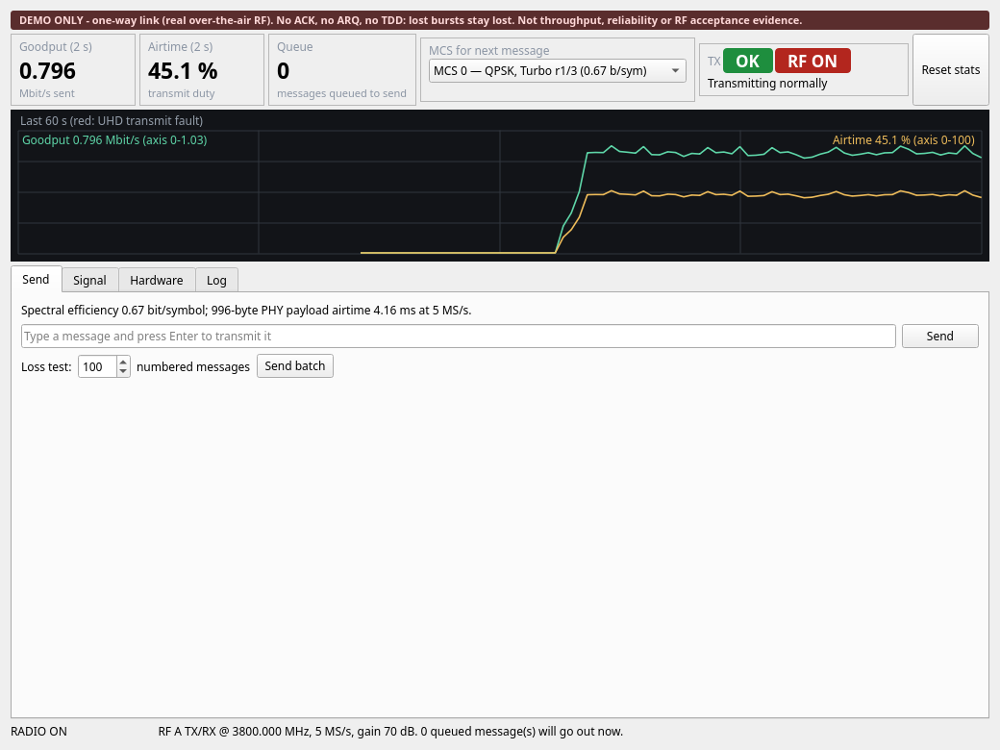
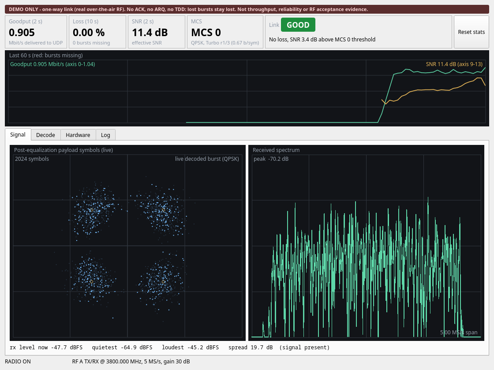
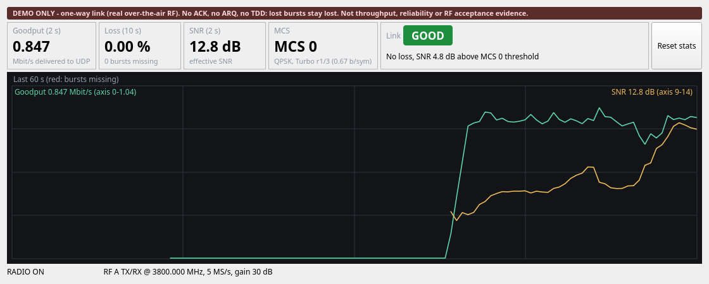

# 8. 實測紀錄

這個專案在實機上跑過的結果。除了當作「這條路徑真的會動」的證據，也可以當作你自己做實驗時
記錄方式的參考：寫清楚設備、設定、量到什麼、**以及沒有量到什麼**。

> **量測條件。** 以下都是同一張桌上的短距離、低功率量測。8.1–8.4 使用的 1.2 GHz 與 3.8 GHz 是當時
> 設備組合下選的頻率，**不是這個專案現在的預設值（2.45 GHz）**，也都不是 ISM 頻段。重現前請先確認你
> 所在場所可用的頻段與功率；不確定時改用 cable 加 attenuator（見[發射前必讀](04-ota-hardware.md#41-發射前必讀)）。
>
> 預設的 2.45 GHz profile 只有 8.5 的 Pluto 對 Pluto、與 8.6 的 N210 對 Pluto 短時間量測。
>
> 8.9 的雙向 FDD 用 2420／2460 MHz，在 2.4 GHz ISM 頻段內，但分別落在 Wi-Fi channel 1 與 11。
>
> **SNR 的定義在 8.7 改了。** 8.1–8.6 的 SNR（`SNR (2 s)`、`effective SNR`）是由 EVM 推算的舊定義：
> 只算解出來的 burst，而且比真實 SNR 低 3–5 dB。8.7 之後的 SNR 由每個 burst 的 preamble 在資料 carrier
> 的頻帶內估計（見 [2.6](02-gui.md#26-統計數字的意義與限制)）。8.1–8.6 當時沒有錄原始 samples，無法用新定義重算，
> 所以舊的數字保留原樣；**兩種定義的數字不要直接比較。**
>
> **8.8 的 v5 burst 用 LTF 估 SNR。** 定義相同（資料 carrier 頻帶內的熱雜訊 SNR），但同一個 TX gain 下
> v5 的讀數比 legacy 高約 3 dB。這是真的發射功率差，不是估計的偏差，原因見 8.8。

這些都是 demo 等級的觀察：單一擺放位置、時間短、沒有重複多次。不能當作 throughput 或 reliability
的正式結論。

## 8.1 B210 → NI USRP-2901，3.8 GHz

第一次把這條 link 搬到實機上。

| 項目 | 結果 |
|---|---|
| 發送 | B210，RF A `TX/RX`，TX gain 70 dB |
| 接收 | NI USRP-2901，RF A `TX/RX`，RX gain 30 dB |
| 設定 | `configs/profiles/b210_ota_3p8ghz.yaml`：3.8 GHz、5 MS/s、MCS 0 |
| 兩個獨立 process | 9 則訊息送達 7 則（含 JSON），bytes 完全正確 |
| 單一 process 的 run | 14 則送達 13 則，burst loss 7.14% |
| 離線 decode 錄下的 samples | 213 個 burst 解出 211 個，EVM 0.21–0.24、effective SNR 12–14 dB |
| 遺失的訊息 | **不會回來**。單向 link 沒有重傳 |

重現用的指令（兩端都要帶 overlay）：

```bash
# 終端機 1
python -m ofdm_message_link.rx_app \
    --overlay configs/profiles/b210_ota_3p8ghz.yaml \
    --transport uhd --serial <RX_SERIAL> --channel 0 --antenna TX/RX --gain 30 --auto-start

# 終端機 2
python -m ofdm_message_link.tx_app \
    --overlay configs/profiles/b210_ota_3p8ghz.yaml \
    --transport uhd --serial <TX_SERIAL> --channel 0 --antenna TX/RX --gain 70 --auto-start \
    --enable-rf \
    --acknowledgement 'I acknowledge that this process will transmit RF'
```

## 8.2 OTA 影像 demo，B210 → NI USRP-2901，3.8 GHz

`scripts/run_ota_video_demo.sh`，5 MS/s，TX 70 dB / RX 30 dB，1280×720 15 fps webcam。數字來自 RX 的
`--stats-log`（每 0.5 秒一筆）。「無遺失區間」是相鄰兩筆之間 `missing_bursts` 沒有增加的比例。

| 項目 | Run A：MCS 4 + 1.3 Mbit/s | Run B：MCS 0 + 0.75 Mbit/s |
|---|---|---|
| 影片時間 | 180 s | 119 s |
| 送達 burst / 遺失 burst | 32,206 / 11,840 | 16,818 / 420 |
| Burst loss | **26.9 %** | **2.4 %**（全部集中在一次約 7 秒的衰落） |
| 即時 goodput 中位數 / 最大 | 1.305 / 1.577 Mbit/s | 0.835 / 0.936 Mbit/s |
| 無遺失區間 | 152 / 359（42 %） | 226 / 239（95 %） |
| Effective SNR 範圍 | 7.6 – 13.0 dB | 4.5 – 13.6 dB |
| UHD `rx_overflow` / 遺失 samples | 0 / 0 | 0 / 0 |

解讀：

- **主機端沒有瓶頸**：兩次都 0 overflow、0 遺失 samples。遺失全部來自空中的 channel：SNR 會在幾秒內
  掉到 11 dB 以下（人走動、multipath 變化），掉包率與 SNR 下降同步。
- 這次的 SNR 平均約 11 dB，正好卡在 MCS 4 的門檻，所以 MCS 4 反覆破圖。**MCS 選得太激進的後果
  就長這樣。** 同樣的環境用 MCS 0 就穩定得多。
- 單向 link 沒有重傳，衰落期間的破圖無法修復；intra-refresh 讓畫面在約 2 秒內自行恢復。

另外一組在 SNR 較穩定時量的上限（同樣的設備與頻率，RX 4 個 decode worker）：

| 接收端 `SNR (2 s)` | 設定 | 無遺失上限（900-byte burst） | 752-byte datagram 上限 |
|---|---|---|---|
| ≥ 11 dB | 5 MS/s + MCS 4 | 每秒 400 個 burst，2.88 Mbit/s（94% duty） | 2.41 Mbit/s |
| 約 8–11 dB | 5 MS/s + MCS 0 | 每秒 230 個 burst，1.65 Mbit/s（98% duty） | 1.38 Mbit/s |

- MCS 4 在 TX 降 3 dB（SNR 約 9.7 dB）時已開始掉包（0.2%），降 6 dB 掉 16%；同樣條件下 MCS 0 仍是
  0 遺失。**GUI 裡 MCS 4 = 11 dB、MCS 0 = 8 dB 這兩個門檻就是從這裡來的。**
- 最高的穩定影片 bitrate：1.8 Mbit/s 60 秒 0 遺失；2.1 Mbit/s 60 秒掉 1 個 datagram。
- 一次 5 分鐘的 run（1.3 Mbit/s）：73,364 個 datagram，0 遺失、0 overflow。
- 10 MS/s 的 profile 在同樣的擺放下 SNR 掉了 2.5–5 dB（bandwidth 加倍，收進來的 noise 也加倍）：
  MCS 4 至少 1.4% 遺失。

下面兩張是這個 demo 的畫面（MCS 0、750 kbit/s）：

| 發送端（OTA） | 接收端（OTA） |
|---|---|
|  |  |

視窗高度小於 600 px 時只留 cards 與 trend：



## 8.3 OTA 影像 demo，N210 → NI USRP-2901，1.2 GHz

N210（CBX，RF1 = `TX/RX`，TX gain 5 dB）→ NI USRP-2901（`TX/RX`，RX gain 15 dB），
`configs/profiles/usrp_ota_1p2ghz.yaml`，5 MS/s，MCS 4，影片 1.3 Mbit/s，180 秒。
Antenna 是約 900 MHz 的 antenna，距離沒有量測。

| 項目 | 結果 |
|---|---|
| 送達 datagram / 遺失 | 43,862 / 246（**0.56 %**） |
| 無遺失區間 | 366 / 408（90 %）；**前 160 秒 0 遺失**，遺失全部集中在最後約 21 秒 |
| 即時 goodput 中位數 / 最大 | 1.448 / 1.610 Mbit/s |
| `SNR (2 s)` 範圍 | 15.6 – 17.3 dB（MCS 4 門檻 11 dB） |
| UHD `rx_overflow` / 遺失 samples / 時間不連續 | 0 / 0 / 0 |
| TX underflow / late | 0 / 0 |

解讀：

- 最後 21 秒的遺失全部是 payload CRC 失敗。當時 `SNR (2 s)` 仍然在 16 dB 左右，主機端也沒有 overflow。
  SNR 只從成功解出的 burst 計算，所以短暫的外部干擾會讓部分 burst 失敗，卻不會拉低這個數字。
  **原因沒有查明。** 結束後立刻用同樣設定重測（7,500 個 burst），結果是 0 遺失，所以不是穩定存在的問題。
- 1.2 GHz 位於衛星導航與 L-band 雷達等系統使用的頻段，無法排除外部干擾；這只是推測，沒有量測佐證。
- **RX gain 為什麼是 15 dB 而不是 30 dB：** 這個頻率的路徑損耗比 3.8 GHz 少約 10 dB。RX gain 30 dB
  時 signal 太強，接收端的 acquisition 跟不上，每秒 400 個 burst 時掉了 40%。

各 MCS 在這組設備上的完整 throughput 掃描，見
**[throughput 實驗報告](../experiments/ota_udp_throughput/README.md)**。

## 8.4 ADALM-Pluto → ADALM-Pluto，1.2 GHz

兩台 PlutoSDR Rev.B（官方韌體），各接原廠 antenna、放在同一張桌上，
`--transport pluto --overlay configs/profiles/usrp_ota_1p2ghz.yaml`、5 MS/s、MCS 0、900-byte 訊息，
兩個獨立 process。

| 方向 | Backend／韌體 | TX／RX gain | 速率 | 送達 | Burst loss | SNR | RX overflow |
|---|---|---|---:|---:|---:|---:|---:|
| A → B | `ip:`／v0.31→v0.30 | −15／15 dB | 150/s，8 秒 | 1,200／1,200 | 0 | 12.7 dB | 0 |
| A → B | `ip:`／v0.31→v0.30 | −15／15 dB | 100/s，90 秒 | 8,990／9,000 | 0.11% | 12.1 dB | 0 |
| B → A | `ip:`／v0.30→v0.31 | −15／15 dB | 100/s，60 秒 | 5,947／6,000 | 0.88% | 10.7 dB | 0 |
| **A → B** | **`usb:`／v0.39** | −15／15 dB | 100/s，30 秒 | 2,991／3,000 | 0.30% | 12.0 dB | 0 |
| **B → A** | **`usb:`／v0.39** | −15／15 dB | 100/s，30 秒 | 2,960／3,000 | 1.30% | 10.3 dB | 0 |

- 前三列是經 Pluto 的 USB 網路介面（libiio `ip:` backend）量的，當時主機還沒有裝 udev rule。
  後兩列是裝好 udev rule、兩台都更新到 v0.39 之後，直接走 USB backend 量的。
- 發送端在 MCS 0 約 190 burst/s 飽和；RX gain 30 dB 加上較強的 signal 會讓 acquisition 跟不上
  （150/s 時掉 86%）。
- **影像 demo**（`usb:`／v0.39，TX −10／RX 15 dB，750 kbit/s）：接收端收到 835 kbit/s，等於 ffmpeg
  送出的 832 kbit/s，30 秒內 4 個 burst 遺失、0 overflow。
- 最長 90 秒、單一擺放位置。

## 8.5 ADALM-Pluto → ADALM-Pluto，2.45 GHz（預設 profile）

兩台 PlutoSDR Rev.B（韌體 v0.39，USB backend），各接原廠 antenna、放在同一張桌上，預設的
`configs/profiles/ota_2p45ghz.yaml`、5 MS/s、MCS 0。

訊息：1000 個 900-byte datagram，每秒 100 個。

| TX／RX gain | 送達 | Burst loss | `SNR (2 s)` | RX overflow |
|---|---:|---:|---:|---:|
| −15／15 dB | 898／1,000 | **10.2%** | 7.1–8.2 dB | 0 |
| **−5／15 dB** | 1,000／1,000 | 0 | 15.2–16.6 dB | 0 |
| −5／30 dB | 1,000／1,000 | 0 | 22.8–23.7 dB | 0 |

- 1.2 GHz 時夠用的 TX −15 dB，在 2.45 GHz 只剩約 7–8 dB 的 SNR，低於 MCS 0 需要的 8 dB，所以掉了一成。
  遺失的 burst 幾乎都是 header 解不出來（99 個）。頻率越高路徑損耗越大是原因之一；antenna 與
  干擾的影響沒有另外量測。**換頻率之後 gain 要重新找。**
- TX 調高 10 dB，SNR 也大約升 8–9 dB，遺失歸零。

影像：`scripts/run_ota_video_demo.sh --transport pluto --auto-start`，TX −5／RX 15 dB，MCS 0，
750 kbit/s，1280×720 15 fps webcam，30 秒。

| 項目 | 結果 |
|---|---|
| 送達 burst / 遺失 | 4,253 / **0** |
| 即時 goodput 中位數 / 最大 | 0.835 / 0.860 Mbit/s |
| `SNR (2 s)` 範圍 | 15.8 – 16.6 dB |
| RX overflow | 0 |
| ffplay 的 `corrupt` 訊息 | 0 |
| Link light | 全程 `GOOD` |

每個設定只跑了一次，最長 30 秒，單一擺放位置。

### 2026-10-05 重跑：同樣的設定，結果沒有那麼乾淨

同樣兩台 Pluto、同一張桌子、RX 15 dB，之後照文件重跑一次。訊息改成 500 個 900-byte datagram、
每秒 50 個；影像各 60 秒。

| 測試 | TX gain | 送達／遺失 | 遺失率 | `SNR (2 s)` | ffplay `corrupt` |
|---|---:|---:|---:|---:|---:|
| 訊息 | −20 dB | 9／401 | 幾乎全掉 | 2.7–3.5 dB | — |
| 訊息 | −10 dB | 487／13 | 2.6% | 10.6–11.3 dB | — |
| 訊息 | −5 dB | 499／1 | 0.2% | 14.8–15.5 dB | — |
| 影像 | −5 dB | 8,553／25 | **0.29%** | 13.4–15.2 dB | 24 |
| 影像 | **0 dB** | 8,672／4 | **0.05%** | 17.1–18.7 dB | 4 |
| 影像 | 0 dB（再一次） | 8,650／3 | 0.03% | 17.4–19.1 dB | 2 |

- **同樣的 TX −5 dB，這次 SNR 低了 1–2 dB，而且不是零遺失。** 上面那次的「0 遺失、全程 `GOOD`」
  是當時的環境，不是這個設定的保證。2.4 GHz 的干擾與擺放的細微差異沒有分開量。
- TX −5 dB 的影像 `Link` light 幾乎全程是黃燈 `LOSS`；0 dB 時約一半時間是綠燈。兩種情況的畫面
  看起來都正常，偶爾破一小塊後自己恢復。**遺失率低於 1% 的黃燈可以接受。**
- RX overflow 全部是 0。
- −5 到 0 dB 這 5 dB 只換到約 3.5 dB 的 SNR，比 −20 到 −5 那一段（接近 1 dB 換 1 dB）少；
  原因沒有查。

## 8.6 N210 與 ADALM-Pluto 交叉，2.45 GHz

第一次讓兩種不同廠牌的 radio 各在一端。N210r4（daughterboard 可調 1180–6020 MHz，TX gain
0–31.5 dB、RX gain 0–38 dB，Slot A `TX/RX (RF1)` 接 antenna）與 PlutoSDR Rev.B（原廠 antenna），
同一張桌上，預設 profile、5 MS/s、MCS 0。訊息測試是 500 個 900-byte datagram、每秒 50 個。

### N210 發 → Pluto 收：可以

| N210 TX gain | Pluto RX gain | 送達／遺失 | 遺失率 | `SNR (2 s)` |
|---:|---:|---:|---:|---:|
| 0、5 dB | 15 dB | 0 | 沒有偵測到任何 burst | — |
| 10 dB | 15 dB | 0 | 偵測到 16 個，header 全部解不出來 | — |
| 15 dB | 15 dB | 83／413 | 83% | 5.3–6.3 dB |
| 20 dB | 15 dB | 439／61 | 12.2% | 7.9–8.5 dB |
| 25 dB | 15 dB | 498／2 | 0.4% | 10.6–11.3 dB |
| 30 dB | 15 dB | 500／0 | 0 | 12.3–12.7 dB |
| 20 dB | **30 dB** | 494／6 | 1.2% | 12.7–13.2 dB |

影像（N210 TX 25 dB、Pluto RX 30 dB，750 kbit/s，60 秒）：送達 8,703、遺失 36（**0.41%**），
`SNR (2 s)` 14.0–15.2 dB，RX overflow 0，ffplay `corrupt` 31 次。這次沒有畫面截圖（螢幕在測試中
鎖定），只有數據。

- **把 Pluto 的 RX gain 從 15 調到 30 dB，N210 就可以少發 10 dB**（TX 20 dB 時 SNR 從約 8 dB 變成
  約 13 dB）。接收端的 gain 不會多輻射任何東西，先調它比較好。
- N210 的 TX gain 每加 5 dB，SNR 只多約 3 dB。

### Pluto 發 → N210 收：這個擺放下收不到

Pluto TX −15、−10、−5、0 dB（N210 RX 15 dB），以及 Pluto TX 0 dB 配 N210 RX 30 與 38 dB，
**全部是 0 個 burst candidate**。N210 有以 5 MS/s 收到 samples，RX overflow 0。

直接抓 N210 的原始 samples（RX gain 30 dB，Pluto TX 0 dB、每秒 100 個 burst）：

| N210 的 port | 沒有人發射 | Pluto 發射中 |
|---|---:|---:|
| `TX/RX (RF1)`，底噪（中位數） | −35.5 dBFS | −34.8 dBFS |
| `TX/RX (RF1)`，burst 期間 | — | −30.0 dBFS（佔 41% 的時間） |
| `RX2 (RF2)` | — | −35.6 dBFS，沒有變化 |

- N210 **有聽到** Pluto：功率升高的時間比例（41%）和 burst 的佔空比吻合，頻譜也是 OFDM 的形狀。
  但 burst 只比底噪高約 5 dB，換算 SNR 約 **3.6 dB**，低於 MCS 0 需要的 8 dB。
- RX gain 30 與 38 dB 結果相同，所以是接收前端的雜訊在限制，不是 gain 不夠。
- 同一條路徑反方向是通的，所以不是頻率偏移或 port 接錯（`RX2` 完全沒有訊號，確認 antenna 在 RF1）。
- **結論是 link budget 不夠，不是軟體解不出來。** 同樣是 Pluto 用最大輸出發射，另一台 Pluto 收到
  約 18 dB，N210 只收到約 4 dB。原因（daughterboard 在這個頻率的 noise figure、bulkhead cable、
  antenna）沒有再往下查。把 antenna 放近、或用 cable 加 attenuator，應該可以驗證 N210 的接收路徑，
  但這次沒有做。

每個設定只跑了一次。

## 8.7 改進 RX 之後：Pluto → Pluto，2.45 GHz

`improve-rx` 分支**只改接收端**，wire format 與 v1.0.0 完全相同。改了五件事：
1. Turbo decoder 拿到真正的 soft 輸入（以前 noise variance 是寫死的 `1e-6`，LLR 全部飽和）。現在 LLR 的雜訊
   用解出來的 header 實際量。
2. Channel estimate 平滑。
3. Header 在 CRC 失敗時改用 maximum likelihood 選。
4. Acquisition 門檻從 0.40／0.40 降到 0.25／0.30。
5. 畫面上的 SNR 改由 preamble 在資料 carrier 的頻帶內估計。

做法、模擬與所有原始數據見 [`experiments/rx_improvement/`](../experiments/rx_improvement/README.md)。

兩台 PlutoSDR Rev.B（Z7010-AD9364，韌體 v0.39，USB backend），各接原廠 antenna、放在同一張桌上，
預設 profile、5 MS/s，RX gain 15 dB。2026-11-01 量測。

### 同一份錄音，新舊兩版 RX 各解一次

TX 依序用 −25 到 0 dB（每 2.5 dB）各送 400 個 900-byte burst（每秒 100 個，app 的 framing），
RX 那台錄下原始 IQ；22 份錄音的 RX overflow 都是 0。之後用 v1.0.0 的 RX（連同它自己的設定檔）
與新的 RX 解**同一份錄音**，所以環境變化不影響比較。SNR 是新 RX 顯示的 SNR（中位數）。

| TX gain | SNR | MCS 0 v1.0.0 | MCS 0 新 | SNR | MCS 4 v1.0.0 | MCS 4 新 |
|---:|---:|---:|---:|---:|---:|---:|
| −5 dB | 22.0 dB | 0 | 0 | 20.8 dB | 0.25% | 0 |
| −10 dB | 17.5 dB | 0 | 0 | 16.5 dB | 3.25% | **0** |
| −12.5 dB | 15.0 dB | 1% | **0** | 13.8 dB | 21.75% | **0** |
| −15 dB | 12.7 dB | 10% | **0.25%** | 11.4 dB | 50.75% | **1.75%** |
| −17.5 dB | 10.3 dB | 35.25% | **0** | 8.9 dB | 84% | **19.5%** |
| −20 dB | 8.1 dB | 73% | **0.25%** | 6.7 dB | 98.5% | 75.5% |
| −22.5 dB | 5.6 dB | 97% | 16.5% | 4.8 dB | 100% | 100% |
| −25 dB | 3.5 dB | 100% | 81.75% | 2.8 dB | 100% | 100% |

（0、−2.5、−7.5 dB 兩版都幾乎沒有遺失，表中省略；完整數據在 `results/ota_v1.json`、`results/ota_new.json`。）

- **遺失率 < 1% 的最低 TX gain**：MCS 0 從 −10 dB 移到 **−20 dB**（少發 10 dB）；MCS 4 從 −7.5 dB
  移到 **−12.5 dB**（少發 5 dB）。量測間距是 2.5 dB，所以這兩個數字的解析度也是 2.5 dB。
- 新 RX 在每一個點都不比舊的差。
- 舊 RX 的遺失大多是 header 解不出來（MCS 0 在 −20 dB 有 229 次）。新 RX 每個點的 header 失敗最多
  4 次，而且大多出現在 400 個全部解出的點上，是多出來的候選，不是遺失。新 RX 剩下的遺失：MCS 0 在
  −22.5 dB 的 66 個裡有 61 個是 **preamble 沒抓到**；MCS 4 主要是 payload 解不出來。

### 真的 app，即時收發

`tx_app` 與 `rx_app`（4 個 decode worker），`udp_load.py` 每秒送 100 個 900-byte datagram、30 秒，
逐 byte 比對。舊、新、舊、新輪流跑，兩次之間只換 RX 的程式碼與它的設定檔。量測時電腦沒有其他負載。

| 設定 | v1.0.0 RX（兩次） | 新 RX（兩次） | 送資料期間 RX overflow |
|---|---:|---:|---:|
| MCS 0，TX −20 dB | 75.6% / 77.4% 遺失 | **0.80% / 1.27%** | 全部 0 |
| MCS 4，TX −15 dB | 47.6% / 49.1% 遺失 | **1.17% / 1.53%** | 全部 0 |

**電腦有其他負載時會掉包。** 有一輪 A/B 跑的時候，背景同時有離線解碼與模擬在跑（負載平均約 25，
這台是 20 核）。新 RX 出現 RX overflow（11–33 次），MCS 0 遺失 7–10%；舊 RX 沒有，因為它在這個 SNR
下大多在 header 就放棄，不跑 Turbo。新 RX 在門檻附近每個 burst 都要跑滿 Turbo iteration，所以需要
空出 CPU 給 decode worker。上表是電腦閒置時重跑的結果。

影像（`scripts/run_ota_video_demo.sh --transport pluto`，MCS 0、750 kbit/s、60 秒，只跑新 RX）：

| TX gain | `SNR (2 s)` | 送達／遺失 burst | 遺失率 | ffplay `corrupt` | goodput 中位數 |
|---:|---:|---:|---:|---:|---:|
| −17.5 dB | 10.0–10.5 dB | 8,472／8 | **0.094%** | 9 | 0.835 Mbit/s |
| −20 dB | 7.7–8.2 dB | 8,306／156 | 1.8% | 142 | 0.820 Mbit/s |

8.5 節 10/05 重跑時，同樣的兩台 Pluto 要 TX −5 到 0 dB 才有 0.05–0.3% 的影像遺失。這次在 −17.5 dB
就做到 0.09%。兩次不是同一天、同一個環境，所以這不是嚴格的比較，但量級是清楚的。

### SNR 顯示與 MCS 門檻

- **Pluto 的雜訊不是白的。** 錄音開頭還沒有 burst 的那 0.2 秒裡，guard band 的雜訊比資料 carrier 高
  10.3–10.7 dB，整個頻寬平均比資料 carrier 高 4.3–4.5 dB（`noise_spectrum.py`）。所以 SNR 只在資料
  carrier 的頻帶內估；用整個頻寬估會低約 4 dB。
- 新的 `SNR (2 s)` 在即時 run 裡的跳動（標準差）是 0.12–0.21 dB，舊的 EVM 推算值是 0.25–0.40 dB。
- TX gain 每降 2.5 dB，新的 SNR 降 1.8–2.5 dB。
- 新的 SNR 是熱雜訊的 SNR，所以比 v1.0.0 的 EVM 推算值高：TX −10 dB 以上高 3.8–5.9 dB（EVM 還包含
  硬體缺陷），低 SNR 時差距縮小，因為 EVM 只算解得出來的 burst。
- **解碼用的雜訊比熱雜訊大。** 解出來的 header 量到的有效雜訊，在會掉包的 SNR 範圍比熱雜訊高約
  3.3–3.7 dB（channel 估計誤差、相位雜訊、IQ imbalance、TX 失真）。同樣的 SNR，實機比模擬難解。
- GUI 的門檻用「新 RX 遺失 < 1% 的最低 SNR + 1 dB，四捨五入到 0.5 dB」重訂：**MCS 0 = 9.0 dB，
  MCS 4 = 15.0 dB**。數字比 v1.0.0 的 8／11 dB 高，是因為 SNR 的刻度換了，不是 RX 變差；用發射功率比，
  新 RX 少發 10 dB 與 5 dB。MCS 4 那一點的間距太粗：11.4 dB 遺失 1.75%、13.8 dB 遺失 0，真正的 1% 點
  在兩者之間，所以 15.0 dB 偏保守。

### Acquisition 門檻

TX 關閉時錄空中訊號約 90 秒（RX gain 15 與 30 dB 各一段），coherent correlation 最高 0.203，
沒有任何一次 ≥ 0.25，和以前量到的 0.199 一致。所以 `correlation_threshold` 降到 0.30 仍有 0.1 的餘裕。
`detection_threshold` 在空中雜訊上任何設定都會過（metric 最高到 0.96），它只決定有多少候選要做
coherent 檢查。在邊緣的錄音上，0.25／0.30 讓 MCS 0 在 −20 dB 的遺失從 14.5% 降到 0.25%（當時的 RX
版本，`results/thresholds_*.json`）。B210、N210 的 profile 也改成同樣的值：這個門檻是正規化的，
最早在 USRP 上量到的空中雜訊上限 0.199 和 Pluto 的 0.203 一致；但這兩組設備還沒有配新 RX 實測。

### 這次沒有量到的

- **B210、N210、USRP-2901 配新 RX。** 只量了 Pluto。
- **每秒 330 個 burst 以上。** Pluto 發送端在 MCS 4 大約每秒 330 個就飽和：每秒送 380 個時只收到 88%，
  但 RX 端的 PHY sequence 沒有缺號，所以是 TX 送不出去。在這個速率下新 RX 的 owner thread 跟得上，
  RX overflow 為 0。B210 那種每秒 400 個 burst 的速率沒有測。
- **CPU：** 單核解一個 MCS 0 burst，20 dB 時新 RX 2.57 ms、v1.0.0 2.46 ms；3 dB 時新 RX 3.6 ms 而且
  解得出來（`results/cpu_bench.txt`）。門檻附近 4 個 decode worker 要有空的 CPU 可用，見上面的負載說明。
- 每個設定只跑一次錄音、即時 run 各兩次，單一擺放位置。

## 8.8 Wire v5：Pluto → Pluto，2.45 GHz

`tx-v5` 分支**改了 wire format**：TX 只送 wire v5，RX 同時收 v5 與 v1–v4。改了六件事：

1. Preamble 改成 802.11a 的 L-STF + L-LTF。兩種 preamble 共用一次 acquisition 掃描。
2. Header 改成 SIG：802.11a SIGNAL 的作法（K=7 convolutional code、BPSK、CRC-16），不再用 ML list。
3. 802.11 的 scrambler（x⁷+x⁴+1），每個 burst 換一個 seed。
4. Turbo code 照 TS 36.212 做 rate matching，任何 code rate 都剛好填滿整數個 OFDM symbol。
   新的 MCS 8–17（QPSK 1/3 到 64QAM 3/4）。
5. 802.11n 式的 A-MPDU：排隊中的多個 datagram 共用一個 burst。
6. Guard 從 256／256 改成 16／64 個 zero sample。

做法、每一項的依據、所有腳本與原始數據見 [`experiments/tx_v5/`](../experiments/tx_v5/README.md)。

同一組 Pluto、同一個擺放位置（與 8.7 相同），預設 profile、5 MS/s、RX gain 15 dB。2026-11-01 量測。
Baseline 是 improve-rx（8.7 的新 RX），在 v5 之前約 1–1.5 小時量。

### 錄音：每個 MCS 遺失 < 1% 的最低 TX gain

TX 每點送 400 個 900-byte burst（每秒 100 個，一個 burst 一個 datagram），RX 錄原始 IQ，之後用修完的
RX 離線解。全部錄音 0 RX overflow。SNR 是該點的中位數。

| MCS | 格式 | 最低 TX gain | SNR | GUI 門檻 |
|---:|---|---:|---:|---:|
| 0（baseline） | QPSK Turbo 1/3 | −18.75 dB | 9.2 dB（legacy） | 9.0 dB |
| 4（baseline） | 16QAM Turbo 1/3 | −12.5 dB | 13.7 dB（legacy） | 15.0 dB |
| **8** | QPSK 1/3 | **−25 dB** | 6.7 dB | 7.5 dB |
| 9 | QPSK 1/2 | −23.75 dB | 7.9 dB | 9.0 dB |
| 10 | QPSK 2/3 | −21.25 dB | 10.2 dB | 11.0 dB |
| **12** | 16QAM 1/2 | **−18.75 dB** | 13.0 dB | 14.0 dB |
| 13 | 16QAM 2/3 | −17.5 dB | 14.3 dB | 15.5 dB |
| 14 | 16QAM 3/4 | −15 dB | 16.7 dB | 17.5 dB |
| 15 | 64QAM 1/2 | −16.25 dB | 15.7 dB | 16.5 dB |
| 16 | 64QAM 2/3 | −11.25 dB | 20.2 dB | 21.0 dB |
| 17 | 64QAM 3/4 | −11.25 dB | 20.8 dB | 22.0 dB |

（MCS 11 在 TX 選單裡隱藏，沒有量。每點的完整數據在 `experiments/tx_v5/results/v5/summary.md`。）

- **MCS 8 比 baseline MCS 0 少發 6.25 dB**，code rate 一樣是 1/3。量測間距在邊緣是 1.25 dB。
- **這 6.25 dB 約有一半是發射功率。** Pluto sink 把每個 burst 的 peak 縮放到 0.7。v5 的 PAPR 比較低
  （MCS 8 9.9 dB，legacy QPSK 12.9 dB），所以縮放後的平均功率多 2.95 dB（預測）；同一個 TX gain 下
  RX 量到的 SNR 也高 3.17 dB（實測）。另一半是 coding 與 RX：**同樣的 SNR，v5 MCS 8 比 MCS 0 少需要
  約 3 dB**（6.7 dB 對約 9.5 dB，後者是 baseline 的 9.2 dB 換算到 v5 的刻度）。
- 16QAM 1/2（MCS 12）也比 baseline MCS 4（16QAM 1/3）少發 6.25 dB，code rate 卻高了一半。
- **MCS 8 的邊緣不再是 preamble。** 遺失 1–20% 的區間約三分之二是 payload；baseline MCS 0 在
  −22.5 dB 的 57 個遺失裡有 54 個是 preamble 沒抓到。SIG 失敗佔遺失不到 3%。
- **三個 64QAM 都開放。** 這組 Pluto 最高約 29.7 dB SNR，三個 64QAM 遺失 < 1% 的 SNR 都低它 6 dB 以上。
- **MCS 15 比 MCS 14 好。** 同樣 3 bit/symbol，64QAM 1/2 少需要 1 dB。
- **舊的錄音在新 RX 上結果完全相同**：baseline 的 27 份 legacy 錄音，每一點的遺失與 SNR 都與
  improve-rx 的 RX 一樣。

GUI 的門檻規則與 8.7 相同：遺失 < 1% 的最低 SNR + 1 dB，四捨五入到 0.5 dB。v5 的 SNR 由兩個 LTF
symbol 估計，比 legacy 的讀數高約 3 dB，所以 **v5 的門檻和 MCS 0／4 的門檻不能直接比**，要比就用
TX gain。

### 其他量測

| 項目 | 結果 |
|---|---|
| Guard（MCS 8，TX −26.25 dB，每組 2000 個） | (16,64) 3.60%、(0,32) 3.55%、(256,256) 4.20%；(16,64) 再跑一次 5.40%。兩次相同設定差 1.8%，比 guard 的差別大 |
| Scrambler（MCS 8，TX −23.75 dB，每組 1000 個） | 全零 payload 沒有 scrambler：PAPR 17.0 dB、平均功率少約 7 dB、遺失 99.8%。有 scrambler：全零 0.20%、隨機 0.10% |
| 兩個 LTF symbol 平均、channel smoothing | 各自值 1–1.5 dB（關掉任何一個，MCS 8 在 −25 dB 從 0.25% 變成 4.0% 或 1.0%） |
| `phy.rx.llr_noise_source` | 三個選項結果相同（一個 burst 只有一個 noise variance，max-log Turbo 對共同的倍率不敏感） |
| 空中雜訊（TX 關閉 90 秒） | v5 STF 分數最高 0.084、LTF 分數最高 0.067（門檻 0.20／0.25），0 次 false acquisition |

### 真的 app，即時收發

`goodput_search.py`：900-byte datagram，遺失 < 0.1% 而且送資料期間 0 RX overflow 的最高速率，
每次 30 秒，aggregation 開。下表的 v5 是**兩個修正之後**的值（第一輪的數字在表後）。

| | TX −5 dB | TX −15 dB |
|---|---:|---:|
| Baseline（improve-rx），最好的 MCS | 2.339 Mbit/s（MCS 4） | 1.539 Mbit/s（MCS 0） |
| v5，最好的 MCS（修正之後） | **9.295 Mbit/s**（MCS 17，+297%） | **5.063 Mbit/s**（MCS 12，+229%） |
| v5，最好的 MCS（第一輪，修正前） | 7.128 Mbit/s（MCS 14，+205%） | 4.738 Mbit/s（MCS 12，+208%） |
| Baseline，300-byte datagram | 1.170 Mbit/s（MCS 4） | 0.952 Mbit/s（MCS 0） |
| v5，300-byte datagram（修正之後） | 6.164 Mbit/s（MCS 14） | 沒有重跑（第一輪 MCS 12：4.252 Mbit/s） |
| v5，300-byte datagram（第一輪，修正前） | 0.534 Mbit/s（MCS 14，比 baseline 差） | 4.252 Mbit/s（MCS 12） |

- 第一輪到修正之後（900 B，−5 dB）：MCS 16 1.641 → 5.589、MCS 17 1.512 → 9.295、MCS 14 7.128 → 7.217 Mbit/s；−15 dB MCS 12 4.738 → 5.063；300 B MCS 14 −5 dB 0.534 → 6.164。
- 第一輪的兩個弱點：300 B 比 baseline 差（TX 一個 datagram 一個 burst，burst 率停在每秒 222–300 個，RX 每個 burst 的成本使它 overflow），64QAM 在約 210–230 datagram/s 就 RX overflow。
- **修正 1：RX 的 acquisition 成本。** 空 stream 加 DC 0.003，接收執行緒從 556% 降到 24% 個 core；v5 MCS 14 300 B 每秒 500 個短 burst，RTF 從 0.85 升到 1.21。**目標 1.5 沒有完全達到。**
  （`experiments/tx_v5/results/rx_rate/summary.txt`）
- **修正 2：TX 最小 burst 間隔。** `mac.aggregation.min_burst_interval_ms` 預設 4 ms（最多每秒 250 個 burst；`--min-burst-interval-ms`）。理由：Pluto 推送 0.413 ms + 0.194 µs/sample，加上 RX 每個 burst 的成本。
  代價是負載高時延遲多一點（見下）。
  **事後修正（`f3f84fc`）：** 最初從前一個 burst 結束才算 4 ms，每個長 burst 後多 4 ms 空中閒置（MCS 8：8 ms burst + 4 ms，airtime 約 0.67，`node_app` 的 M2 發現）；
  現在改成從 start 算（修完的重量見下）。
- Aggregation 開與關（900 B，第一輪）：−5 dB MCS 14 開 7.128、關 1.971 Mbit/s（3.6 倍）；−15 dB MCS 12 開 4.738、關 2.268（2.1 倍）。關掉時被 RX 每個 burst 的成本限制（約每秒 280–300 個 burst）。修正之後沒有重跑。
- 延遲（收發同機，p50／p99，含 TX 排隊）：第一輪最好的點 MCS 12–14 為 55／121 到 65／151 ms；低 rate 的 MCS 8、9 貼著 TX 容量，p50 約 440–470 ms。修正之後 67／90 到 192／250 ms，900 B 的 MCS 14（192／250）與 MCS 12（161／281）比修正前高，因為在容量邊緣排隊與 4 ms 的最小間隔。Baseline 的延遲沒有重量。
- 送資料期間的 RX overflow：兩輪每個最好的點都是 0；第一輪的 64QAM 在約 210–230/s 以上會 overflow，修正之後所有 run（含失敗的）都是 0。
- 即時的 legacy TX（improve-rx）→ 新 RX（30 秒×2）：MCS 0、−15 dB、200/s 遺失 0.050%／0.000%；MCS 4、−5 dB、300/s 0.078%／0.011%；0 overflow；與 baseline RX 在附近速率的結果在雜訊內相同。

**間隔改成 start 到 start 之後的重量**（`experiments/tx_v5/results/v5_goodput_mcs8_recheck/`，`f3f84fc`，900 B、TX −15 dB、每次 30 秒、遺失 < 0.1% 而且 0 RX overflow；
所有 run 送資料期間 RX overflow 都是 0）：

| 點 | 間隔之前（第一輪） | 之後（4 ms，start 到 start） |
|---|---|---|
| MCS 8 | 243/s，1.748 Mbit/s | **252.8/s，1.820 Mbit/s**（259.7/s 在 0.33% 失敗） |
| MCS 8，interval 0 | （243/s） | 218.7/s，1.575 Mbit/s（225.5/s 在 1.0% 失敗） |
| MCS 10 | 486/s，3.496 Mbit/s | 283.1/s，2.038 Mbit/s（291.6/s 在 0.103% 失敗，邊緣） |

- MCS 8 沒有退步：252.8/s 比第一輪高，比 interval 0 的 218.7/s 高（間隔讓 MCS 8 多聚合、少 burst）。
- MCS 10 的搜尋在 283/s 以邊緣的 0.103% 停下；直接跑 486/s 的 4 次中 3 次通過（3.50 Mbit/s；interval 0 兩次 0.000%，4 ms 一次 0.021%），
  第一次（4 ms）的 3.573% 是離群值，反過來順序重跑沒有重現。這一段 Wi-Fi 造成的 run-to-run 變化比間隔的影響大，283/s 是搜尋的雜訊停點。
- 高 rate 的點不受間隔影響（RX 修正之後，TX −5 dB，interval 0 對 4 ms）：300 B MCS 14 2568/s 都是 0%、6.163 Mbit/s；900 B MCS 17 1291/s 遺失 0.031% 對 0.010%、都是 9.29 Mbit/s。預設維持 4 ms。

### 這次沒有量到的

- B210、N210、USRP-2901 送或收 v5。
- MCS 11；64QAM 在比 29.7 dB 更高的 SNR。
- 模擬的 S1、S3、S4、S7、S8（acquisition、channel estimate、rate matching、SNR 估計、CPU）沒有執行（CPU 留給硬體量測）；
  同樣的問題由上面的實機量測回答。S2（SIG header：v5 SIG FER 1% 在 0.95 dB AWGN／1.27 dB multipath，legacy 加 ML list 3.0／3.38 dB）與 S5（scrambler）有模擬結果。
  見 [`experiments/tx_v5/`](../experiments/tx_v5/README.md#49-模擬)。
- 每點只錄一次、單一擺放位置；邊緣的點有約 2% 的 run-to-run 漂移。
- 間隔改成 start 到 start 之後只重量 MCS 8、MCS 10 與 MCS 8 interval 0；MCS 10 在 interval 0 的搜尋沒有量；MCS 10 的直接重跑只有 4 次，Wi-Fi 造成的 run-to-run 變化比間隔的影響大。
- 修正之後的 goodput 只重跑 5 個點，每點一次搜尋；300 B MCS 12 −15 dB 與 aggregation 關沒有重跑；MCS 16（5.589）低於 MCS 17（9.295）沒有重查。

## 8.9 雙向 FDD：兩個 `node_app`，Pluto ↔ Pluto，2420／2460 MHz

`duplex-fdd` 分支加了雙向的 `node_app`：一台 Pluto 一個 process，同時在一個頻率發、在另一個頻率收
（FDD）。每個 burst 的第一個 subframe 帶 feedback，讓對方的 link adaptation（LA）為每個 burst 選 MCS。
語意仍是 UDP，沒有 ARQ（只有提案）。`tx_app` 與 `rx_app` 不變。

設計、每個決定的依據、review 修的問題、ARQ 提案、所有腳本與原始數據見
[`experiments/duplex_fdd/`](../experiments/duplex_fdd/README.md)。命令列見
[7.9](07-reference.md#79-node_app雙向-node-的命令列)，wire format 見
[7.8](07-reference.md#78-雙向-link-的-control-與-feedback-wire-format)，怎麼換成自己的 LA 見
[3.4](03-your-own-app.md#34-寫你自己的-link-adaptation-模組)。

同一組 Pluto、同一個擺放位置（與 8.7、8.8 相同），5 MS/s、RX gain 15 dB。2026-11-01 量測。
Node 1（`…1e6e77`）在 2420 MHz 發、2460 MHz 收；node 2（`…1ef9c6`）相反。A→B 是 node 1 → node 2。

### 先量：USB 與自干擾

**USB（M0）。** 一台 Pluto 只能開一個 libiio context，第二個回 EBUSY，所以 node 的 TX 與 RX 共用一個
context，在同一個 process。Pluto 同時以 5 MS/s 接收時，TX 推的 duty 最多到 0.78：

| 要求的 TX duty | `…1e6e77` overflow／分鐘 | `…1ef9c6` overflow／分鐘 |
|---:|---:|---:|
| 0、0.5、0.6、0.7 | 0 | 0 |
| 0.8、0.9（實際 0.78） | 222–224 | 0 |
| 0.9，兩台同時，4 或 8 個 kernel buffers | 177–183 | 0 |

TX 是 −89.75 dB，所以這是 USB 2.0 的頻寬，不是 RF；kernel buffers 沒有幫助。兩台設定相同，差別在
裝置或 port（兩台與 webcam 共用一條 480 Mbit/s 的 bus）。所以 `node_app --tx-duty-cap` 預設 0.7。

**自干擾（M1）。** 自己的 TX 送真的 MCS 14 aggregate（duty 0.7），peer 送已知的 burst，比較自己的 TX
開與關：

| 間距 | RX gain | data carrier 的底噪上升 | peer 的 SNR 下降 |
|---|---|---:|---:|
| 20、40、70 MHz | 15、30 dB | ≤ 0.15 dB，與自己的 TX gain 無關 | ≤ 0.6 dB（大多 ≤ 0.2，正負都有） |
| 40 MHz（決定的設定） | 15 dB | 0.00／0.05 dB（兩台 DUT） | 0.43／0.04 dB |

- **量不到自干擾。** TX 的寬頻雜訊會讓底噪隨自己的 gain 每 dB 升約 1 dB，這裡斜率是 −0.04…+0.03 dB/dB；
  沒有 spur；overflow 不變。
- 判定表裡幾個 FAIL 都來自遺失的差：每個 phase 只有 200 個 burst（1 個 = 0.5%），加上 Wi-Fi。同樣的組合
  底噪與 SNR 都沒變。RX gain 45 dB 會 clip，與自己的 TX 無關。
- **決定：FDD 2420／2460 MHz、RX gain 15 dB、analog BW 5 MHz，不需要 LBT。**
- 2420、2460 MHz 分別在 Wi-Fi channel 1、11 裡。TX 關閉時 1 ms block 高於底噪 6 dB 的比例（RX gain 15 dB）：
  2420 MHz 0%、2460 MHz 1.6%。LA 把 Wi-Fi 看成 channel loss。
- **路徑不對稱約 6 dB**：同樣的 SNR，B→A 要比 A→B 多約 6 dB 的 TX gain。

### Link adaptation

| 項目 | 內容 |
|---|---|
| 介面 | `LinkAdaptation`（TX：`on_sent`、`on_feedback`、`decide`、`snapshot`）與 `FeedbackReporter`（RX）兩個 Protocol，不需要繼承 |
| 載入 | `--link-adaptation fixed\|olla\|arf\|package.module:Class\|path/file.py:Class`、`--link-adaptation-arg K=V`；reporter 一樣 |
| Feedback | 附在下一個 burst 的 CONTROL subframe（有 version 欄位）；沒有 data 時送 control-only burst（MCS 8）；data 的 MCS 高於 9 時每 100 ms 有一份走 MCS ≤ 9 |
| 預設演算法 `olla` | LTE 式的 inner loop（filtered SNR + offset 對照 threshold 表）與 outer loop（每個收到的 subframe +0.00505 dB、每個遺失的 −0.5 dB，平衡在 1% 遺失）；連續兩份新 report 比 filter 低 6 dB 以上時 SNR filter 重啟（`snr_drop_db` = 6、`snr_drop_reports` = 2，la-tune）；reporter 在 FCS 失敗增加時讓一份 report 到期 |
| Ladder | MCS 8、9、10、12、13、15、16、17。MCS 14 被拿掉：與 MCS 15 一樣 3 bit/symbol，多需要 1 dB。MCS 11 沒有量 |
| Threshold | `configs/la/thresholds_pluto_v5.yaml`，GUI 燈號與 LA 共用（8.8 的實測值） |

`node_app` 的 `--link-adaptation` 預設是 `olla`；要固定 MCS 給 `--link-adaptation fixed`。

**Review 修的 7 個 bug**（每個都有先失敗後通過的測試；數字來自假的 link，不是硬體）：

1. Peer 重新啟動後 report 序號從 0 開始，LA 會忽略它約 11 分鐘 → 加 session id，重設基準。
2. CONTROL frame 壞掉的自己的 burst 進了 DATA 的遺失計數（一次約 20 000 個）→ 由 SIG 的 scrambler seed
   範圍（node 1：1–63、node 2：64–127）在 decode 之前丟掉。
3. 自訂 LA 丟例外時 TX worker busy-spin、什麼都沒送 → guard 後繼續送，退讓 50 ms。
4. Feedback handler 的例外讓 RX 丟掉整個 chunk → 當作 ACCEPT 並計數。
5. 自己 TX 洩漏的 preamble SNR 進了給 peer 的 report → 只回報被接受的 peer burst。
6. OLLA 的 per-report clamp 只截掉壞的 report，遺失的平衡點從 1% 跑到約 4%（每份 report 16 個 subframe）
   或 9%（40 個）→ 整份 report 依大小縮放，好壞一樣，平衡點回到 1%。
7. Reporter 只回報最後一個 chunk 的 clipping／backlog flag → 整個窗取 OR。

### 第一次 smoke：被 RX acquisition 的 CPU 擋住

MCS 8、每方向 100 datagram/s × 900 B、20 秒：

| | 修正前（node 1／2 都 −20 dB） | RX 修正後（node 1 −20、node 2 −14 dB） |
|---|---|---|
| A→B 遺失（SNR） | 10.8%（9.9 dB） | **0%**（9.6 dB） |
| B→A 遺失（SNR） | 43.1%（3.0 dB） | 5.1%（8.4 dB，MCS 8 的邊緣） |
| RX overflow，node 1／2 | 55／25 | **0／0** |
| 延遲 p50 | 約 290 ms | 約 62 ms |
| CPU，每個 node | 約 1.3 core | 約 0.9 core |

修正前每個 engine 在 load 之前就約 1 core：Pluto 的 LO 洩漏是 DC，DC 或 CW 讓 acquisition 在每個
offset 都進入 coherent 檢查。只收不發時 RX 的接收執行緒就用 0.88 core 而 overflow。修法見 8.8 的
「修正 1」（`7006eb6`）。A→B 兩次的 gain 與 SNR 相同，所以 10.8% → 0 是這個修正的效果；B→A 第二次
把 node 2 的 gain 提高 6 dB，差別主要是 SNR。

### 固定 MCS，雙向（M2）

**實測**，來源 `experiments/duplex_fdd/results/m2/README.md` 與各 run 的 `summary.json`。900 B datagram，每方向
MCS 12 450/s（3.24 Mbit/s）、MCS 8 180/s（1.30 Mbit/s），60 秒，固定 MCS，RX gain 15 dB，3 個 decode workers，
duty cap 0.7；node 2 的 TX gain 比 node 1 高 6 dB（路徑不對稱）。每點一次雙向、兩次單向（反方向只有 control
burst）。每個 run 開始時 load1 < 4。「遺失」是 `udp_load` 逐 byte 比對的 datagram 遺失，空中遺失是接收端的 sequence gap。

| MCS | TX gain A／B | 方向 | 遺失 雙向／單向 | 空中遺失 雙向／單向 | SNR | Goodput 雙向／單向 Mbit/s | 延遲 p50 雙向／單向 ms | RX overflow 雙向／單向 |
|---:|---|---|---:|---:|---:|---:|---:|---:|
| 12 | −5／0 dB | A→B | 0%／0% | 0%／0% | 22.8 dB | 3.251／3.243 | 91／77 | 0／0 |
| 12 | −5／0 dB | B→A | 0.86%／0.81% | 0.86%／0.81% | 21.0 dB | 3.212／3.213 | 284／107 | 3／0 |
| 12 | −12.5／−6.5 dB | A→B | 0.02%／0% | 0.02%／0% | 16.4 dB | 3.254／3.240 | 235／79 | 1／0 |
| 12 | −12.5／−6.5 dB | B→A | 3.33%／3.51% | 2.96%／3.51% | 15.7 dB | 3.115／3.128 | 585／85 | 1／0 |
| 12 | −20／−14 dB | A→B | 24.7%／24.1% | 24.7%／24.0% | 9.5 dB | 2.427／2.455 | 546／85 | 1／0 |
| 12 | −20／−14 dB | B→A | 60.8%／60.0% | 60.4%／60.0% | 8.7 dB | 1.271／1.299 | 637／96 | 2／0 |
| 8 | −20／−14 dB | A→B | 10.5%／5.88% | 0%／0.02% | 9.6 dB | 1.131／1.191 | 1766／1670 | 1／0 |
| 8 | −20／−14 dB | B→A | 16.8%／13.4% | 5.04%／5.31% | 8.3／8.5 dB | 1.051／1.095 | 1802／1719 | 0／0 |

- **雙向不比單向多掉**：每個 gain 點、每個方向的空中遺失與 SNR 在雜訊內相同（0.86% 對 0.81%、2.96% 對 3.51%、
  24.7% 對 24.0%、60.4% 對 60.0%、5.0% 對 5.3%），與 M1「量不到自干擾」一致。兩個 node 都沒聽到自己的 burst。
- **SNR 與 threshold 表一致**：MCS 12 要 14 dB（加 Wi-Fi 實際約 16 dB）；8.7–9.6 dB 時掉 24–61%。−20 dB 正是 LA 該降
  階的地方。
- **RX overflow**：雙向每個 run 0–3 次，幾乎都在 `…6e77`；單向全部 0。RX acquisition 修正之後，engine 不論只發、只收
  或同時都是 0.61–0.67 core，decode workers 0.4–0.9 core（大多數 burst 解不出來時 1.5–2.0 core）。
- **2460 MHz（B→A）有約 0.8–1.15% 的遺失下限**：21 dB 也掉 0.8%，A→B 在 16–23 dB 是 0；遺失成串出現。2460 MHz 在
  Wi-Fi channel 11（M1 量到 1.6–29% 的佔用），這是推測，沒有另外查。
- **雙向的延遲較高，遺失相同**：MCS 12 單向 p50 77–107 ms，雙向最高 637 ms。發送端在 450/s 的 airtime 到 0.63–0.64，
  接近上限；雙向時同一個 node 還要跑接收，約慢 5%，TX queue 有 70–230 則而不是約 13。
- **Node 的 TX airtime 上限是 0.66–0.70（同時接收時，每個 MCS 都一樣）**：一次 push 花 burst airtime 的約 1.33 倍
  （USB 2.0；M0 的 TX duty 在 0.78 封頂）。這不是 duty cap：MCS 8、−5 dB、180/s、30 秒，cap 0.7 與不設 cap 分別送出
  A→B 1.125／1.135 Mbit/s、B→A 1.102／1.110 Mbit/s，0 次 cap 等待，push 牆鐘時間／airtime = 1.32–1.35
  （`results/m2/cap_mcs8_cap0.7/`、`cap_mcs8_cap1.0/`）。所以 MCS 8 的 180/s 在發送端就掉 5.9–10.5%
  （空中幾乎 0；`tx.pending` 到 272、p50 約 1.7–1.8 s），現在算進 `tx.ingress_dropped_queue_full`（M2 時沒有算）。
  先前 MCS 8 的短缺有一部分是 burst 間隔的 bug（4 ms 從前一個 push 結束才算；`f3f84fc` 改成 start 到 start），M2 的
  run 用舊程式；修了之後仍是 airtime 0.66–0.70，剩下的是 USB。Node 的 MCS 8 因此只到 1.05–1.19 Mbit/s，低於 `tx_app`
  （8.8 的第一輪）的 1.748。

### LA 跟著 gain 變化（M3）

Node A 的 TX gain 依 `0:-5,30:-20,60:-5` 變化，90 秒；A→B 4 Mbit/s、B→A 1 Mbit/s。`olla` 與固定
MCS 8／10／12／15 比較：MCS 軌跡、每個 step 之後的收斂時間、與最好的固定 MCS 的 goodput 比較。

**實測**，`experiments/duplex_fdd/results/m3/README.md` 與各 run 的 `summary.json`、`la_*.jsonl`。Node A 的 TX gain 依
`0:-5,30:-20,60:-5` 變化，90 秒；node B 固定 −5 dB。A→B 4 Mbit/s（555/s），B→A 1 Mbit/s（139/s）。`olla` ×2、`olla`
而 B→A 閒置（feedback 只靠 control burst）、固定 MCS 8／10／12／15（15 取代被 ladder 拿掉的 14）。程式是 `337b445`
（含 start-to-start 的 burst 間隔）。A→B 每 30 秒一段（M3 的更正版；goodput 為接收端收到的、空中為 subframe 遺失）：

| Run | 0–30 s（−5 dB） | 30–60 s（−20 dB） | 60–90 s（−5 dB） | 整個 run（udp_load） |
|---|---|---|---|---|
| `olla` #1 | 3.43 Mbit/s，空中 0.00%，MCS → 17 | 1.71 Mbit/s，3.50%，MCS 9↔10（30 次變化） | 3.36 Mbit/s，0.01%，MCS 17 | 3.21 Mbit/s，p50 70 ms |
| `olla` #2 | 3.47 Mbit/s，0.07%，→ 17 | 1.73 Mbit/s，3.49%，9↔10（30 次） | 3.33 Mbit/s，0.02%，17 | 3.23 Mbit/s，p50 72 ms |
| `olla`，B→A 閒置 | 3.49 Mbit/s，0.00%，→ 17 | 1.62 Mbit/s，4.05%，8–10（31 次） | 3.35 Mbit/s，0.01%，17 | 3.19 Mbit/s，p50 61 ms |
| 固定 8 | 0.99 Mbit/s，0% | 1.12 Mbit/s，0% | 0.97 Mbit/s，0% | 1.13 Mbit/s，p50 1780 ms |
| 固定 10 | 1.91 Mbit/s，0% | 2.14 Mbit/s，4.13% | 1.96 Mbit/s，0.05% | 2.22 Mbit/s，p50 912 ms |
| 固定 12 | 2.76 Mbit/s，0% | 2.41 Mbit/s，25.2% | 2.69 Mbit/s，0.13% | 2.92 Mbit/s，p50 664 ms |
| 固定 15 | 3.50 Mbit/s，0% | 0.02 Mbit/s（99.6% 遺失） | 3.31 Mbit/s，0.18% | 2.64 Mbit/s，p50 78 ms |

每個 gain step 之後（A→B，`step_metrics.py`，視窗是 stats 行的 0.5 秒解析度；「step 後 1.5 秒起」算到下一個 step）：

| Run | Step | 頭 0.5／1／1.5 秒遺失的 subframe | step 後 1.5 秒起的遺失 | 到 MCS ≤ 10（降）／≥ 15（升）的時間 |
|---|---|---:|---:|---:|
| `olla` #1 | −5 → −20 dB | 0／0／188 | 1.04% | 0.47 秒 |
| `olla` #1 | −20 → −5 dB | 0／0／0 | 0.01% | 0.24 秒 |
| `olla` #2 | −5 → −20 dB | 0／188／188 | 1.05% | 0.48 秒 |
| `olla` #2 | −20 → −5 dB | 0／0／0 | 0.02% | 0.26 秒 |
| `olla`，B→A 閒置 | −5 → −20 dB | 0／209／209 | 1.17% | 0.52 秒 |
| `olla`，B→A 閒置 | −20 → −5 dB | 0／0／0 | 0.01% | 0.27 秒 |

接收端是在下一個 subframe 解出來時才算前面遺失的，所以降階之後的遺失會晚 0.5–1.5 秒才出現在計數裡。

**更正：** 第一版的文件說 OLLA 降階「step 那一刻 0 個 frame 遺失」，這是錯的。原因是 `summarize_duplex.py` 把接收端的計數器放在接收端自己的
時間軸上，gain step 卻在發送端的時間軸上，而兩個 node 的 ready 相差數秒。`50fb42f` 把每個方向的接收端計數器經共用的 monotonic clock 對到
發送端的時間軸；M2–M4 的 summary 全部重算，M2 的整個 run 數字不變。更正之後：−5 → −20 dB 的頭 1.5 秒遺失 188／188／209 個 subframe。

- **整個 run，OLLA 贏過每個固定 MCS。** 3.19–3.23 Mbit/s，對固定 12 的 2.92、15 的 2.64、10 的 2.22、8 的
  1.13，延遲也最低（p50 61–72 ms，固定 12 是 664 ms）。固定階不是在 −5 dB 浪費容量（8、10、12），就是在 −20 dB 崩潰
  （15：96% 遺失；12：24.5% 空中遺失）。
- **−5 dB：OLLA 選到最好的階並守住。** 第一份 feedback 之後（開始後約 3.5 秒）與 60 秒回到 −5 dB 之後，0.1–0.5 秒內
  到 MCS 17，offset 守在 +3 dB（上限），空中遺失 ≤ 0.07%。Goodput 3.3–3.5 Mbit/s 與最好的固定階（15：
  3.31–3.50）相同；此時發送端已在 airtime 上限（0.66–0.68，沒有 duty-cap 等待，見上面 M2 一節），所以 17 在這裡載得不比 15 多。
- **−20 dB：M3 的 188–209 個遺失集中在 step 後的頭 1.5 秒，之後守在 1% 的目標。** Gain step 之後 0.47–0.52 秒到 MCS ≤ 10
  （17 → 12 → 9 → 8），這段時間 MCS 17／12 的 burst 都 FCS 失敗，遺失 188／188／209 個 subframe；從 step 後 1.5 秒起到
  下一個 step 的遺失是 1.04／1.05／1.17%，在 1% 的目標上，靠約每秒一次的 9 ↔ 10 來回達成（每秒約 250 個 subframe，
  offset 動得快）。所以整段 3.5%（3.50／3.49／4.05%）幾乎全是頭半秒的 burst，**不是 OLLA 在穩態超過目標**
  （先前 M3 寫的「3.2–3.6%」是接收端時間軸的舊算法，更正後是 3.5–4.1%）。Goodput 1.62–1.73 Mbit/s：比固定 8（1.12，0%
  遺失）多，比固定 10（2.14，4.1%）少。原因與修法見下面的 la-tune 與 M3b。
- **收斂判準的註記：「1 秒窗遺失 < 2%」在 1% 目標下太嚴。** 遺失是約 3 個 subframe 一串（一個 aggregate 一起掉），
  1% 的穩態下 1 秒（約 250 個 subframe）常有一串就過 2%，這個判準一次都沒達到。收斂改報**到 MCS ≤ 10（降階）／≥ 15（升階）的時間**
  與 **step 後 1.5 秒起的遺失**（上表）。
- **只靠 control burst 的 feedback 與搭便車的一樣好。** B→A 閒置時，OLLA 的軌跡、goodput（3.19 Mbit/s）與遺失
  （−20 dB 時空中 4.05%，step 後 1.5 秒起 1.17%）與有載的 run 相同。Feedback 從不過時：所有 run 的 `la.feedback_age_s` 最大
  0.43 秒（固定 8，node 2）。
- **回到 −5 dB：** OLLA 在 step 後頭 1.5 秒遺失 0 個 subframe，0.24–0.27 秒內回到 MCS ≥ 15；1.5 秒起遺失 0.01–0.02%。
- **同時接收時，每階的容量：** 固定 8 只載到 0.97–1.12 Mbit/s；發送端 airtime 到 0.69、`duty_cap_waits` = 0，
  49,950 個 datagram 中 35,615 個在滿的 send queue 被丟，現在算進 `tx.ingress_dropped_queue_full`。start-to-start 的
  修正（`f3f84fc`）沒有讓 MCS 8 在雙向時超過 airtime 約 0.69：剩下的天花板是 USB 的 push 時間（見上面 M2 一節）。固定 12 在 −5 dB 載到 2.69–2.76，
  15 載到 3.31–3.50，都在 airtime 0.6–0.7 附近。
- **RX overflow：** 每個 run 0–2 次，固定 15 除外：node 2 的接收端 overflow 42 次，因為 −20 dB 那段幾乎每個 MCS 15 的
  burst 都失敗，decode workers 用到 1.55 core。每個 node 的 CPU：engine 0.6–0.9 core，decode workers 0.4–1.6 core。

與最好的固定階的比較（OLLA 取兩次的平均）：

| | OLLA（2 次平均） | 每段最好的固定階 |
|---|---|---|
| 0–30 s，−5 dB | 3.45 Mbit/s，空中 0.04% | 15：3.50 Mbit/s，0% |
| 30–60 s，−20 dB | 1.72 Mbit/s，3.5%（1.5 秒起 1.05%） | 10：2.14 Mbit/s，4.1%（8：1.12 Mbit/s，0%） |
| 60–90 s，−5 dB | 3.35 Mbit/s，0.02% | 15：3.31 Mbit/s，0.18% |
| 整個 run | 3.21 Mbit/s，p50 71 ms | 12：2.92 Mbit/s，p50 664 ms |

MCS 軌跡、SNR_f 與 offset 隨 gain step 變化的圖是每個 run 目錄的 `duplex_AB.png`、`duplex_BA.png`。

#### la-tune：頭 1.5 秒為什麼那麼長，怎麼修（commit `4ced886`）

**根因**（M3 的 sequence-gap 計數，A→B、−20 dB 那段）：OLLA 在穩態沒有問題（E[d offset] = 0 就是 1% 的目標），多出來的 2.3–2.8 個百分點是一次性的暫態。
Gain 降 15 dB 之後 A 還送 MCS 17 約 0.29 秒才換到 MCS 12，遺失約 190 個 subframe。兩個原因：

- **Reporter 在 burst 都 FCS 失敗時是靜音的。** Reporter 只在新的 DATA burst 才排一份 report；失敗的 MCS 17 burst 的 header 有效、FCS 失敗，
  不產生 report，B 一路靜音到 200 ms 的 keepalive（step 後 0.11 到 0.29 秒沒有 feedback），再加約 0.1 秒的 decode 延遲。
- **SNR filter 太慢。** τ = 0.1 秒加 +3 dB 的 offset，要 0.25 秒的 report 才能把 13 dB 的下降拉到 MCS 12 與 MCS 10 的 threshold 之下。

A 的 LA 在同一個窗收到的 feedback 與接收端的計數完全吻合（run 1：70 個遺失／6253 = 1.12%），所以沒有遺失被漏掉、重複或晚算。

**修法**（outer loop、gain、clamp、inner loop 的 hysteresis 都沒變）：

- `DefaultReporter`：PSDU FCS 失敗（`RxHealth.fcs_fail_total` 增加）讓一份 report 到期，與 DATA burst 一樣用 `period_ms`；第一個值只當基準，每次失敗讓一份 report 到期。
- `OllaLinkAdaptation`：連續兩份新的 report 都比 filter 值低 6 dB 以上時，SNR filter 從 report 重新開始（`snr_drop_db` = 6、`snr_drop_reports` = 2；計為 `snr_drops`）。

**離線證據**（`tests/app/la_fakes.BurstLink`：以 M3 校準的 burst 層級雙向 link；不是硬體）：舊行為重現硬體——step 後頭 1.5 秒遺失 184 個（硬體 188–209）、
30 秒 3.55%（硬體 3.5–4.1%）、之後 1.06%（硬體 1.04–1.17%）。10 個 seed，修正前 → 後：頭 1.5 秒遺失 184 → 77 個 subframe，−20 dB 那 30 秒 3.55% → 2.13%，
step 之後 1.06% → 1.11%（沒變）。剩下的約 77 個是 feedback 來回約 0.13 秒內送出的 MCS 17 burst，主要由接收端的 decode 延遲決定。

#### M3b：用 la-tune 重跑 M3（實測）

`experiments/duplex_fdd/results/m3b/README.md`。同樣的 profile 與負載（A 依 `0:-5,30:-20,60:-5`、B −5 dB、A→B 555/s、B→A 139/s 或閒置、900 B、OLLA 從 MCS 8、3 個 decode workers、duty cap 0.7），
程式是 wp-node `50fb42f`（含 la-tune）；開始時 load1 1.7。−5 → −20 dB 的 step（A→B，M3 與 M3b 並列）：

| Run | 頭 0.5／1／1.5 秒遺失 | 1.5 秒起的遺失 | 整段（30 秒）空中遺失 | 到 MCS ≤ 10 | 整段 goodput | `snr_drops` |
|---|---:|---:|---:|---:|---:|---:|
| M3 `olla` #1 | 0／0／188 | 1.04% | 3.50% | 0.47 秒 | 1.71 Mbit/s | – |
| M3 `olla` #2 | 0／188／188 | 1.05% | 3.49% | 0.48 秒 | 1.73 Mbit/s | – |
| M3 `olla`，B→A 閒置 | 0／209／209 | 1.17% | 4.05% | 0.52 秒 | 1.62 Mbit/s | – |
| **M3b `olla`** | **108／108／108** | **1.00%** | **2.40%** | **0.22 秒** | **1.74 Mbit/s** | **1** |
| **M3b `olla`，B→A 閒置** | **91／91／91** | **1.16%** | **2.27%** | **0.16 秒** | **1.82 Mbit/s** | **1** |

−20 → −5 dB 的 step 沒變：M3b 頭 0.5／1／1.5 秒遺失 2／2／2 與 0／0／2 個 subframe，1.5 秒起 0.00%／0.01%，到 MCS ≥ 15 0.29／0.25 秒（M3 是 0.24–0.27 秒），
整段 goodput 3.34／3.36 Mbit/s（M3 3.33–3.36）。整個 run（A→B，`udp_load`，4 Mbit/s offered）：M3b 3.23 與 3.27 Mbit/s（M3 3.19–3.23），p50 兩者都是 61–72 ms，
比最好的固定階（MCS 12）的 2.92 Mbit/s 高；B→A（139/s）0.99 Mbit/s、遺失 1.09%，與 M3 相同。RX overflow 每個 run 0–1 次，feedback 從不過時。

- **降階的代價少了約一半：** 頭 1.5 秒遺失 188–209 → 108（OLLA）／91（B→A 閒置）個 subframe，到 MCS ≤ 10 的時間 0.47–0.52 → 0.22／0.16 秒，SNR filter 每個 run 重啟一次（`snr_drops` = 1），照設計。
  預期是 60–90 個：一個 run 在範圍內，另一個高 18 個。
- **−20 dB 那段的遺失 3.5–4.1% → 2.40／2.27%：** step 後 1.5 秒起的遺失仍是 OLLA 的 1% 目標（1.00／1.16%，沒變），仍在 MCS 9 與 10 之間來回；段 goodput 1.62–1.73 → 1.74／1.82 Mbit/s。
- **沒有別的變差：** 升階與 −5 dB 的段和之前一樣（MCS ≥ 15 在 0.25–0.29 秒後、≤ 2 個 subframe 遺失、空中遺失約 0.01%）。
- **剩下的 step 後遺失是 feedback 來回約 0.13 秒**（decode 延遲），在這段時間內 A 還在送太高的 MCS。**之後的想法（沒有做）：** 在 payload decode 之前先回報 preamble 的 SNR，繞過 decode 延遲。

### 雙向影像（M4）

**實測**，`experiments/duplex_fdd/results/m4/README.md` 與 `video_750k/`、`video_1300k/`。A→B webcam（MJPEG
1280×720、15 fps）、B→A `ffmpeg -f lavfi testsrc2`，H.264 CBR，兩端同時 60 秒，`--la olla`，兩個 node TX −5 dB。

| kbit/s | 方向 | 解出的 frame | corrupt／error 行 | Datagram 遺失 | MCS（OLLA） | SNR |
|---:|---|---:|---:|---:|---|---:|
| 750 | A→B | 883 | 2／2 | 0.01% | 17（0.1 秒後） | 23.3 dB |
| 750 | B→A | 877 | 96／65 | 1.15% | 約 10（8–15） | 17.0 dB |
| 1300 | A→B | 884 | 4／2 | 0.02% | 17 | 23.1 dB |
| 1300 | B→A | 884 | 155／125 | 1.15% | 約 10（8–15） | 16.8 dB |

- 兩端都解出完整 60 秒（877–884 frame），兩個 bitrate 都是。
- A→B 乾淨（2–4 行 corrupt）；B→A 的 96／155 行 corrupt 來自 ch-11 的遺失下限（17 dB SNR 下 1.15%），OLLA 以 −3 到
  −4.6 dB 的負 offset 守在約 MCS 10。
- Engine 0.66–0.82 core，RX overflow 0–1 次，沒有 datagram 在發送端被丟。
- `video_duplex.sh` 的 consumer `ffmpeg` 曾卡在 UDP read、不理 SIGTERM；現在加了 `timeout`（5 秒）與 SIGKILL。

### 這次沒有量到的

- B210、N210、USRP-2901 跑 `node_app`（共用 context 只有 Pluto 有）。
- LBT（單頻）與把 RX、TX 分成兩個子 process 的 layout：只有設計。ARQ 只有提案。
- 自干擾每個 phase 只有 200 個 burst，只能說小於約 0.5 dB 的影響量不出來；自己的 duty 只到 0.7。
- `…1e6e77` 在 duty 0.78 overflow 而 `…1ef9c6` 不會，原因沒有分開查。
- Wi-Fi 造成的遺失沒有與 channel 的遺失分開。
- 每點只跑一次、單一擺放位置。

## 8.10 沒有實測過的東西

誠實列出來，免得被誤認為已經驗證：

- **B210／2901 在預設的 2.45 GHz profile**，不論 OTA 或 cable（8.5、8.6 只量了 Pluto 與 N210）。
- **N210 當接收端並成功解出 burst。** 8.6 只確認它在那個擺放下 SNR 不夠。
- **任何 cable 加 attenuator 的量測。** 上面全部是 antenna。
- Pluto 與 B210／2901 各在一端的組合。
- 20 MS/s。
- MCS 1、2、3、5、6、7 的影像 demo（throughput 報告有它們的 UDP 掃描結果）。
- 超過幾分鐘的長時間穩定度。
- 不同的 antenna 距離與擺放。

如果你量了其中任何一項，那就是這個專案還沒有的新資料。

回到 [README](../README.md)。
