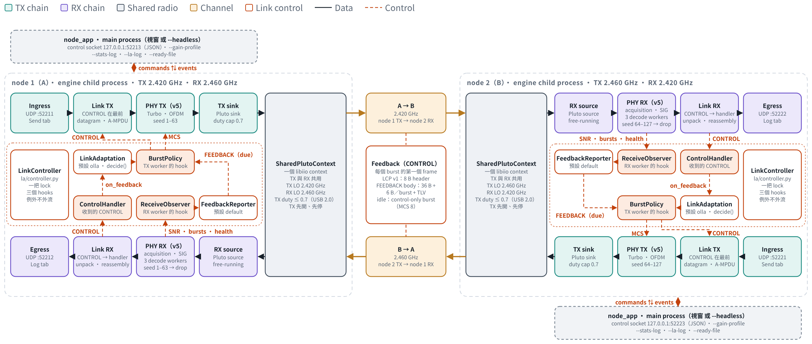

# 雙向 FDD：`node_app`、link adaptation 與實機量測

[Wire v5](../tx_v5/README.md)（`tx-v5`）之前，這個專案只有單向的 link：`tx_app` 發、`rx_app` 收。
這個資料夾記錄 `duplex-fdd` 分支怎麼把它變成**雙向**：一台 Pluto 一個 `node_app` process，同時在
一個頻率發、在另一個頻率收（FDD），每個 burst 帶回 feedback，讓對方的 link adaptation（LA）
為每個 burst 選 MCS。也記錄量測用的腳本與數據。

**語意仍是 UDP。** 掉了的 datagram 不會重送；ARQ 只寫了提案（第 5 節），沒有實作。
**`tx_app` 與 `rx_app` 不變。** 沒有設定 hook 時，它們送出的 burst 與以前 bit 相同（golden-hash
測試），收的東西也一樣。

表裡的數字分三種，每張表都會標明：

- **實測**：兩台 Pluto 的即時 run 或錄音，有結果檔。
- **模擬**：測試或 review script 在假的 link 上的輸出。只記在 commit message 裡的會註明「commit 記錄」。
- **預測**：由模型或設計算出來的，沒有量。

兩台 ADALM-Pluto（韌體 v0.39）：`…1e6e77` = node 1 = A，`…1ef9c6` = node 2 = B。
A→B 是 node 1 發、node 2 收（2420 MHz），B→A 相反（2460 MHz）。

## 1. 結論

### Owner 的要求

| # | 要求 | 結果 | 依據 |
|---|---|---|---|
| 1 | FDD，2.420／2.460 GHz | **完成**。Node 1 TX 2420／RX 2460 MHz，node 2 相反；`configs/profiles/duplex_fdd_2420_2460.yaml`。備用 2405／2475 | 2.1、4.2 |
| 2 | 先量自干擾（SI）再決定頻率 | **完成**（M1，實測）。S = 20／40／70 MHz、RX gain 15／30 dB 都量不到 SI：data carrier 的底噪上升 ≤ 0.15 dB，peer 的 SNR 下降 ≤ 0.6 dB。決定 FDD 2420／2460、RX gain 15 dB、analog BW 5 MHz，不需要 LBT | 2.1、4.2 |
| 3 | 一台 Pluto 一個 process（`node_app`），有 GUI 也有 headless | **完成**。TX 與 RX 在同一個 engine 子 process，共用一個 libiio context；`--headless` 給腳本，視窗模式給 demo | 2.2 |
| 4 | UDP ports | **完成**。`base = 52200 + 10·node_id`：node 1 ingress／egress／control／UDP sample = 52211／52212／52213／52214，node 2 = 52221–52224。不設 `SO_REUSEADDR`，衝突時 EADDRINUSE | 2.2 |
| 5 | `tx_app`／`rx_app` 照常可用 | **完成**。Hook 預設 `None`；golden-hash 測試確認沒有 policy 時 burst 不變；`rx_app` 收 node 的 burst 時 CONTROL frame 只記在 `control_frames` | 2.4 |
| 6 | 雙向 datagram | **完成**（UDP transport：`test_node_udp_duplex.py` 兩個方向逐 byte 正確）；**實測**：MCS 12、兩個方向各 3.25 Mbit/s 同時跑，A→B 0 遺失、B→A 0.86%（4.3） | 4.3 |
| 7a | 可替換的 LA：Protocol 介面 | **完成**。`LinkAdaptation`、`FeedbackReporter` 是 `typing.Protocol`，不需要繼承 | 2.3 |
| 7b | `module:Class` loader | **完成**。`fixed`／`olla`／`arf`、`package.module:Class`、`path/file.py:Class`；`--link-adaptation-arg K=V` 以 Python literal 解析；錯誤一行 `SystemExit` | 2.3 |
| 7c | 可替換的 reporter | **完成**。`--feedback-reporter SPEC`，內建 `default` | 2.3 |
| 7d | Feedback piggyback，有 version 欄位 | **完成**。每個 burst 的第一個 MPDU 是 CONTROL frame（LCP header 有 `version`，其他版本被忽略並計數） | 2.4 |
| 7e | 閒置時送 control burst | **完成**。沒有 data 而 report 到期時送 control-only burst（MCS 8；4 個 entries 時 0.51 ms） | 2.4 |
| 7f | 預設是兩個 loop 的 OLLA，target 1% | **完成**。`node_app` 的 `--link-adaptation` 預設是 `olla`（`node_options.DEFAULT_LINK_ADAPTATION`；inner loop + outer loop，`target_loss=0.01`），從 `--mcs-index` 開始；要固定 MCS 給 `--link-adaptation fixed`。**實測**：M3 在 gain step 下整個 run 3.19–3.23 Mbit/s，優於每個固定 MCS；−20 dB 那段遺失 3.5–4.1% 幾乎全是 step 後頭 1.5 秒的 burst（188–209 個 subframe），之後在 1% 的目標上；la-tune 之後（M3b）頭 1.5 秒降到 91–108 個、整段 2.27–2.40%，剩下的是 feedback 來回約 0.13 秒（4.4） | 2.3、4.4 |
| 8 | 單元測試 | **完成**。LA、control wire、link hooks、node 的每一部分都有測試（6 節）；合併 `tx-v5` 時全部 1577 個測試通過（2 個已知的環境失敗） | 6 |
| 9 | ARQ 只提案 | **完成**：LTE RLC AM 式的提案，沒有實作 | 5 |

### 其他結論

- **限制是 USB 與 CPU，不是 RF。** 一台 Pluto 同時以 5 MS/s 接收時，USB 2.0 只讓 TX 推到 duty
  約 0.78；`…1e6e77` 在這個上限每分鐘 overflow 177–224 次，`…1ef9c6` 不會（M0，實測）。所以
  `node_app --tx-duty-cap` 預設 0.7。
- **同一台 Pluto 開第二個 libiio context 會 EBUSY**（實測），所以 TX 與 RX 共用
  `pluto.SharedPlutoContext`，兩個方向在同一個 process。
- **路徑不對稱約 6 dB**：同樣的 SNR，B→A 要比 A→B 多約 6 dB 的 TX gain（M1 的校準、M2 smoke）。
  M2 的 matrix 因此讓 node 2 的 gain 比 node 1 高（`--m2-gain2-offset`）。
- **第一次 M2 smoke 失敗的原因是 RX acquisition 的 CPU**：Pluto 的 LO 洩漏是 DC，舊的
  acquisition 在 DC 或 CW 下每個 offset 都進入 coherent 階段，RX owner 單獨就吃 0.88 core 而
  overflow。修完（`7006eb6`）之後，同樣的 smoke 0 overflow，A→B 遺失 10.8% → 0（2.5、4.3）。
- **雙向不比單向多掉（M2，實測）。** 每個 gain 點、每個方向的空中遺失與 SNR 相同（差 ≤ 0.7 個百分點、≤ 0.2 dB）：
  MCS 12 在 −5／0 dB 的 0%／0.86%（SNR 22.8／21.0 dB，各 3.25 Mbit/s），−12.5／−6.5 dB 的 0.02%／3%，
  −20／−14 dB（低於 MCS 12 的 threshold）的 25%／60%。RX overflow 雙向每個 run 0–3 次（多在 `…6e77`），單向 0；
  engine 0.61–0.67 core，decode workers 0.4–2.0 core。**雙向的延遲較高**（MCS 12 p50 最高 637 ms，單向約 100 ms），
  因為發送端在接近它的 airtime 上限運轉。B→A（2460 MHz，Wi-Fi channel 11）有約 0.8–1.15% 的遺失下限。
- **Node 的 TX airtime 上限是 0.66–0.70，每個 MCS 都一樣（同時接收時）。** 一次 push 要花 airtime 的約 1.33 倍
  （USB 2.0）；duty cap 0.7 與不設 cap 一樣（1.125 對 1.135 Mbit/s，0 次 cap 等待）。所以低 MCS（MCS 8，180/s）
  在發送端就掉 datagram（現在算進 `tx.ingress_dropped_queue_full`）。先前 MCS 8 的短缺有一部分是 burst 間隔的 bug，
  已在 `f3f84fc` 修成 start 到 start（4.3）。
- **審查找到 7 個 LA／link 的 bug，全部修了**，每個都有先失敗後通過的測試（2.5）。其中 OLLA 的
  per-report clamp 讓 loss 的平衡點從 1% 跑到約 4%（每份 report 16 個 subframe）或 9%（40 個）。
- **LA 跟著 gain 變化（M3，實測）。** Node A −5 → −20 → −5 dB、offered 4 Mbit/s：OLLA 整個 run 3.19–3.23 Mbit/s、
  p50 61–72 ms；固定 12 是 2.92（p50 664 ms）、固定 15 是 2.64（−20 dB 時 96% 遺失）、固定 10 是 2.22、固定 8 是 1.13。
  OLLA 在 −5 dB 於 0.1–0.5 秒內到 MCS 17、遺失 ≤ 0.07%。**更正：** 第一版寫「降階時 step 那一刻 0 個遺失」是錯的（時間軸算錯，
  見 4.4）：−5 → −20 dB 之後頭 1.5 秒遺失 188／188／209 個 subframe，0.47–0.52 秒到 MCS ≤ 10，之後 1.04／1.05／1.17%，
  在 1% 的目標上；−20 dB 那段 3.5–4.1% 是頭 1.5 秒的暫態，不是穩態超標。
  **la-tune（`4ced886`）與 M3b（實測）：** reporter 在 FCS 失敗增加時就排 report，OLLA 的 SNR filter 在兩份新 report 低 6 dB 以上時重啟；
  頭 1.5 秒遺失 188–209 → 108（OLLA）／91（B→A 閒置），到 MCS ≤ 10 0.47–0.52 → 0.22／0.16 秒，段遺失 3.5–4.1% → 2.40／2.27%，
  段 goodput 1.62–1.73 → 1.74／1.82 Mbit/s；整個 run A→B 3.23／3.27 Mbit/s（最好的固定階 MCS 12 是 2.92）；升階沒變。
  剩下的 step 後遺失是 feedback 來回約 0.13 秒（decode 延遲）。B→A 閒置（feedback 只靠 control burst）的行為相同；feedback 從不過時（最大 0.43 秒）。
  固定 15 時 node 2 overflow 42 次（decode workers 忙著解失敗的 burst）（4.4）。
- **兩台 USRP B210 也能跑 `node_app`（`--transport uhd`，2026-11-10，實測）。** 一台 B210 一個 node：
  RF A 發、RF B 收，TX LO 偏 8 MHz。MCS 12、每個方向 450/s × 900 B、180 秒同時雙向：A→B 遺失 1.77%、
  B→A 2.30%，各 3.17–3.18 Mbit/s，p50／p99 延遲 96–98／128–130 ms，RX overflow 0（4.6）。第一次 run 遺失
  25–30%：RX sink block 在 queue 滿時忙等 GIL，修正後（`6a063d9`）才是上面的數字。
  **TX 從 68 改成 80 dB 重測（4.7）**：同樣的雙向 MCS 12 遺失 0.00%／0.01%，MCS 16、每個方向 800/s 是 0.08%／0.04%
  （5.76 Mbit/s）；單向 5 MS/s MCS 17 到約 10.6 Mbit/s、遺失 ≤ 0.81%，10 MS/s 單向約 18 Mbit/s、遺失 ≤ 0.83%（收端 8 個
  decode workers）。10 MS/s 雙向與 20 MS/s 不能用，重測的判斷是收端 Python 處理的 CPU 不夠（USB buffer 不是 1x1 的限制）。全部沒有 real-time priority、每點一次。
- **雙向影像（M4，實測）。** 60 秒、OLLA、TX −5 dB：750 與 1300 kbit/s 兩端都解出完整 60 秒（877–884 frame）。
  A→B corrupt 行 2／4、遺失 0.01–0.02%、MCS 17；B→A corrupt 行 96／155，來自 ch-11 的遺失下限，OLLA 在約 MCS 10
  （offset −3 到 −4.6 dB）。Engine 0.66–0.82 core，overflow 0–1 次。`video_duplex.sh` 的 consumer 卡住問題已修
  （timeout 5 秒加 SIGKILL）（4.5）。

## 2. 做法

### 2.1 自干擾量測與頻率決定（M0、M1）

**為什麼先量。** FDD 的 node 一邊發一邊收，自己的 TX 可能用三種 RF 機制干擾自己的 RX，另外還有 USB；各有不同的解法：

| 症狀 | 機制 | 有用的 | 沒用的 |
|---|---|---|---|
| 自己的 TX gain 每加 1 dB，data carrier 的底噪也加約 1 dB，與 RX gain 無關 | TX 的寬頻雜訊落在 RX 頻帶 | 加大頻率間距、antenna 分開 | RX gain、analog BW |
| 底噪或 clipping 隨 RX gain 急升，RSSI 高 | LNA／mixer／ADC 壓縮 | 降低 RX gain、縮窄 BW | — |
| 少數幾個 bin 有線 | LO 洩漏、spur、aliasing | 換間距 | gain |
| Overflow 隨自己的 TX duty 增加，連 TX −89.75 dB 也一樣 | USB 2.0 頻寬（不是 RF） | kernel buffers、TX duty 上限 | 任何 RF 的設定 |

**M0：USB（`usb_capacity.py`）。** TX −89.75 dB（幾乎沒有 RF），每台 Pluto 在共用的 context 上以
5 MS/s 接收，同時自己的 TX 以 duty 0／0.5／0.6／0.7／0.8／0.9 推 6.9 ms 的 burst。發現：

- **第二個 context → EBUSY。** `--probe-double-open`：在一台正在 streaming 的 Pluto 上開第二個
  `IioContext`，回 `[Errno 16] Device or resource busy`。所以 node 必須共用一個 context。
- **TX duty 的上限約 0.78。** 要求 0.8 或 0.9，兩台都只推到 0.78–0.79：RX 20 MB/s 加 TX 約
  16 MB/s 是一台 Pluto 的 USB 2.0 的上限。
- **`…1e6e77` 在上限 overflow，`…1ef9c6` 不會。** 每分鐘 222–224 次（RX 只剩 4.78 MS/s）。設定與韌體
  相同；差別在裝置或 port（`…1e6e77` 在 root port，`…1ef9c6` 在 hub 後面，兩台與 webcam 共用
  bus 3 的 480 Mbit/s）。8 個 kernel buffers 沒有幫助（177／183 次）：這是頻寬，不是延遲。
- **Duty ≤ 0.7 兩台都乾淨**，單獨或同時。**決定：`--tx-duty-cap` 預設 0.7**
  （`node_engine.DutyCappedSink`：一個 burst 最早在前一個開始時間 + airtime ÷ 0.7 之後開始，閒置時
  最多累積 50 ms 的 credit）。

**M1：SI（`si_scan.py`）。** 一個 process 同時控制兩台 Pluto。DUT 的 RX 在 `f_rx`，自己的 TX 在
`f_tx` 送真的 v5 MCS 14 aggregate（6.85 ms），duty 0.7（設計是 0.9，但 M0 說 0.9 做不到，而且會讓
一台 overflow）。Peer 在 `f_rx` 送 MCS 8、一個 900 B datagram、每秒 100 個，先在自己 TX 關閉時校準到
preamble SNR 約 15 dB（mid）與約 10 dB（edge）。每個 phase 2 秒，共 20 分鐘：

| Phase | Peer | 自己的 TX | 量什麼 |
|---|---|---|---|
| a | 關 | 沒開 | 環境底噪；Wi-Fi 佔用 = 1 ms block 高於底噪 6 dB 的比例 |
| b0 | 關 | 開、−5 dB、閒置 | LO 洩漏 + TX 雜訊 |
| b1–b4 | 關 | burst，−20／−10／−5／0 dB | 底噪 vs. 自己的 gain、clipping、RSSI、overflow |
| b5 | 關 | burst，duty 0.3，−5 dB | 與 duty 的關係 |
| c-mid、c-edge | 開 | 沒開 | 基準 SNR 與遺失 |
| d-mid、d-edge | 開 | burst，−5 與 0 dB | ΔSNR、Δ遺失 |

Grid：間距 S = 20（2430／2450）、**40（2420／2460）**、70 MHz（2405／2475）× 兩台都當 DUT × RX gain
15／30／45 dB，analog BW 5 MHz；另外 S = 40、g = 15 時 BW 4 與 8 MHz；以及 S = 0（兩台都 2440 MHz，給
LBT 用）。

**判定規則**（設計 §1.3，`summarize` 算）：自己的 TX −5 dB、兩台 DUT 都要 PASS：底噪上升 ΔN ≤ 1.0 dB、
ΔSNR ≤ 1.0 dB、Δ遺失 ≤ 0.5 個百分點、clipping < 1e-6、Δoverflow ≤ 0.5／分鐘。依序：S = 40、g = 15、
BW 5 PASS → FDD 2420／2460；否則換 g、BW；再否則 70 MHz；再否則 MARGINAL；最後才是單頻 + LBT。

**結果（實測，4.2）：第一步就 PASS。** 在 20、40、70 MHz、RX gain 15 與 30 dB：

- ΔN 都在 ±0.15 dB 內，與自己的 TX gain 無關（斜率 −0.04…+0.03 dB/dB；TX 寬頻雜訊會是約 +1），
  閒置的 TX、duty 0.3 與 0.7 都一樣。
- ΔSNR ≤ 0.6 dB，大多 ≤ 0.2 dB，正負都有。
- 沒有 spur：guard bin 最大的線在各 phase 之間不變。ADC 以 40 MS/s 取樣，所以 40 MHz 外的 TX 會
  alias 到 DC，但 analog filter 把它壓在底噪下（P_dc 不變）。
- Δoverflow 全部是 0（duty 0.7）。

**表裡的 FAIL 不是 SI。** 每個 FAIL 都來自 Δ遺失，而 Δ遺失是計數雜訊加 Wi-Fi：200 個 burst 裡的
1 個就是 0.5 個百分點，edge phase 在 10 dB SNR。同樣的組合 ΔN ≈ 0、ΔSNR ≈ 0。0.5 個百分點的規則
每個 phase 要 ≥ 2000 個 burst 才有意義，所以遺失留給 M2–M4 的 60 秒 run 量。RX gain 45 dB 會 clip
（peer 在 mid 時 clip 比例 1e-4 到 3.9e-2），是 RX gain 的問題，不是自己的 TX。

**Wi-Fi。** 2420 在 Wi-Fi channel 1（2401–2423 MHz）、2460 在 channel 11（2451–2473 MHz）。Phase a
的佔用（g = 15／30／45）：2420 MHz 0／2.6／20%，2460 MHz 1.6／7.8／29%。LA 把它們的 burst 看成
channel loss；2430 MHz 有一個高於底噪 14–28 dB 的環境訊號，所以 20 MHz 間距只當趨勢點。

**決定：FDD 2420／2460 MHz、RX gain 15 dB、RX analog BW 5 MHz；不需要 LBT。** g = 15 dB 時 peer 在
TX gain −8 dB（A←B）／−14 dB（B←A）就有 14–15 dB SNR，還有 15–20 dB 的餘裕。LBT 的設計（設計稿 §5）
沒有實作。

### 2.2 `node_app` 架構



上圖是兩個 node 的 block diagram（node 2 是 node 1 轉 180 度）；互動版在
[導覽的「雙向 node」分頁](https://s87315teve.github.io/ofdm-message-link/guide/#node)，說明在
[docs/01 1.7](../../docs/01-architecture.md#17-雙向-nodenode_app)。下面是一個 node 裡的 process 與 thread：

```
node_app parent（視窗 或 headless）       node engine 子 process（_node_main，switch interval 2 ms）
  stats log、control socket、              SharedPlutoContext ─ PlutoSampleSource（refill thread）
  gain profile                             │                  └ PlutoSampleSink ← DutyCappedSink（0.7）
  ⇅ _EngineProcess 的 queues               ReceiveWorker ─ MessageReceiver ─ SegmentDecodePool（3 個 process）
                                           TransmitWorker ─ MessageTransmitter；IngressListener；egress
                                           LinkController（LA + reporter + codec，一把 lock）
```

- **共用的 Pluto context**（`pluto.SharedPlutoContext`）。用 reference count 把一個 libiio context
  租給 sink 與 source；`PlutoSampleSink`／`PlutoSampleSource` 本身不變，只是拿到
  `open_context=shared.factory()`。Attribute 與 register 的呼叫經過一把 lock（libiio 0.x 沒有保證
  兩個 thread 可以同時用一個 context 的 control pipe）；buffer 的 refill 與 push 不鎖（各自的 USB
  pipe，ctypes 會放開 GIL）。Sample rate 是兩個方向共用的 AD936x 設定，`configure()` 只寫一次；
  之後 `_tune` 再寫同樣的值時不碰裝置，寫不同的值會被拒絕（重寫可能讓 clock chain 在 stream
  進行中重跑）。`PlutoSettings.rf_bandwidth` 是新的 RX analog filter 設定；RX kernel buffer 數在
  建立 RX buffer 之前設。
- **啟動與停止順序。** TX 先開、先停，所以 context 關掉之前 TX attenuator 已經回到最小輸出。
- **同一個 engine 子 process 跑兩個方向**（`node_engine.py`），重用單向 app 的
  `TransmitWorker`、`ReceiveWorker`、decode pool、UDP ingress／egress 與 `engine._serve`，
  `engine.py` 沒有改。`LinkController` 同時是 TX worker 的 burst policy、receiver 的 control handler、
  RX worker 的 observer。設計稿另有一個 `split` layout（radio／RX 與 TX 分兩個子 process）作為
  GIL 不夠用時的備案，沒有實作。設計的觸發條件之一是 start-up 之後 RX overflow > 1 次／分鐘：RX
  修正之後 smoke2 是 0，但 MCS 12 雙向 60 秒的 run 在 node 1 有 3 次（4.3），已經碰到這條線；要不要做
  看 M2 的完整結果。
- **`--transport udp`**：兩個 node 在同一台 PC 上把 samples 送到對方的 UDP sample port，不需要 radio
  就是一條完整的雙向 link。
- **CPU 預算。** 兩個 node 在同一台 PC，所以 `node_app` 的 decode workers 預設 3（`rx_app` 仍是 4）。
- **Headless**：每 0.5 s 寫一行 stats（`tx`、`rx`、`la`、`feedback`、`cpu`），依 `--gain-profile`
  準時改 TX gain，提供 localhost 的 JSON control socket（`set_gain` 回 readback、`set_mcs`、`set_la`、
  `mark`、`stats`、`stop`）。SIGTERM 或 `--duration` 到時先停 TX 再停 RX、刪除 ready file，exit 0；
  radio 啟動失敗 exit 2，engine 子 process 中途結束 exit 3。
- **視窗**（`node_window.py`）：TX、RX、LA 三排 cards，60 秒的 MCS／filtered SNR 軌跡，auto／fixed
  切換。見 [docs/02 2.8](../../docs/02-gui.md#28-雙向-node-的視窗node_app)。
- **Ports**：見 1 節第 4 項；完整命令列見 [docs/07 7.9](../../docs/07-reference.md#79-node_app雙向-node-的命令列)。
- **設定**：`LinkConfig.duplex`（選用）。載入時驗證：剛好兩個 node、id 不重複、一個 node 的 TX 頻率
  是另一個的 RX 頻率、FDD 間距至少一個 sample rate；`tx_app`／`rx_app` 忽略這一段。

### 2.3 Link adaptation 的 interface

套件 [`src/ofdm_message_link/la/`](../../src/ofdm_message_link/la/)。怎麼寫自己的模組，完整說明與可以跑的
範例在 [docs/03 3.4](../../docs/03-your-own-app.md#34-寫你自己的-link-adaptation-模組)；這裡只列重點。

**兩個 Protocol**（`la/api.py`，不需要繼承任何 class）：

| Protocol | 在哪一端 | Methods |
|---|---|---|
| `LinkAdaptation` | TX | `on_sent(SentBurst)`、`on_feedback(FeedbackReport)`、`decide(now_s) -> Decision`（每個 data burst 一次，要快）、`snapshot() -> dict`；選用的 `on_mode("fixed" \| "auto")` |
| `FeedbackReporter` | RX | 屬性 `reporter_id`；`on_preambles(now_s, snr_db, *, control_only)`、`on_burst(BurstReport)`、`on_rx_health(now_s, RxHealth)`、`due(now_s)`、`next_due_s(now_s)`、`build(now_s) -> FeedbackReport` |

**資料結構**（frozen dataclass）：`BurstReport`（一個收到的 DATA burst：時間、第一個 sequence、MCS、
preamble SNR、ok／lost subframe 數）、`FeedbackReport`（從 wire 解出的 report，含累計計數器、
最近的 bursts、TLV `extras`、本地收到時間 `received_t_s`、`session_id`）、`SentBurst`、
`Decision(mcs_index, reason, snr_eff_db, offset_db)`、`LaContext`（`ladder`、`thresholds_db`、
`initial_mcs_index`、`sample_rate`、`node_id`）、`ReporterContext`、`RxHealth`。工具：
`counter_delta`（u32 wrap 的差）、`is_newer_seq`（u16 的新舊）、`FeedbackTracker`（處理重複、
peer 重新啟動、長時間的空檔，回傳計數器的增量；自訂演算法應該用它）。

**Loader**（`la/loader.py`）：

| `SPEC` | 意義 |
|---|---|
| `fixed` | 固定在 `--mcs-index` |
| `olla` | 內建預設演算法（`node_app` 的預設）：兩個 loop 的 OLLA，target 1% |
| `arf` | 內建範例：Auto Rate Fallback（`la/examples.py`，不到一百行，可當範本） |
| `package.module:Class` | 可以 import 的 module |
| `path/to/file.py:Class` | 一個檔案，不用安裝 |

`--link-adaptation-arg K=V`（可重複）以 `ast.literal_eval` 解析，失敗就當字串；同一個 K 兩次或少了
`=` 會停止。建立方式是 `Class(context, **kwargs)`，結果必須通過 Protocol 的 `isinstance` 檢查。
所有錯誤都是一行 `SystemExit`。Parent 先建一個用完就丟的 instance 驗證 spec；子 process 再用 spec
字串建真的那個，所以不需要 pickle class。Reporter 一樣：`--feedback-reporter SPEC`、
`--feedback-reporter-arg K=V`，內建 `default`。

**Controller**（`la/controller.LinkController`）把演算法接到 link layer：每個 burst 前問
`decide`，同一個 entry 用在 aggregation 的規劃與 encode（MCS 改變不會讓 burst 超過 airtime 上限）；
所有呼叫在一把 lock 下，所以演算法與 reporter 不必 thread-safe。演算法或 reporter 丟例外時，計數
（`la_errors`、`reporter_errors`）並用安全的預設值（目前的 MCS、不送 report），不會讓 TX 或 RX
thread 停下來。

**預設演算法 `olla.OllaLinkAdaptation`**（LTE 式，兩個 loop）：

- **Inner loop**：filtered peer SNR（EWMA，τ = 0.1 s，只用有 preamble 的 report）+ offset = SNR_eff，
  選 threshold 不超過 SNR_eff 的最高 rung。升階要 T_new + 1 dB，連續 2 份**帶新 SNR** 的 report，
  而且距上次改變 ≥ 0.1 s；降階立即。
- **Outer loop**：每個 peer 收到的 DATA subframe offset +Δup，每個遺失的 −Δdown。Δdown = 0.5 dB、
  Δup = Δdown·t／(1−t) = 0.00505 dB，所以 offset 不再漂移時 loss = Δup／(Δup+Δdown) = t = 1%。
  （沒有 HARQ 可以救回遺失，所以不用 LTE 的 10%。）一份 report 的整個更新乘上
  `gain = min(1, n_cap／n_avg)`，`n_cap = max_report_down_db／Δdown = 4`，`n_avg` 是每份 report
  的 subframe 數的移動平均（2.5 第 6 項）。Offset 限制在 −10…+3 dB。
- **Stale**：0.5 s 沒有收到 report，或 report 一直來但 0.5 s 前送出的 burst 都沒有被聽到（forward
  link 斷了），每 0.5 s 降一階，最低 MCS 8。
- RX overflow 計數改變的 report 不更新 outer loop（那是 CPU 造成的遺失，不是 channel）。
- Fixed mode 時凍結 outer loop，回到 auto 時沿用原來的 offset。

| 參數 | 預設 | 說明 |
|---|---:|---|
| `target_loss` | 0.01 | DATA subframe 的遺失目標 |
| `step_down_db`／`step_up_db` | 0.5／0.00505 | `step_up` 預設由 target 算出 |
| `max_report_down_db`／`max_report_up_db` | 2.0／0.5 | 一份典型大小、全部遺失的 report 讓 offset 立即降 2 dB；硬上限 −4／+0.5 dB 只擋異常值 |
| `offset_min_db`／`offset_max_db` | −10／+3 | |
| `snr_tau_s` | 0.10 | |
| `snr_drop_db`／`snr_drop_reports` | 6／2 | 連續 2 份新 report 都比 filter 低 6 dB 以上時，filter 從 report 重新開始（計為 `snr_drops`） |
| `hysteresis_up_db`／`hysteresis_down_db` | 1.0／0.0 | |
| `up_hold_reports`／`min_dwell_s` | 2／0.10 | |
| `stale_after_s`／`stale_step_s`／`fallback_mcs` | 0.5／0.5／8 | |
| `skip_outer_on_overflow` | True | |
| `initial_offset_db` | 0.0 | 起始的 offset，限制在 offset 的範圍內 |
| `outer_loop` | True | False 時只有 inner loop（offset 固定） |
| `thresholds` | `configs/la/thresholds_pluto_v5.yaml`（`LaContext` 的表） | 可以給另一個 YAML，ladder 由它重建 |

**Ladder 與 threshold。** `configs/la/thresholds_pluto_v5.yaml` 是 GUI 燈號與 LA inner loop 共用的
**唯一**一張表（wire v5 實測：遺失 < 1% 的 SNR + 1 dB，見 [tx_v5 4.1](../tx_v5/README.md#41-錄音每個-mcs-遺失--1-的最低-tx-gain實測)）。
Ladder 依 threshold 由低到高走，只留比前面每一個都快的 entry：

| MCS | 8 | 9 | 10 | 12 | 13 | ~~14~~ | 15 | 16 | 17 |
|---|---:|---:|---:|---:|---:|---:|---:|---:|---:|
| Threshold（dB） | 7.5 | 9.0 | 11.0 | 14.0 | 15.5 | 17.5 | 16.5 | 21.0 | 22.0 |
| bit/symbol | 0.67 | 1.0 | 1.33 | 2.0 | 2.67 | 3.0 | 3.0 | 4.0 | 4.5 |

**MCS 14 被拿掉**：它和 MCS 15 一樣是 3 bit/symbol，卻多需要 1 dB（dominated）。MCS 11 沒有量，表裡
沒有值，所以也不在 ladder 上。Wheel 安裝時 `setup.py` 把這個檔複製進套件（`530ebce`）。

**預設 reporter `la/reporter.DefaultReporter`**（`period_ms=20`、`keepalive_ms=200`、`max_entries=8`）：
量測窗內所有 peer preamble 的 SNR（mean、p10、last）、累計的 DATA ok／lost、RX 的健康計數
（clipping、decode backlog：窗內任何一個 chunk 有就設）、最近的 DATA bursts。Report **due** =
（上次之後收到新的 peer DATA burst，**或**有 PSDU 的 FCS 失敗（`4ced886`），**而且**過了 20 ms）**或**過了
200 ms（keepalive，讓 peer 分得出安靜與斷線）；第一份 report 在第一個 DATA burst 時立即 due。Peer 的
control-only burst 只更新 SNR，不會讓 report due，否則兩個閒置的 node 會互相觸發。每個 reporter 啟動時
抽一個隨機的 32-bit session id（TLV 0x10，每份 report 都帶）。

**換成你自己的**：寫一個有四個 method 的 class，`--link-adaptation my_la.py:MyClass
--link-adaptation-arg k=v`。範例、規則（`decide` 要快、計數器是累計的、第一份 report 只當基準、
不需要 lock）與不開 radio 的試法見 [docs/03 3.4](../../docs/03-your-own-app.md#34-寫你自己的-link-adaptation-模組)。

### 2.4 Wire format 摘要

完整的欄位表在 [docs/07 7.8](../../docs/07-reference.md#78-雙向-link-的-control-與-feedback-wire-format)，
codec 在 [`control.py`](../../src/ofdm_message_link/control.py)。

- **位置。** Node 的每個 v5 burst 的**第一個 MPDU** 是 `FrameKind.CONTROL` frame，payload 是一個
  Link Control PDU（LCP）。它的 sequence 來自**獨立的** 16-bit control counter，所以 DATA 的 sequence
  保持連續，遺失的計數不受影響，舊的 `rx_app` 也不會看到假的 gap。
- **LCP header（8 bytes）**：magic `0x4C43`、**version**（1；其他版本整個忽略並計入
  `control_unsupported`）、pdu_type（1 LINK_HEADER、2 FEEDBACK、3 STATUS 保留給 ARQ）、src_node、
  dst_node、flags、body_length。
- **FEEDBACK body v1**：36 bytes 的固定部分 + 每個 6 bytes 的 burst entries + TLV。計數器是**累計**的
  （u32），掉了幾份 feedback 也不會遺失資訊。TLV 0x10 是 reporter 的 session id（peer 重新啟動時
  立即重設基準）；0x80–0xFF 給自訂 reporter。比已知長的 body 照收、忽略尾巴，所以以後可以加欄位。
- **成本**：LINK_HEADER 每個 burst 24 bytes（含 delimiter 與 padding；一個 900 B datagram 的 2.7%，
  8 KB aggregate 的 0.3%）；內建 reporter 的 FEEDBACK（含 6 bytes 的 session id TLV）4 個 entries 92 bytes、
  8 個 116 bytes（由 codec 算出）。
- **Control-only burst**：沒有 data 而 report 到期時，MCS 8、只有 CONTROL frame；FEEDBACK 帶 4 個 entries 時
  2560 samples（0.51 ms，由 codec 與 airtime 公式算出，沒有量）。沒有 data 也沒有 report 到期時不送。
- **Robust copy**：data 的 MCS 高於 9 時，每 100 ms 至少有一份 feedback 走 MCS ≤ 9 的 burst，
  data 的 MCS 太高時 feedback 仍然到得了。
- **自己的洩漏。** 兩個 node 用不同的 scrambler seed：node 1 用 1–63、node 2 用 64–127
  （`link.node_seed_range`；`tx_app` 仍用 1–127）。RX 由 SIG 的 seed 在 payload decode 之前就丟掉
  自己的 burst（省 Turbo 的 CPU），CONTROL frame 的 src_node 是第二道檢查。
- **解碼端不會因為格式錯誤而失敗**：`decode_lcp`／`decode_feedback` 遇到讀不懂的東西回傳 `None`。

### 2.5 審查之後修的問題

LA 與 link layer 合併後，一個只讀的 reviewer 用 review script 在假的 link 上找到 7 個 bug。全部修了，
每個修正都附了在修正前的 commit（`f8c6d0b`）會失敗、修正後通過的測試。數字是 review script 或測試
的輸出（模擬，commit 記錄）。

| # | 問題 | 修法 | 量到 | Commit |
|---|---|---|---|---|
| 1 | Peer 重新啟動後 `report_seq` 從 0 開始，「不是較新的 report 就忽略」讓 LA 忽略它最多 32767 份（20 ms 一份約 11 分鐘），期間 stale 降到最低 | `la.api.FeedbackTracker` 統一處理：只忽略遲到或重複的；session id 改變、距上一份超過 `stale_after_s`、或 u32 計數器倒退時重設基準。Session id 走 TLV 0x10，v1 的固定格式不變 | 修正前 2000 份被忽略、重啟 40 s 後仍是 MCS 8 stale、ARF 在大量遺失下卡在 MCS 17；修正後 0 份被忽略 | `ec50286` |
| 2 | 自己的 burst 只有在 CONTROL frame 解得出來時才被認出；一個 CONTROL CRC 失敗的自己的 burst 進了 DATA sequence tracker，一次多出約 20 000 個「遺失」 | 三層：SIG 的 seed 落在自己的範圍就整個丟掉（`own_seed_range`）；有 handler 時，sequence 跳超過 1024 要下一個 sequence 確認才重新同步，不算遺失；`BurstReport.subframes_lost` 也有同樣的上限 | 修正前 lost 19 997；修正後 0 | `6bb5988`、`5bb7583` |
| 3 | Burst policy（例如有 bug 的自訂 LA）丟例外時，TX worker 立刻重跑迴圈：busy-spin 而且什麼都沒送 | 每個 policy 呼叫都有 guard：例外時用 transmitter 目前的 entry、不帶 CONTROL，data 繼續送；錯誤計數，每個 method 每秒最多報一次；失敗後退讓 50 ms | 修正前 0.3 s 內 217 260 次錯誤、0 個 burst；修正後 1 次錯誤、burst 送出、4 ms CPU | `32d5ed2` |
| 4 | Control handler（實際上是自訂 LA 的 `on_feedback`）的例外穿出 `MessageReceiver.feed`：CONTROL 後面的 DATA 沒有交付，`rx_app` 丟掉整個 chunk | Handler 丟例外當作 ACCEPT，計入 `control_handler_errors`；controller 對演算法、reporter、encoder、LA log、`on_event` 的每個呼叫都加 guard | 修正前 `feed raised ZeroDivisionError`、0 個訊息交付；修正後訊息交付 | `fa1d4bb` |
| 5 | RX 把**所有** preamble 的 SNR 交給 reporter，包括自己 TX 的洩漏（之後才被當作自己的 burst 丟掉）；peer 的 LA 把很強的自己的 preamble 當成 channel，選了太高的 MCS | `MessageReceiver.drain_peer_snr_db()` 只回傳被接受的 burst 的 SNR；有 observer 時 reporter 只拿這些 | 修正前 report 寫 preambles = 2、SNR 42.9 dB（自己的 46.6 dB 混進去）；修正後 preambles = 1、peer 的 33.1 dB | `b882924` |
| 6 | OLLA 先加總一份 report 的每個 subframe step，再 clamp 到 [−2, +0.5] dB。一個 aggregate 的 subframe 一起掉，所以 clamp 只截掉壞的 report，好的 report 拿到完整的 +Δup·n：平衡點從 1% 跑到約 4%（每份 16 個）或 9%（40 個） | 仍然每個 subframe 一個 step，但整份 report 乘上只與 report 大小有關的 gain = min(1, n_cap／n_avg)，好壞一樣縮放，所以平衡點剛好在 target；硬 clamp −4／+0.5 dB 只擋異常值 | 20 000 份 report、整窗遺失，在 0.5／1／2% 遺失時的 offset 漂移（dB）：修正前 N = 16 +1344／+1148／+715、N = 40 +3752／+3545／+3087（在 2% 仍往上，平衡點高於 2%）；修正後 N = 16 與 40 都是 +139／−51／−471（在 0.5% 與 2% 之間變號） | `3ef16aa` |
| 7 | Reporter 只把最後一個 chunk 的 clipping／decode backlog 放進 report；20 ms 的窗約兩個 chunk，第一個 chunk clip 的話 report 說沒有 | 窗內每個 `RxHealth` 取 OR，`build()` 時清除 | 修正前 flags 0；修正後兩個 bit 都設，下一個窗清除 | `2d392d2` |

同一輪另外修的（不在 reviewer 的 7 個之內）：

- **Forward link 斷了但 feedback 還在來**時 OLLA 永遠不降階；只帶 keepalive（沒有 preamble）的 report
  也算進升階的連續次數（review script R4：MCS 8 → 15）。現在兩者都處理（`f0a718c`）。
- **Fixed mode 時 OLLA 仍在學**：試 MCS 17 在 18 dB 兩秒後回到 auto，offset −9.8 dB、MCS 8，要 0.9 s
  才爬回來；現在凍結，回到 auto 時是 MCS 15、offset 0.59 dB（`69d665c`）。
- 閒置的 TX worker 最多睡 100 ms，收到 peer 的 DATA burst 之後 feedback 要等這麼久；現在最多睡
  reporter 的 period（20 ms）（`e6c6a31`）。
- 其他版本的 LCP 原本算成 `control_undecodable`，現在算 `control_unsupported`（`1288128`）。
- 非 editable 安裝找不到 threshold 檔（`530ebce`）。

**解開 M2 的 RX 修正**（`7006eb6`，在 `tx-v5` 上修、合併進來）。第一次 M2 smoke（4.3）兩個方向都
overflow：每個 engine 子 process 在 load 之前就約 1 core。Pluto 上只收不發、沒有 burst，RX owner
就用 0.88 core、8 秒 7 次 overflow。離線：乾淨雜訊 0.17 core；DC offset 與雜訊一樣大時 0.81 core，
3 倍時 9 core；CW tone 相同（0.98、9.4）。時間都在 `sync._acquisition_candidates` 與
`sync_v5.v5_candidates`。Pluto 的 LO 洩漏就是這樣的 DC。原因與修法：

- DC 或 tone 讓 legacy 的 metric 在每個 offset 都超過門檻（legacy 的 gate 沒有去掉穩定的部分），
  每個 offset 都進入 coherent 階段；v5 的 gate 雖然減掉穩定的 product，干擾 × 雜訊的交叉項仍超過
  0.10。兩個 gate 現在都去掉穩定的部分，只在干擾在兩側都顯著（4σ）的地方做 normalize，其他地方
  修正剛好是 0，所以乾淨的 buffer 判斷 bit 相同。
- 其他：CFO phasor 分兩段建、drain 只在有新 sample 時做、decode worker 保留釋放的記憶體、送進 pool
  一次最多 4 個、v5 detector 少掃幾次。

量到（`experiments/tx_v5/results/rx_rate/summary.txt`，owner = 接收執行緒佔一個 core 的比例）：空
stream 加 DC 0.003：556% → 24%；DC 0.01：884% → 38%；tone 0.003：552% → 24%；Pluto 式雜訊（DC 0.003、
guard +10 dB）每秒 300 個 burst：90% → 61%。`sim_acq.py` 修正前後輸出完全相同，legacy golden 不變。
修完之後的 M2 smoke：見 4.3。

### 2.6 決策紀錄

| 決定 | 依據 |
|---|---|
| FDD 2420／2460 MHz，RX gain 15 dB，analog BW 5 MHz | M1：40 MHz、g = 15、BW 5 兩台 DUT 都 PASS；20／40／70 MHz 都量不到 SI |
| 不做 LBT | M1 第一步就 PASS |
| 一個共用的 libiio context，兩個方向在一個 process | M0：第二個 context EBUSY |
| `--tx-duty-cap` 預設 0.7 | M0：要求 ≥ 0.8 時只到 0.78，`…1e6e77` 每分鐘 overflow 177–224 次；≤ 0.7 兩台都乾淨 |
| Decode workers 預設 3 | 兩個 node 在同一台 PC 的 CPU 預算（設計 §2.3） |
| Ports 52211–52224，不設 `SO_REUSEADDR` | 不與 52001／52002／52012／52022／52101 衝突；衝突時大聲失敗，不默默分流 |
| CONTROL frame 用獨立的 sequence counter | DATA sequence 連續，遺失計數乾淨，舊 `rx_app` 不看到假的 gap |
| Seed 範圍分給兩個 node（1–63／64–127） | SIG 的 13 個保留 bit 必須是 0（已部署的 RX），不能放 node id；seed 有 CRC-16 保護而且可以自由選 |
| 累計計數器 + session id | 掉幾份 feedback 不遺失資訊；peer 重新啟動立即重設基準 |
| OLLA target 1%（不是 LTE 的 10%） | 沒有 HARQ 救回遺失 |
| OLLA 用與大小有關的 gain，不用 per-report clamp | Clamp 讓平衡點跑到 4–9%（2.5 第 6 項） |
| Reporter 在 FCS 失敗時讓 report 到期；OLLA 的 SNR filter 在兩份新 report 低 6 dB 以上時重啟（`snr_drop_db` = 6、`snr_drop_reports` = 2） | M3：失敗的 burst 不產生 report，B 靜音到 200 ms keepalive，SNR filter 又慢；離線 10 個 seed 184 → 77 個遺失、段 3.55% → 2.13%；M3b 實測 188–209 → 91–108（4.4） |
| Ladder 拿掉 MCS 14 | 與 MCS 15 同樣 3 bit/symbol，多需要 1 dB |
| Fixed mode 凍結 OLLA，不重設 offset | 操作員介入前學到的仍然有效 |
| B210 量測關掉 legacy acquisition，只在附加的 overlay `b210_measurement.yaml` 裡，預設不變（使用者 2026-11-11） | v1.0 的 TX 只送 legacy frame，預設要能收；B210 run 的 `detected_legacy_candidates` 都是 0，離線關掉省 owner 10–16%（有 DC 44–46%），delivered 不變（4.8） |
| Native 加速（acquisition、header probe、Turbo float32、TX encode）放在 Python 介面後面，各有 `auto／python／native` 開關，Python 版保留為參考與 fallback（使用者 2026-11-11） | 單一 node 的上限是 engine 的 GIL（cpp_eval phase 1/2）；等價性用容差測，不要求 bit-exact（4.8） |
| `--cpu-affinity`、`--realtime[=PRIO]`、`--overload-protection` 都是選用、預設關閉；過載保護在量測時一律關閉（使用者 2026-11-11） | 低階機器與 Jetson 要能用；整棵 tree RT 在 2 核上有害；丟掉或放棄的 burst 會改變遺失與 BLER 的意義，所以另外計數（4.8） |
| v2.0 預設值：`mac.aggregation.max_psdu_bytes` 16384、`max_subframes` 32（`phy.rx.max_psdu_bytes` 本來就是 16384）、`phy.rx.legacy_acquisition` false；workers 自動、RT 關、RX gain 不變（使用者 2026-11-11） | B210 最大吞吐測試：10 MS/s MCS 17 用 16384／32 撐住 24.0 Mb/s（8192 時 20.7）；不再需要相容 v1.0（要收 v1.0 的 TX 用 `legacy_rx.yaml`）。低階機器的影響見 4.8 |
| 不做：native UHD 接收、把 TX 搬出 engine、IPC 縮減（先量剩下多少再決定）、20 MS/s 目標（使用者 2026-11-11） | 4.8 |
| `split` layout 沒有實作（待定） | RX 修正之後 smoke2 0 overflow；M2 完整結果的雙向 run 每個 0–3 次／60 秒（最壞 MCS 12、−5／0 dB 的 3 次），碰到設計的 1 次／分鐘的線；M3 固定 15 的 node 2 有 42 次，原因是失敗的 burst 佔滿 decode workers（4.3、4.4）。仍沒有實作 |

## 3. 怎麼量的

所有 Python 都以 `OMP_NUM_THREADS=1 OPENBLAS_NUM_THREADS=1 MKL_NUM_THREADS=1` 執行。每個硬體 run 都：
`flock /tmp/ofdm_hw.lock`（一次一個重的工作）；1 分鐘 load average < 4 才開始（最多等 10 分鐘），每秒
記錄 load，超過 8 就把 run 標為無效；記錄 `lsusb -t`、git revision、serial、gain。兩台 Pluto 各接原廠
antenna，同一張桌上，與 tx_v5 相同的擺放；5 MS/s，RX gain 15 dB。

### M0 與 M1

```bash
export OMP_NUM_THREADS=1 OPENBLAS_NUM_THREADS=1 MKL_NUM_THREADS=1 PYTHONPATH=src
ACK='I acknowledge that this process will transmit RF'
python experiments/duplex_fdd/usb_capacity.py run --out experiments/duplex_fdd/results/usb \
    --probe-double-open --enable-rf --acknowledgement "$ACK"
python experiments/duplex_fdd/usb_capacity.py run --out experiments/duplex_fdd/results/usb_duty \
    --parts per-pluto --duties 0.6,0.7,0.8 --seconds 30 --enable-rf --acknowledgement "$ACK"
python experiments/duplex_fdd/si_scan.py run --dut 104473541196000419000c00f2ff1e6e77 \
    --peer 10447354119600041b000b00f2ff1ef9c6 --out experiments/duplex_fdd/results/si/run1 \
    --own-duty 0.7 --enable-rf --acknowledgement "$ACK"
python experiments/duplex_fdd/si_scan.py summarize experiments/duplex_fdd/results/si/run1
```

- `usb_capacity.py`：每台 Pluto 在共用的 context 上收 5 MS/s，自己的 TX 依 duty 推 burst，記錄
  overflow／分鐘（前 3 秒的 start-up overflow 另外記）、實際 RX rate 與 TX duty。`--probe-double-open`
  試第二個 context。
- `si_scan.py`：2.1 的 phases 與 grid；每次 2 秒的錄音（int16）在兩台 TX 都在最低時立刻離線分析，
  不加 `--keep-raw` 就刪掉。分析：64 點 FFT 的每個 bin 的底噪（52 個 data carrier、guard、DC，dBFS）、
  有 peer burst 時把高於中位數 3 dB 的 block 遮掉；peer 的 preamble SNR 與遺失（`MessageReceiver`
  離線解）；clipping、RSSI；overflow。`summarize` 產生 `si_scan.json` 與 `si_summary.md`（判定表）。
  底噪的上升 ΔN 用遮掉 burst 的底噪算：沒有遮的底噪在兩次 2 秒的錄音之間因為 Wi-Fi 差 ±1 dB。

### M2–M4

- `run_duplex.sh`：啟動兩個真的 `node_app --headless`，每個方向一個
  `../ota_udp_throughput/udp_load.py`（固定速率、逐 byte 比對、延遲），記錄 `node{1,2}_stats.jsonl`、
  `la_{1,2}.jsonl`、`load_{AB,BA}.json`、`cpu.jsonl`（`cpu_multi.py`：每個 node 的 parent、engine 子
  process 與 decode workers）、`loadavg.log`、`meta.json`。只 kill 自己啟動的 PID。
- `run_matrix.sh fixed|la|all`：M2 與 M3 的 matrix（`--dry-run` 印出計畫）。
- `video_duplex.sh`：M4，經 `run_duplex.sh --hook` 啟動 node；A→B webcam、B→A `ffmpeg -f lavfi
  testsrc2`，H.264 CBR（與單向影像 demo 相同的設定，752-byte datagram），兩端各用 `ffmpeg -f null`
  消費；`video_counts.py` 數 frame 與 corrupt／error 行。
- `summarize_duplex.py RUN…`：每個方向、每個 segment（gain profile 的 step 之間；沒有 profile 時每
  30 秒）的 goodput、datagram 與 subframe 遺失、MCS 軌跡、SNR、offset、gain step 之後的收斂時間
  （之後每個 1 秒的窗遺失 < 2% 而且 2 秒內 MCS 不變；在 1% 目標下太嚴，見 4.4）、RX overflow（前 3 秒以後）、CPU；寫
  `summary.json`、`summary.md` 與每個方向的 PNG。接收端的計數器經共用的 monotonic clock 對到發送端的時間軸（`50fb42f`）。
- `step_metrics.py RUN…`：每個 gain step 之後頭 0.5／1／1.5 秒遺失的 subframe、1.5 秒起的遺失、到 MCS ≤ 10（降）或 ≥ 15（升）的時間。

| 量測 | 內容 |
|---|---|
| M2 固定 MCS | MCS 12 在 TX −5／−12.5／−20 dB，MCS 8 在 −20 dB；每點一次雙向與兩次單向對照（反方向閒置，只有 control burst），各 60 秒。900 B datagram，0.8 × 預測容量（MCS 12：每方向 450/s ≈ 3.2 Mbit/s；MCS 8：180/s）。Node 2 的 gain 比 node 1 高 `--m2-gain2-offset`（路徑不對稱），上限 0 dB |
| M3 LA 跟 gain 變化 | Node A `--gain-profile 0:-5,30:-20,60:-5`，ready 後 90 秒；node B −5 dB。A→B 4 Mbit/s（555/s），B→A 1 Mbit/s（139/s）。`olla` ×2；`olla` 而 B→A 閒置（feedback 只靠 control burst）×1；固定 MCS 8／10／12／15 各 ×1（ladder 上的 rung，15 取代 14）。與整個 run 與每個 segment 最好的固定 MCS 比較 |
| M4 雙向影像 | 兩個方向同時 60 秒，LA 開；H.264 750 kbit/s（M3 若在 −5 dB 有 MCS ≥ 10 就再跑 1300 kbit/s） |

```bash
bash experiments/duplex_fdd/run_matrix.sh fixed --out-root experiments/duplex_fdd/results/m2 --enable-rf
bash experiments/duplex_fdd/run_matrix.sh la --out-root experiments/duplex_fdd/results/m3 --enable-rf
bash experiments/duplex_fdd/video_duplex.sh --enable-rf --out experiments/duplex_fdd/results/m4/<run>
python experiments/duplex_fdd/summarize_duplex.py experiments/duplex_fdd/results/m2/*/
```

## 4. 數據

### 4.1 M0：USB（實測，`results/usb/`、`results/usb_duty/`）

每台 Pluto 收 5 MS/s，自己的 TX 在 −89.75 dB 推 6.9 ms 的 burst。每列 60 秒（0.6–0.8 為 30 秒）；
每一列前 3 秒的 start-up overflow 都是 0。

| 要求的 TX duty | `…1e6e77` overflow／分鐘 | `…1e6e77` 實際 duty | `…1ef9c6` overflow／分鐘 | `…1ef9c6` 實際 duty |
|---:|---:|---:|---:|---:|
| 0（sink 開著、閒置） | 0 | — | 0 | — |
| 0.5 | 0 | 0.50 | 0 | 0.50 |
| 0.6 | 0 | 0.60 | 0 | 0.60 |
| 0.7 | 0 | 0.70 | 0 | 0.70 |
| 0.8 | 222 | 0.78 | 0 | 0.79 |
| 0.9 | 224 | 0.78 | 0 | 0.79 |
| 0.9，兩台同時，4 個 kernel buffers | 183 | 0.78 | 0 | 0.77 |
| 0.9，兩台同時，8 個 kernel buffers | 177 | 0.78 | 0 | 0.77 |

兩台同時只收不發（30 秒）：0 overflow。第二個 context：`[Errno 16] ... Device or resource busy`。

### 4.2 M1：自干擾（實測，`results/si/run1/`）

自己的 TX −5 dB、duty 0.7，S = 40 MHz，RX gain 15 dB：

| BW | DUT | ΔN | ΔN，TX 0 dB（沒有遮） | ΔSNR | ΔSNR，TX 0 dB | 遺失 c-edge → d-edge | clip | Δoverflow／分鐘 | 判定 |
|---:|---|---:|---:|---:|---:|---|---:|---:|---|
| 5 MHz | `…1e6e77`（RX 2460） | 0.00 dB | −0.36 dB | 0.43 dB | 0.13 dB | 4.0% → 2.5% | 0 | 0 | PASS |
| 5 MHz | `…1ef9c6`（RX 2420） | 0.05 | −0.02 | 0.04 | 0.16 | 0% → 0% | 0 | 0 | PASS |
| 4 MHz | `…1e6e77` | 0.14 | −0.28 | 0.31 | 0.20 | −1.5 個百分點 | 0 | 0 | PASS |
| 4 MHz | `…1ef9c6` | −0.07 | −0.07 | −0.11 | −0.10 | 0 → 0 | 0 | 0 | PASS |
| 8 MHz | `…1e6e77` | −0.04 | 0.03 | 0.03 | −0.01 | +2.5 個百分點 | 0 | 0 | FAIL（Δ遺失） |
| 8 MHz | `…1ef9c6` | 0.00 | 0.01 | 0.06 | −0.05 | 0 → 0 | 0 | 0 | PASS |

ΔN = 52 個 data carrier 的底噪，自己 burst 開與關的差；ΔSNR = peer 的 preamble SNR 中位數下降；
Δ遺失以 200 個 peer burst 計（1 個 = 0.5 個百分點）。

- 20／40／70 MHz、g = 15 與 30：ΔN 在 ±0.15 dB 內，ΔSNR ≤ 0.6 dB。g = 45 clip（1e-4 到 3.9e-2）。
- Phase a 的 Wi-Fi 佔用（g = 15／30／45）：2420 MHz 0／2.6／20%、2460 MHz 1.6／7.8／29%、2405 0／2.6／10%、
  2475 0／0／0.05%、2440 5.7–7.7%。
- 校準：g = 15 時 peer 在 −8 dB（A←B）／−14 dB（B←A）有 14–15 dB 的 SNR：**路徑不對稱約 6 dB**，B 聽 A
  比較清楚。
- S = 0（兩台都 2440 MHz、自己 −20 dB）：自己的 burst −35.4／−36.0 dBFS（最大 129／178 LSB，沒有 clip），
  底噪 −50.9／−53.1 dBFS；burst 結束後底噪（+3 dB 內）回來的時間中位數 46／14 samples、p90 845／224
  samples（0.17／0.05 ms）。Burst detector 把 OFDM 的包絡切成好幾段，所以這是上限。只給 LBT 參考，
  沒有用到。
- 每個組合的完整表：`results/si/run1/si_summary.md`；每個 phase 的紀錄（含每個 bin 的頻譜）：
  `si_scan.json`、`records.jsonl`。

### 4.3 M2：固定 MCS，雙向

**第一次 smoke 與 RX 修正之後的 smoke（實測）。** MCS 8、每方向 100 datagram/s × 900 B、20 秒、RX gain 15 dB。

| | smoke（`results/m2/smoke/`，`2496d7f`，修正前） | smoke2（`results/m2/smoke2/`，`16af5b9`，修正後） |
|---|---|---|
| TX gain A／B | −20／−20 dB | −20／−14 dB |
| A→B 遺失（SNR） | 10.8%（9.9 dB） | **0%**（9.6 dB） |
| B→A 遺失（SNR） | 43.1%（3.0 dB，低於 MCS 8 的 7.5 dB） | 5.1%（8.4 dB，在 MCS 8 的邊緣） |
| RX overflow（前 3 秒以後）node 1／2 | 55／25 | **0／0** |
| 延遲 p50（A→B／B→A） | 284／299 ms | 61／63 ms |
| CPU，每個 node 所有 process 合計 | 133%／130% | 92%／94% |

A→B 兩次的 gain 與 SNR 相同，所以 10.8% → 0 與 overflow 25 → 0 是 RX 修正的效果。B→A 第二次把 node 2
的 gain 提高 6 dB（路徑不對稱），遺失的差主要是 SNR。

**Matrix（實測，以 `results/m2/README.md` 與各 run 的 `summary.json` 為準）。** 900 B，每方向 MCS 12 450/s
（3.24 Mbit/s）、MCS 8 180/s（1.30 Mbit/s），60 秒，RX gain 15 dB，3 個 decode workers，duty cap 0.7；
node 2 的 TX gain 比 node 1 高 6 dB（`run_matrix.sh fixed --m2-gain2-offset 6`，上限 0 dB；路徑不對稱），
MCS 固定。每個 run 開始時 load1 < 4。每點一次雙向、兩次單向（反方向只有 control burst）。程式是
`16af5b9` 加上還沒 commit 的 ingress 丟棄計數（不影響射頻路徑）。「遺失」是 `udp_load` 逐 byte 比對的
datagram 遺失，「空中遺失」是接收端的 sequence gap，SNR 是接收端 2 秒 preamble SNR 的中位數，RX ovf 是前
3 秒以後的接收端 overflow，CPU 單位是 core，取自 stats 行：發送端與接收端的 engine 子 process，以及接收端的
decode workers。

| MCS，TX dB A／B | 方向 | Run | 速率/s | 遺失 | 空中遺失 | Goodput Mbit/s | 延遲 p50／p99 ms | SNR dB | RX ovf | Engine 發／收 | Workers 收 |
|---|---|---|---:|---:|---:|---:|---:|---:|---:|---:|---:|
| 12，−5／0 | A→B | 雙向 | 450 | 0.00% | 0.00% | 3.251 | 91／293 | 22.8 | 0 | 0.66／0.65 | 0.81 |
| | A→B | 單向 | 450 | 0.00% | 0.00% | 3.243 | 77／160 | 22.9 | 0 | 0.84／0.52 | 0.81 |
| | B→A | 雙向 | 450 | 0.86% | 0.86% | 3.212 | 284／382 | 21.0 | 3 | 0.65／0.66 | 0.84 |
| | B→A | 單向 | 450 | 0.81% | 0.81% | 3.213 | 107／231 | 21.2 | 0 | 0.83／0.52 | 0.83 |
| 12，−12.5／−6.5 | A→B | 雙向 | 450 | 0.02% | 0.02% | 3.254 | 235／374 | 16.4 | 1 | 0.67／0.66 | 0.81 |
| | A→B | 單向 | 450 | 0.00% | 0.00% | 3.240 | 79／143 | 16.4 | 0 | 0.85／0.52 | 0.81 |
| | B→A | 雙向 | 450 | 3.33% | 2.96% | 3.115 | 585／698 | 15.7 | 1 | 0.66／0.67 | 0.87 |
| | B→A | 單向 | 450 | 3.51% | 3.51% | 3.128 | 85／180 | 15.7 | 0 | 0.84／0.53 | 0.87 |
| 12，−20／−14 | A→B | 雙向 | 450 | 24.7% | 24.7% | 2.427 | 546／670 | 9.5 | 1 | 0.63／0.64 | 1.55 |
| | A→B | 單向 | 450 | 24.1% | 24.0% | 2.455 | 85／150 | 9.6 | 0 | 0.81／0.51 | 1.52 |
| | B→A | 雙向 | 450 | 60.8% | 60.4% | 1.271 | 637／726 | 8.7 | 2 | 0.64／0.63 | 1.99 |
| | B→A | 單向 | 450 | 60.0% | 60.0% | 1.299 | 96／156 | 8.7 | 0 | 0.78／0.48 | 1.99 |
| 8，−20／−14 | A→B | 雙向 | 180 | 10.5% | 0.00% | 1.131 | 1766／1843 | 9.6 | 1 | 0.62／0.61 | 0.40 |
| | A→B | 單向 | 180 | 5.88% | 0.02% | 1.191 | 1670／1751 | 9.6 | 0 | 0.82／0.49 | 0.41 |
| | B→A | 雙向 | 180 | 16.8% | 5.04% | 1.051 | 1802／1886 | 8.3 | 0 | 0.61／0.62 | 0.41 |
| | B→A | 單向 | 180 | 13.4% | 5.31% | 1.095 | 1719／1783 | 8.5 | 0 | 0.82／0.48 | 0.42 |

- **雙向不比單向多掉（實測）。** 每個 gain 點、每個方向的空中遺失與 SNR 在計數雜訊內相同：0.86% 對
  0.81%、2.96% 對 3.51%、24.7% 對 24.0%、60.4% 對 60.0%、5.0% 對 5.3%。與 M1「量不到 SI」一致：自己的
  發射機不會把 40 MHz 外的底噪墊高。兩個 node 都沒有聽到自己的 burst（`own_bursts_heard` =
  `own_seed_drops` = 0），feedback 在每個 run 都雙向流通。
- **SNR 與 threshold 表一致。** MCS 12 要 14 dB（Wi-Fi 之下實際要約 16 dB）：22.8／21.0 dB 時 0–0.9%，
  16.4／15.7 dB 時 0–3.5%，9.5／8.7 dB 時 24–61%。A→B 的 SNR 是 22.8／16.4／9.6 dB（−5／−12.5／−20 dB），
  B→A 是 21.0／15.7／8.5 dB（0／−6.5／−14 dB）。node 1 在 −20 dB 的 A→B SNR 9.6 dB 高於 MCS 8 的
  7.5 dB，所以不需要原本預留的 dip 變體。
- **RX overflow 很少。** 雙向 run 每個 0–3 次，幾乎都在 node 1（`…6e77`，M0 就會 overflow 的那台），單向
  run 全部 0。RX acquisition 的修正是雙向能跑的關鍵：修正前 engine 約 1 core、每秒 overflow 1–2 次
  （`smoke/`）；現在 engine 不論只發、只收或同時，都是 0.61–0.67 core。Decode workers 在 good burst 時
  每個 node 0.4–0.9 core，大多數 burst 解不出來時（MCS 12，−20 dB）1.5–2.0 core。兩個 node 合計約 2–5 core
  （`cpu.jsonl`：每個 node 106–267%）。3 個 workers 沒有 overflow，所以不需要 2 個 workers 的重複。
  設計的 `split` 觸發條件是 > 1 次／分鐘；最壞的 3 次（MCS 12，−5／0 dB，B→A）高於這條線；`split` 仍然沒有
  實作，見 2.6。
- **雙向的延遲較高，遺失相同。** MCS 12、450/s 讓發送端的 airtime 到 0.63–0.64，接近它的上限（每個 burst 6 個
  subframe，約 66 個 data burst/s）。雙向時同一個 node 還要跑接收，發送速度約慢 5%，TX queue 裡有 70–230 則而不是
  約 13（`tx.pending`），所以 p50 是 91–637 ms 而不是 77–107 ms。MCS 12 沒有 datagram 因此遺失。
- **B→A（2460 MHz）有遺失下限。** 在 21 dB SNR（比 MCS 12 的 threshold 高 7 dB）仍掉 0.8%，A→B 在
  16–23 dB 卻是 0。遺失成串出現；2460 MHz 在 Wi-Fi channel 11，M1 在那裡量到 1.6–29% 的佔用。這是推測，
  沒有另外查；LA 會把它看成 channel 遺失（M3、M4）。

**發送端的 airtime 上限 0.66–0.70（實測），低 MCS 在發送端就掉。** MCS 8、180/s 的 A→B 空中遺失幾乎是 0，
datagram 卻掉 5.9–10.5%、延遲 p50 約 1.7–1.8 s：遺失在發送端的 queue，不在空中。發送端的 airtime 到 0.67–0.70，
`duty_cap_waits` = 0，`tx.pending` 到 272；雙向比單向少送約 5%（A→B 1.131 對 1.191 Mbit/s）。這些丟棄當時沒有
算進 `tx.ingress_dropped_queue_full`（UDP ingress 忽略 queue 滿），現在算進去了，從下一次 run 起有數字。

這個上限不是 duty cap（`results/m2/cap_mcs8_cap0.7/`、`cap_mcs8_cap1.0/`，M3 之後以 start-to-start 的 burst
間隔量的）：MCS 8，兩個 node 都 −5 dB，每方向 180/s，30 秒，`--tx-duty-cap` 0.7 與 1.0。

| Cap | 方向 | Goodput Mbit/s | 遺失（全在發送端） | 發送端 airtime | Cap 等待 | Push 牆鐘時間／airtime |
|---:|---|---:|---:|---:|---:|---|
| 0.7 | A→B | 1.125 | 8.6% | 0.67 | 0 | 25.95 s／19.65 s = 1.32 |
| 0.7 | B→A | 1.102 | 10.1% | 0.66 | 0 | 26.13 s／19.34 s = 1.35 |
| 1.0（不限） | A→B | 1.135 | 7.7% | 0.68 | – | – |
| 1.0（不限） | B→A | 1.110 | 10.0% | 0.66 | – | – |

不設 cap 送得跟有 cap 一樣多，cap 一次也沒等過。限制是 Pluto 的 push：接收端同時以 5 MS/s 串流時，推一個 burst
要花它 airtime 的約 1.33 倍，所以 airtime 的天花板是 1/1.33 ≈ 0.75；node 還要 encode，到不了，停在 0.66–0.70。
這是 M0 的 USB 2.0 上限（TX＋RX 約 36 MB/s，M0 的 TX duty 在 0.78 封頂）。每個 MCS 都一樣：MCS 12、15、17 在
M2–M4 也是 airtime 0.6–0.7。0.7 的 cap 剛好在天花板下，保護 `…6e77` 的接收端（TX duty ≥ 0.8 就 overflow，M0）。

**先前 MCS 8 的短缺有一部分是 bug，已修。** 最小 burst 間隔 4 ms 原本從前一個 push 結束才開始算（`tx-v5`
`f3f84fc` 改成 start 到 start），所以每個約 8 ms 的 MCS 8 burst 後面多 4 ms 空檔。M2 的 run 全部用舊程式；MCS 12 也
靠近這個限制（66 個 data burst/s，上限約 80），可能解釋了雙向延遲的一部分。修了之後 MCS 8 仍然只到 airtime 0.66–0.70
（上表），所以剩下的是 USB 的 push 時間。**所以低 MCS 的 datagram 容量在 node 上比 `tx_app` 低**（`tx_v5` 第一輪的
`tx_app` 有 1.748 Mbit/s，node 同時接收只到 1.05–1.19）。

### 4.4 M3：LA 跟著 gain 變化

**實測**，`results/m3/README.md` 與各 run 的 `summary.json`、`la_*.jsonl`、`node*_stats.jsonl`。程式是 `337b445`（duplex-fdd 加
la-fix、RX acquisition 修正與 start-to-start 的最小 burst 間隔 `f3f84fc`）。同一個 bench：FDD 2420／2460 MHz，
RX gain 15 dB，900 B datagram，3 個 decode workers，duty cap 0.7。Node A 依 `0:-5,30:-20,60:-5`（ready 後的秒數）變
gain，node B 固定 −5 dB。A→B 555/s（4.0 Mbit/s，比任何一階在 −20 dB 載得動的都多），B→A 139/s（1.0 Mbit/s）；
每個 run 90 秒加開頭與尾巴。Run：`olla` ×2、`olla` 而 B→A 閒置（feedback 只靠 control burst）、固定 MCS 8／10／12／15
（15 取代 14，14 被 ladder 當作劣勢拿掉；ladder 是 8 9 10 12 13 15 16 17）。每個 run 開始時 load1 < 4。舊的 burst
間隔的一個早期 run 在 `results/m3_prefix/`，不拿來比較。

A→B 每 30 秒一段的數字（**M3 更正版**，時間軸已對到發送端；goodput = 接收端在該段收到的 bytes；空中 = sequence gap 的 subframe 遺失；整個 run 的
datagram 遺失含 offered 4 Mbit/s 超過該階容量時在發送端丟的，即 `tx.ingress_dropped_queue_full`）：

| Run | 0–30 s（−5 dB） | 30–60 s（−20 dB） | 60–90 s（−5 dB） | 整個 run（udp_load） |
|---|---|---|---|---|
| `olla` #1 | 3.43 Mbit/s，空中 0.00%，MCS → 17 | 1.71 Mbit/s，3.50%，MCS 9↔10（30 次變化） | 3.36 Mbit/s，0.01%，MCS 17 | 3.21 Mbit/s，p50 70 ms |
| `olla` #2 | 3.47 Mbit/s，0.07%，→ 17 | 1.73 Mbit/s，3.49%，9↔10（30 次） | 3.33 Mbit/s，0.02%，17 | 3.23 Mbit/s，p50 72 ms |
| `olla`，B→A 閒置 | 3.49 Mbit/s，0.00%，→ 17 | 1.62 Mbit/s，4.05%，8–10（31 次） | 3.35 Mbit/s，0.01%，17 | 3.19 Mbit/s，p50 61 ms |
| 固定 8 | 0.99 Mbit/s，0% | 1.12 Mbit/s，0% | 0.97 Mbit/s，0% | 1.13 Mbit/s，p50 1780 ms |
| 固定 10 | 1.91 Mbit/s，0% | 2.14 Mbit/s，4.13% | 1.96 Mbit/s，0.05% | 2.22 Mbit/s，p50 912 ms |
| 固定 12 | 2.76 Mbit/s，0% | 2.41 Mbit/s，25.2% | 2.69 Mbit/s，0.13% | 2.92 Mbit/s，p50 664 ms |
| 固定 15 | 3.50 Mbit/s，0% | 0.02 Mbit/s（99.6% 遺失） | 3.31 Mbit/s，0.18% | 2.64 Mbit/s，p50 78 ms |

A→B 的 SNR：−5 dB 時 22.8–23.4 dB，−20 dB 時 9.5–10.2 dB。Threshold：MCS 9 是 9.0、10 是 11.0、12 是 14.0、15 是
16.5、17 是 22.0 dB。第一段的 goodput 含第一份 feedback 到達前約 3.5 秒的 MCS 8。B→A（139/s，−5 dB，SNR
17.5 dB）在每個 run 都載到 0.98–1.00 Mbit/s：OLLA 下遺失 1.1%（MCS 約 10，81–93 次變化），固定階 0–2.4%；
與 M2 量到的這條 Wi-Fi channel 11 路徑的約 0.8% 遺失下限一致。

每個 gain step 之後（A→B，`step_metrics.py`，視窗是 stats 行的 0.5 秒解析度；「step 後 1.5 秒起」算到下一個 step）：

| Run | Step | 頭 0.5／1／1.5 秒遺失的 subframe | step 後 1.5 秒起的遺失 | 到 MCS ≤ 10（降）／≥ 15（升）的時間 |
|---|---|---:|---:|---:|
| `olla` #1 | −5 → −20 dB | 0／0／188 | 1.04% | 0.47 秒 |
| `olla` #1 | −20 → −5 dB | 0／0／0 | 0.01% | 0.24 秒 |
| `olla` #2 | −5 → −20 dB | 0／188／188 | 1.05% | 0.48 秒 |
| `olla` #2 | −20 → −5 dB | 0／0／0 | 0.02% | 0.26 秒 |
| `olla`，B→A 閒置 | −5 → −20 dB | 0／209／209 | 1.17% | 0.52 秒 |
| `olla`，B→A 閒置 | −20 → −5 dB | 0／0／0 | 0.01% | 0.27 秒 |

接收端是在下一個 subframe 解出來時才算前面遺失的，所以降階之後的遺失會晚 0.5–1.5 秒才出現在計數裡。

**更正：** 第一版的文件說 OLLA 降階「step 那一刻 0 個 frame 遺失」，這是錯的。原因是 `summarize_duplex.py` 把接收端的計數器放在接收端自己的
時間軸上，gain step 卻在發送端的時間軸上，而兩個 node 的 ready 相差數秒。`50fb42f` 把每個方向的接收端計數器經共用的 monotonic clock 對到
發送端的時間軸；M2–M4 的 summary 全部重算，M2 的整個 run 數字不變。更正之後：−5 → −20 dB 的頭 1.5 秒遺失 188／188／209 個 subframe。

- **整個 run，OLLA 贏過每個固定 MCS。** 3.19–3.23 Mbit/s，對固定 12 的 2.92、15 的 2.64、10 的 2.22、8 的
  1.13，延遲也最低（p50 61–72 ms，固定 12 是 664 ms）。固定階不是在 −5 dB 浪費容量（8、10、12），就是在 −20 dB 崩潰
  （15：96% 遺失；12：24.5% 空中遺失）。
- **−5 dB：OLLA 選到最好的階並守住。** 第一份 feedback 之後（開始後約 3.5 秒）與 60 秒回到 −5 dB 之後，0.1–0.5 秒內
  到 MCS 17，offset 守在 +3 dB（上限），空中遺失 ≤ 0.07%。Goodput 3.3–3.5 Mbit/s 與最好的固定階（15：
  3.31–3.50）相同；此時發送端已在 airtime 上限（0.66–0.68，沒有 duty-cap 等待，見 4.3），所以 17 在這裡載得不比 15 多。
- **−20 dB：M3 的 188–209 個遺失集中在 step 後的頭 1.5 秒，之後守在 1% 的目標。** Gain step 之後 0.47–0.52 秒到 MCS ≤ 10
  （17 → 12 → 9 → 8），這段時間 MCS 17／12 的 burst 都 FCS 失敗，遺失 188／188／209 個 subframe；從 step 後 1.5 秒起到
  下一個 step 的遺失是 1.04／1.05／1.17%，在 1% 的目標上，靠約每秒一次的 9 ↔ 10 來回達成（每秒約 250 個 subframe，
  offset 動得快）。所以整段 3.5%（3.50／3.49／4.05%）幾乎全是頭半秒的 burst，**不是 OLLA 在穩態超過目標**
  （先前 M3 寫的「3.2–3.6%」是接收端時間軸的舊算法，更正後是 3.5–4.1%）。Goodput 1.62–1.73 Mbit/s：比固定 8（1.12，0%
  遺失）多，比固定 10（2.14，4.1%）少。原因與修法見下面的 la-tune 與 M3b。
- **收斂判準的註記：「1 秒窗遺失 < 2%」在 1% 目標下太嚴。** 遺失是約 3 個 subframe 一串（一個 aggregate 一起掉），
  1% 的穩態下 1 秒（約 250 個 subframe）常有一串就過 2%，這個判準一次都沒達到。收斂改報**到 MCS ≤ 10（降階）／≥ 15（升階）的時間**
  與 **step 後 1.5 秒起的遺失**（上表）。
- **只靠 control burst 的 feedback 與搭便車的一樣好。** B→A 閒置時，OLLA 的軌跡、goodput（3.19 Mbit/s）與遺失
  （−20 dB 時空中 4.05%，step 後 1.5 秒起 1.17%）與有載的 run 相同。Feedback 從不過時：所有 run 的 `la.feedback_age_s` 最大
  0.43 秒（固定 8，node 2）。
- **回到 −5 dB：** OLLA 在 step 後頭 1.5 秒遺失 0 個 subframe，0.24–0.27 秒內回到 MCS ≥ 15；1.5 秒起遺失 0.01–0.02%。
- **同時接收時，每階的容量：** 固定 8 只載到 0.97–1.12 Mbit/s；發送端 airtime 到 0.69、`duty_cap_waits` = 0，
  49,950 個 datagram 中 35,615 個在滿的 send queue 被丟，現在算進 `tx.ingress_dropped_queue_full`。start-to-start 的
  修正（`f3f84fc`）沒有讓 MCS 8 在雙向時超過 airtime 約 0.69：剩下的天花板是 USB 的 push 時間（見 4.3）。固定 12 在 −5 dB 載到 2.69–2.76，
  15 載到 3.31–3.50，都在 airtime 0.6–0.7 附近。
- **RX overflow：** 每個 run 0–2 次，固定 15 除外：node 2 的接收端 overflow 42 次，因為 −20 dB 那段幾乎每個 MCS 15 的
  burst 都失敗，decode workers 用到 1.55 core。每個 node 的 CPU：engine 0.6–0.9 core，decode workers 0.4–1.6 core。

與最好的固定階的比較（OLLA 取兩次的平均）：

| | OLLA（2 次平均） | 每段最好的固定階 |
|---|---|---|
| 0–30 s，−5 dB | 3.45 Mbit/s，空中 0.04% | 15：3.50 Mbit/s，0% |
| 30–60 s，−20 dB | 1.72 Mbit/s，3.5%（1.5 秒起 1.05%） | 10：2.14 Mbit/s，4.1%（8：1.12 Mbit/s，0%） |
| 60–90 s，−5 dB | 3.35 Mbit/s，0.02% | 15：3.31 Mbit/s，0.18% |
| 整個 run | 3.21 Mbit/s，p50 71 ms | 12：2.92 Mbit/s，p50 664 ms |

MCS 軌跡、SNR_f 與 offset 隨 gain step 變化的圖是每個 run 目錄的 `duplex_AB.png`、`duplex_BA.png`。

#### la-tune：頭 1.5 秒為什麼那麼長，怎麼修（commit `4ced886`）

**根因**（M3 的 sequence-gap 計數，A→B、−20 dB 那段）：OLLA 在穩態沒有問題（E[d offset] = 0 就是 1% 的目標），多出來的 2.3–2.8 個百分點是一次性的暫態。
Gain 降 15 dB 之後 A 還送 MCS 17 約 0.29 秒才換到 MCS 12，遺失約 190 個 subframe。兩個原因：

- **Reporter 在 burst 都 FCS 失敗時是靜音的。** Reporter 只在新的 DATA burst 才排一份 report；失敗的 MCS 17 burst 的 header 有效、FCS 失敗，
  不產生 report，B 一路靜音到 200 ms 的 keepalive（step 後 0.11 到 0.29 秒沒有 feedback），再加約 0.1 秒的 decode 延遲。
- **SNR filter 太慢。** τ = 0.1 秒加 +3 dB 的 offset，要 0.25 秒的 report 才能把 13 dB 的下降拉到 MCS 12 與 MCS 10 的 threshold 之下。

A 的 LA 在同一個窗收到的 feedback 與接收端的計數完全吻合（run 1：70 個遺失／6253 = 1.12%），所以沒有遺失被漏掉、重複或晚算。

**修法**（outer loop、gain、clamp、inner loop 的 hysteresis 都沒變）：

- `DefaultReporter`：PSDU FCS 失敗（`RxHealth.fcs_fail_total` 增加）讓一份 report 到期，與 DATA burst 一樣用 `period_ms`；第一個值只當基準，每次失敗讓一份 report 到期。
- `OllaLinkAdaptation`：連續兩份新的 report 都比 filter 值低 6 dB 以上時，SNR filter 從 report 重新開始（`snr_drop_db` = 6、`snr_drop_reports` = 2；計為 `snr_drops`）。

**離線證據**（`tests/app/la_fakes.BurstLink`：以 M3 校準的 burst 層級雙向 link；不是硬體）：舊行為重現硬體——step 後頭 1.5 秒遺失 184 個（硬體 188–209）、
30 秒 3.55%（硬體 3.5–4.1%）、之後 1.06%（硬體 1.04–1.17%）。10 個 seed，修正前 → 後：頭 1.5 秒遺失 184 → 77 個 subframe，−20 dB 那 30 秒 3.55% → 2.13%，
step 之後 1.06% → 1.11%（沒變）。剩下的約 77 個是 feedback 來回約 0.13 秒內送出的 MCS 17 burst，主要由接收端的 decode 延遲決定。

#### M3b：用 la-tune 重跑 M3（實測）

`experiments/duplex_fdd/results/m3b/README.md`。同樣的 profile 與負載（A 依 `0:-5,30:-20,60:-5`、B −5 dB、A→B 555/s、B→A 139/s 或閒置、900 B、OLLA 從 MCS 8、3 個 decode workers、duty cap 0.7），
程式是 wp-node `50fb42f`（含 la-tune）；開始時 load1 1.7。−5 → −20 dB 的 step（A→B，M3 與 M3b 並列）：

| Run | 頭 0.5／1／1.5 秒遺失 | 1.5 秒起的遺失 | 整段（30 秒）空中遺失 | 到 MCS ≤ 10 | 整段 goodput | `snr_drops` |
|---|---:|---:|---:|---:|---:|---:|
| M3 `olla` #1 | 0／0／188 | 1.04% | 3.50% | 0.47 秒 | 1.71 Mbit/s | – |
| M3 `olla` #2 | 0／188／188 | 1.05% | 3.49% | 0.48 秒 | 1.73 Mbit/s | – |
| M3 `olla`，B→A 閒置 | 0／209／209 | 1.17% | 4.05% | 0.52 秒 | 1.62 Mbit/s | – |
| **M3b `olla`** | **108／108／108** | **1.00%** | **2.40%** | **0.22 秒** | **1.74 Mbit/s** | **1** |
| **M3b `olla`，B→A 閒置** | **91／91／91** | **1.16%** | **2.27%** | **0.16 秒** | **1.82 Mbit/s** | **1** |

−20 → −5 dB 的 step 沒變：M3b 頭 0.5／1／1.5 秒遺失 2／2／2 與 0／0／2 個 subframe，1.5 秒起 0.00%／0.01%，到 MCS ≥ 15 0.29／0.25 秒（M3 是 0.24–0.27 秒），
整段 goodput 3.34／3.36 Mbit/s（M3 3.33–3.36）。整個 run（A→B，`udp_load`，4 Mbit/s offered）：M3b 3.23 與 3.27 Mbit/s（M3 3.19–3.23），p50 兩者都是 61–72 ms，
比最好的固定階（MCS 12）的 2.92 Mbit/s 高；B→A（139/s）0.99 Mbit/s、遺失 1.09%，與 M3 相同。RX overflow 每個 run 0–1 次，feedback 從不過時。

- **降階的代價少了約一半：** 頭 1.5 秒遺失 188–209 → 108（OLLA）／91（B→A 閒置）個 subframe，到 MCS ≤ 10 的時間 0.47–0.52 → 0.22／0.16 秒，SNR filter 每個 run 重啟一次（`snr_drops` = 1），照設計。
  預期是 60–90 個：一個 run 在範圍內，另一個高 18 個。
- **−20 dB 那段的遺失 3.5–4.1% → 2.40／2.27%：** step 後 1.5 秒起的遺失仍是 OLLA 的 1% 目標（1.00／1.16%，沒變），仍在 MCS 9 與 10 之間來回；段 goodput 1.62–1.73 → 1.74／1.82 Mbit/s。
- **沒有別的變差：** 升階與 −5 dB 的段和之前一樣（MCS ≥ 15 在 0.25–0.29 秒後、≤ 2 個 subframe 遺失、空中遺失約 0.01%）。
- **剩下的 step 後遺失是 feedback 來回約 0.13 秒**（decode 延遲），在這段時間內 A 還在送太高的 MCS。**之後的想法（沒有做）：** 在 payload decode 之前先回報 preamble 的 SNR，繞過 decode 延遲。

### 4.5 M4：雙向影像

**實測**，`results/m4/README.md` 與 `video_750k/`、`video_1300k/` 的 `summary.json`、`video_counts.json`。程式 `6ba3868`（OLLA
預設、start-to-start 的 burst 間隔、RX 修正）。兩個 node 的 TX gain 都 −5 dB，RX gain 15 dB，`--la olla` 從 MCS 8
起，3 個 decode workers，duty cap 0.7。A→B 是 webcam（`/dev/video0`，MJPEG 1280×720、15 fps），B→A 是
`ffmpeg -f lavfi testsrc2`，都是 H.264 CBR、MPEG-TS、752 B UDP packet，60 秒，編碼設定同 `scripts/run_ota_video_demo.sh`。
每端用 `ffmpeg -i udp://… -f null -` 消費並數 `corrupt` 與 `error` 行。M3 在 −5 dB 兩個方向都是 MCS ≥ 10，所以 750
kbit/s 之後照計畫再跑 1300 kbit/s。

| kbit/s | 方向 | 解出的 frame | corrupt／error 行 | Datagram 遺失 | MCS（OLLA） | SNR dB | 發送端 airtime | RX ovf | Engine 發／收 | Workers 收 |
|---:|---|---:|---:|---:|---|---:|---:|---:|---:|---:|
| 750 | A→B（camera） | 883 | 2／2 | 0.01% | 0.1 秒後 17，3 次變化 | 23.3 | ≤ 0.09 | 1（node 2） | 0.69／0.77 | 0.26 |
| 750 | B→A（testsrc2） | 877 | 96／65 | 1.15% | 約 10（8–15），92 次變化 | 17.0 | ≤ 0.35 | 0（node 1） | 0.77／0.69 | 0.28 |
| 1300 | A→B（camera） | 884 | 4／2 | 0.02% | 17，3 次變化 | 23.1 | ≤ 0.15 | 0 | 0.66／0.82 | 0.39 |
| 1300 | B→A（testsrc2） | 884 | 155／125 | 1.15% | 約 10（8–15），103 次變化 | 16.8 | ≤ 0.54 | 1 | 0.82／0.66 | 0.42 |

Frame 數是消費端解出的（camera 60 秒約 14.7 fps，lavfi 15 fps）。Datagram 遺失是接收端 subframe 遺失。Feedback 全程雙向
流通、從不過時；兩個 node 都沒聽到自己的 burst；沒有 datagram 在發送端被丟（`tx.ingress_dropped_queue_full` = 0）。

- **兩個方向同時承載即時影像。** 在 750 與 1300 kbit/s，兩端都解出完整 60 秒（877–884 frame）。Corrupt 行數的是這些
  frame 裡受損的。
- **A→B（camera，2420 MHz）很乾淨。** 60 秒內 2–4 行 corrupt，datagram 遺失 0.01–0.02%。OLLA 在第一份 feedback 之後
  0.1 秒內從 MCS 8 到 17 並守住，所以 camera 串流只佔 9–15% 的 airtime。
- **B→A（2460 MHz）出現那個 channel 的遺失下限。** 96（750 kbit/s）與 155（1300 kbit/s）行 corrupt 來自 17 dB SNR
  下 1.15% 的 datagram 遺失，比 MCS 10 的 threshold 高 6 dB；與 M2、M3 在這條 Wi-Fi channel 11 路徑量到的約 0.8–1.1% 相同。
  OLLA 以 −3 到 −4.6 dB 的負 offset 守在約 MCS 10，把遺失維持在接近 1% 的目標，每秒仍變 MCS 約 1.5 次。這種遺失要靠
  PHY 之上的 FEC 或 ARQ（第 5 節）或比較安靜的 channel。
- **負載：** engine 0.66–0.82 core，decode workers 每個 node 0.26–0.42 core；RX overflow 每個 run 0–1 次。
- **腳本修正：** 第一個 run（750 kbit/s）結束時兩個消費端 `ffmpeg` 沒有因 SIGTERM 結束（卡在 UDP read 的 process 要等到
  下一個 packet 才處理 signal），`video_duplex.sh` 等了約 8 分鐘，直到手動 kill。計數不受影響（消費端已記完，node 在
  `--duration` 停止）。現在 consumer URL 有 `&timeout=5000000`（5 秒沒資料就結束），8 秒後還活著就 SIGKILL；1300 kbit/s
  的 run 用修好的腳本，自己結束。

### 4.6 兩台 USRP B210（`--transport uhd`）

**實測**，2026-11-10，`results/b210/`。A = `30FE782`（NI USRP-2901）= node 1，B = `3150380`（B210）= node 2，
都在 USB 3，同一張桌上各接天線；UHD 4.11（`ofdm-message-link` conda env，`UHD_IMAGES_DIR=/usr/share/uhd/images`）。
每個 node 一台 B210：TX 在 RF A（TX/RX port）、RX 在 RF B（TX/RX port），兩個單通道 UHD block 以 `serial=`
指向同一台裝置（`node_engine.UhdDuplexFactory`）。頻率同 Pluto：node 1 TX 2420／RX 2460 MHz，node 2 相反，5 MS/s。
TX 用 `tune_request(f, lo_off=8 MHz)` 把 LO 移到載波外、TX analog filter 25 MHz：不偏移時 TX 的 LO 洩漏落在對方
RX 中心約 2.4 kHz，淹沒 acquisition（`--tx-lo-offset`、`--tx-analog-bw`）。B210 的 gain 是放大器 gain（TX 0–89.75 dB），
與 Pluto 的衰減（−89.75–0 dB）尺度不同，`node_options` 依 `--transport` 檢查。兩個 node 都是 TX 68 dB、RX 30 dB、
固定 MCS 12、3 個 decode workers；每個方向一個 `udp_load.py`，450/s × 900 B（3.24 Mbit/s），180 秒。

```bash
export UHD_IMAGES_DIR=/usr/share/uhd/images PYTHON=/home/steve/anaconda3/envs/ofdm-message-link/bin/python
bash experiments/duplex_fdd/run_duplex.sh --enable-rf --transport uhd --out experiments/duplex_fdd/results/b210/m2_mcs12_450_180s \
    --mcs 12 --la fixed --tx-gain 68 --rx-gain 30 --rate-ab 450 --rate-ba 450 --duration 180
python experiments/duplex_fdd/summarize_duplex.py experiments/duplex_fdd/results/b210/m2_mcs12_450_180s
```

| Run | 方向 | Datagram 遺失 | Goodput Mbit/s | 延遲 p50／p99 ms | SNR dB（2 s，收端） | RX overflow | 丟掉的 samples | Engine／workers core |
|---|---|---:|---:|---:|---:|---:|---:|---:|
| `m2_mcs12_450_180s`（修正後） | A→B | 1.77%（1437／81000） | 3.18 | 96／128 | 17.3 | 0 | 0 | 0.91／0.97（node 2） |
| | B→A | 2.30%（1860／81000） | 3.17 | 98／130 | 25.3 | 0 | 0 | 0.92／0.97（node 1） |
| `m2_mcs12_450_180s_spin`（修正前） | A→B | 24.6% | 2.44 | 399／475 | 16.0 | 1570 | 1.68 億（約 18%） | 1.03／0.80 |
| | B→A | 29.7% | 2.28 | 415／493 | 25.0 | 1801 | 2.00 億（約 21%） | 1.05／0.78 |

Goodput 與延遲是 `udp_load.py` 量的（延遲含 TX 排隊，收發在同一台 PC）；SNR 是 `summarize_duplex.py` 整個 run 的
中位數；overflow 與丟掉的 samples 是收端 `rx.transport.uhd_faults.rx_overflow`、`rx_samples_lost`。兩個 run 都沒有
corrupt datagram、沒有 TX underflow 或 late。

- **修正前的 run 掉 25–30%，原因是 RX 在 GIL 上忙等。** Engine 子 process 吃滿 1 core，RX 每秒約 10 次 overflow，
  約 20% 的 samples 沒進 receiver。py-spy 取樣（node 1，35 秒）時間最多的是 `RxChunkSink.work` 裡 queue 滿時的
  `return 0`：GNU Radio 在 input 還在時立刻再呼叫 `work`，`put_nowait` 失敗、再回 0，190 秒內 190 萬次，搶走要清 queue
  的 receiver 的 GIL。`6a063d9` 改成最多等 5 ms 的 blocking put（等待時放開 GIL）：back-pressure 次數 190 萬 → 1600–1800，
  overflow → 0，engine 1.03 → 0.91 core，延遲 p50 約 400 → 97 ms。這也是之前單向 B210 量測裡「中等負載時
  300–360 ms 延遲」的可能原因（那時 back-pressure 538 萬次）；4.7 的重測在中等負載量到 p50 61–72 ms。
- **兩個方向不對稱約 8 dB**（A→B 17 dB、B→A 25 dB，同樣 TX 68 dB）。之前單向量到 B 的 RF A 在 2420 MHz 收得比 RF B
  弱約 13 dB，所以 RX 都放 RF B；剩下的差異（天線、擺放、2420 在 Wi-Fi channel 1）沒有分開。
- **剩下的 1.8–2.3% 遺失**比 Pluto 的 M2（MCS 12：0%／0.86%）高；只跑一次，沒有分開 Wi-Fi、SNR 與 CPU 的部分。
  TX 改成 80 dB 後同樣的 run 是 0.00%／0.01%（4.7）。
- 兩個 run 的 `meta.json` 是 `git_rev 3abca7e`、`git_dirty true`：程式是工作目錄裡的 `bdb468b`（UHD node）加上
  （修正後的 run）`6a063d9`，commit 在 run 開始之後。

### 4.7 B210 重測：TX gain 70 → 80 dB（2026-11-10 晚）

**實測**，2026-11-10 晚，同一對 B210、同一張桌，程式 `7a39973`（雙向 run 的 `meta.json`：`git_dirty false`）。
原始資料在本機 `runs/usrp_b210_retest_20261110/`（`runs/` 不進版控）。單向用 `tx_app`／`rx_app`：TX 在 RF A、
RX 在 RF B（channel 0／1），A→B 2420 MHz、B→A 2460 MHz，900 B，每點 15 秒，RX gain 30 dB。**每點只跑一次。**
UHD 這時拿不到 real-time priority：重測的 agent 回報該 session 的 `ulimit -r` 是 0，所以下面全是沒有 RT priority
的結果（`runs/` 裡沒有記下這個值的檔案）。

**USB 的速率餘裕**（`01_rate/summary.txt`，重測自己寫的 `uhd_fdd_probe.py`，每點 15 秒、TX 送零、TX gain 0）：
`num_recv_frames`／`num_send_frames` 512 時，1x1 在 5、10、20、30.72 MS/s 兩台都是 0 overflow、0 underflow；
2x2 用 1024 時 10 與 15.36 MS/s 也是 0，30.72 MS/s 失敗（RX overflow 1628–1688、TX underflow 33636–40138）。
所以 1x1 的上限不在 USB。

**單向 5 MS/s，同樣的提供量**（遺失率；`10_mcs_sweep/summary.txt` 是 TX 70，`30_sweep_tx80/summary.txt` 是 TX 80）：

| MCS，提供量 | TX 70，A→B | TX 70，B→A | TX 80，A→B | TX 80，B→A |
|---|---:|---:|---:|---:|
| 12，690/s（4.97 Mbit/s） | 0.29% | 0.59% | 0% | 0% |
| 14，1100/s（7.92 Mbit/s） | 6.53% | 2.93% | 0% | 0% |
| 16，1330/s（9.58 Mbit/s） | 9.77% | 4.73% | 0.12% | 0.005% |
| 17，1480/s（10.66 Mbit/s） | 54.6% | 73.8% | 0.81%（10.57 Mbit/s） | 0.21%（10.63 Mbit/s） |

- **TX 70 dB 的遺失主要是 SNR 不夠。** `30_sweep_tx80/summary.txt` 的 TX 80 dB 點 RX overflow 都是 0。MCS 17 在 750/s：B→A TX 75 dB 3.47%、
  TX 80 dB 0.03%，A→B TX 75 dB 5.22%、TX 80 dB 0.45%；RX gain 改成 20 dB 沒有更好（`21_gain_up/summary.txt`）。
- **中等負載的延遲**：TX 70 dB、MCS 8–12、沒超過 TX 服務速率的點 p50 61–72 ms，back-pressure 0–1 次（`10_mcs_sweep/summary.txt`），
  符合 4.6 對修正前 300–360 ms 的解釋。
- **5 MS/s MCS 17 的上限約 10.7 Mbit/s，超過就崩潰。** B→A 提供 11.52 Mbit/s（1600/s）遺失 93.1%，降回 10.66 Mbit/s
  仍是 93.1%；1700／1900/s 用 8 個 decode workers 也是 100%（`30_sweep_tx80/BA_tx80_rx30_mcs17_1600/`、`…_hi_w8/`）。
  收端 CPU（`summary.txt` 的 `cpu_rx`）：MCS 12 約 2.3 core，MCS 17 2.7–4.2 core。
- **10 MS/s 單向**（重測時自己加的 overlay，在 `runs/…/overlays/`；`40_rate10m/`）：預設的 decode workers 在 MCS 17、TX 80 dB
  遺失 13–36%，`--decode-workers=8` 後 7.7–9.5%，再加到 TX 85 dB 後 A→B 0.76–1.5%、B→A ≤ 0.012%（到 15.84 Mbit/s）。
  MCS 16、TX 85 dB、8 workers、提供 18.0 Mbit/s：A→B 遺失 0.83%（17.85 Mbit/s，p50／p99 385／484 ms）、
  B→A 0.024%（18.0 Mbit/s，213／254 ms）。MCS 14、TX 80 dB、15.12 Mbit/s：0.18%／0.073%。
- **20 MS/s 單向不可用**：MCS 14、TX 85 dB、12 workers，提供 7.2／14.4／20.2 Mbit/s 遺失 28.5／19.1／28.0%（`50_rate20m/`）。
- **雙向 `node_app`，5 MS/s，TX 80 dB**（`70_duplex/`，180 秒，每個 node 3 個 decode workers）：

| Run | 方向 | Datagram 遺失 | Goodput Mbit/s | 延遲 p50／p99 ms | SNR dB | RX overflow（node 1／node 2） |
|---|---|---:|---:|---:|---:|---:|
| `mcs12_450_tx80_180s` | A→B | 0.00%（0／81000） | 3.240 | 100／137 | 18.6 | 0／0 |
| | B→A | 0.01%（6／81000） | 3.240 | 100／135 | 30.2 | |
| `mcs16_800_tx80_180s` | A→B | 0.08% | 5.756 | 146／210 | 19.2 | 0／1 |
| | B→A | 0.04% | 5.758 | 153／218 | 30.4 | |
| `mcs16_1000_tx80_180s` | A→B | 0.45% | 7.168 | 236／331 | 22.3 | 90／36 |
| | B→A | 1.04% | 7.125 | 250／350 | 30.6 | |

- **10 MS/s 雙向失敗**（MCS 14、TX 85 dB）：每個方向 1500/s 遺失約 54%、每個 node overflow 約 4100 次；600/s 仍遺失
  26–31%（`70_duplex/10m_mcs14_*`）。雙向維持 5 MS/s。
- **A→B 比 B→A 弱約 12 dB**（雙向、兩邊都 TX 80 dB：18.6 對 30.2 dB）。原因沒有分開（天線、擺放、port、2420 MHz 的 Wi-Fi）。
- **和 Pluto 的對照條件不同**：Pluto 單向 5 MS/s MCS 17 的最好點是 9.295 Mbit/s、遺失 < 0.1%
  （`experiments/tx_v5/results/v5_goodput_after_fix/NOTES.md`：TX −5 dB、30 秒的 run、每點一次搜尋），B210 是固定提供量的
  15 秒點、gain 尺度也不同。所以只能說這次 5 MS/s 的 B210 不比 Pluto 差，不能說它比較好。10 MS/s 是 Pluto 在 USB 2 上
  做不到的（1 節〈其他結論〉）。

**B210 桌上測試的 TX gain 程序**（使用者 2026-11-11 決定）：一般的桌上空中測試，TX gain 從最大值（89.75 dB）開始，
再一步一步往下調。這只適用沒有接實驗室功率放大器的桌上空中測試。接上放大器或到戶外時不從最大值開始，要先登記
放大器的規格、量過 TX gain 80–85 dB 時實際的發射功率（兩件都還沒做）。桌上距離短，RX 的 ADC 可能飽和：看到
clipping（收到的樣本頂到滿刻度，或 gain 往上時 SNR 反而變差）就往下調。第一次接天線或改了接線時，仍照
[`docs/04-ota-hardware.md`](../../docs/04-ota-hardware.md) 4.1 的步驟從低 gain 開始。

### 4.8 CPU 加速（2026-11-11，`speedup-wip` 併入 `duplex-fdd`）

依據是 cpp_eval 的兩份離線 profiling 報告（phase 1／phase 2，不在 repo 裡）：單一 node 的 CPU 上限是 engine process 的
GIL（acquisition、header probe、GNU Radio 的 Python block，duplex 時再加 TX encode）；worker 端最大的是 Turbo
（40–66%）與 `measure_quality`（23–33%）；低階機器（2 個 E-core）崩在 worker。使用者 2026-11-11 核准的範圍與做法：

| 項目 | 改了什麼 | 開關 |
|---|---|---|
| B210 量測關 legacy acquisition | `configs/profiles/b210_measurement.yaml`（附加 overlay）；`run_duplex.sh --transport uhd` 自動加，`--legacy-acquisition` 不加 | overlay |
| CPU affinity | `--cpu-affinity CPUS\|p-cores`，不寫死核心 | 預設不綁 |
| Chunk 合併 | `ReceiveWorker` 把短 chunk 併到 ≥ 8192 samples，最多等 2 ms | 無（samples 不變） |
| Worker 的 NumPy 快速路徑 | `measure_quality` 每軸找最近點（平手照 argmin 的規則），16QAM soft demap 每軸分開 | 無（輸出相同） |
| Native acquisition | `_acq_native` | `OFDM_LINK_NATIVE_ACQ` |
| Native header probe | `_header_native`（`channel.py` 不動） | `OFDM_LINK_NATIVE_HEADER` |
| Turbo float32 | `_turbo_native.decode`；舊的 double kernel 是 `decode_reference` | `OFDM_LINK_NATIVE_TURBO` |
| TX encode | `_tx_native`：rate match、map、IFFT；TX 仍在 engine 裡 | `OFDM_LINK_NATIVE_TX` |
| 過載保護 | `--overload-protection off\|drop\|give-up\|both` | 預設 `off` |
| RT | `--realtime[=PRIO]`、`--force`；`ofdm_link/runtime/realtime.py` | 預設關閉 |

開關與計數器的說明在 [`docs/07-reference.md` 7.10 節](../../docs/07-reference.md#710-效能開關與-native-模組)。

**量測規則。** JMS1 與其他量測 run：`--overload-protection` 一律 `off`（預設），`--realtime` 只有在要量 RT 本身時才開，
並且記在 run 的 meta。B210 的量測用 `b210_measurement.yaml`；要和 4.6、4.7 的舊 run 對照時要記得它們的 legacy 偵測是開的。

**TX analog filter（2026-11-11 晚，使用者決定）。** `node_app` 的 TX filter 預設改成依 sample rate 與 LO offset 計算
（10 MS/s 25 → 29 MHz、20 MS/s 25 → 40 MHz、15.36 MS/s 35 MHz，5 MS/s 不變），舊的 25 MHz 在 10 與 20 MS/s 會切到信號邊緣。
`--tx-analog-bw 25e6` 重現舊設定。表在 [`docs/07-reference.md` 7.9 節](../../docs/07-reference.md#79-node_app雙向-node-的命令列)。

**5 分鐘離線檢查的判準。** 使用者的規則：遺失 ≤ 1%，偶發事件的每分鐘速率沒有持續上升，事件之後的資料不受影響。離線用的
`soak_judge.py`（cpp_eval 的 scratch 腳本）把「最後三分之一的速率高於前三分之一」就算 FAIL，比使用者的規則嚴：S4（5 MS/s
MCS 17 a0.8、TX 144/s）在 16-chunk（約 8 ms）的 queue 下最後一分鐘有一次 10 個 overflow 的尖峰（每分鐘 3、2、3、0、10，
遺失 0.023%，CPU 平穩），依使用者的規則算通過；改成接近 UHD 的約 0.1 s queue 時 overflow 是 0。

**`judge_run.py`（2026-11-11 晚，使用者決定）。** `python judge_run.py RUN_DIR ...` 判 `run_duplex.sh` 的 run，寫出
`RUN_DIR/judge.json`。看每分鐘的趨勢，不再比首尾三分之一：遺失 > 1%、缺 load 結果或 stats（crash 或 hang）就 FAIL。
計數器（RX overflow、RX backpressure、TX underflow、TX late、TX queue 滿而被拒的 burst、ingress 因 queue 滿丟掉的 datagram）
最後 3 個完整分鐘嚴格上升、倒數第二分鐘已高於前面各分鐘的中位數，而且最後一分鐘超過該中位數的 2 倍、多 3 個以上，才算
「持續上升」而 FAIL。延遲 p50 用同樣的測試，門檻是 1.25 倍且多 20 ms。只有一分鐘高的尖峰不判 FAIL，列在 `spikes`。不完整的
最後一分鐘不算。用 2026-11-11 驗收的 7 個 duplex run 對照：和人工判定只差一個，10 MS/s 900/s、29 MHz 那次（node 2 的
ingress drop 每分鐘 31、130、67、84、190）判 FAIL，使用者確認維持這個規則。

**等價性（離線，固定 seed，全部是正確性測試）。** Acquisition：測試語料（−6 到 30 dB、背靠背、±20 ppm、DC、tone、
兩種 family 混合、純雜訊、全零；整個 buffer 與 8192-sample 視窗）起點全部相同，|ΔCFO| ≤ 1.2e-9，confidence 相對差
≤ 1e-9。Header probe：74 個 acquisition 加上 toggle 組合，結果與 header 欄位全部相同，SIG LLR 差 ≤ 2.7e-5。Turbo：60
個 block 的 waterfall（Eb/N0 0–0.9 dB）BLER 與每個 block 的 iteration 數完全相同。TX：rate match 與 map 逐 bit 相同，
IFFT 差 ≤ 1e-6。端到端：native 與 Python（`OFDM_LINK_NATIVE=python`）在 8–25 dB、legacy 開／關、inline 與 2 個 workers
下 delivered 的 payload 相同。`measure_quality`：75 組向量的 EVM 與 SNR 與原本逐 bit 相同。

## 5. ARQ 提案（沒有實作）

Owner 只要求提案。下面是 LTE RLC AM（TS 36.322）式的設計，以及它與這個 link 已有的 A-MPDU、feedback
通道與 LA 怎麼接。

**範圍。** 由應用程式選擇：AM 走另一個 ingress port（`base+5`，node 1 = 52215）並由另一個 egress port
交付（`base+6`，node 1 = 52216）。原本的 ports 保持 UDP 語意。影像這類「晚到不如不到」的流量繼續用
UDP，檔案、訊息這類要完整的流量用 AM。

**Data PDU。** 仍然是一個 DATA frame（一個 A-MPDU subframe）。Datagram header 現有的 `flags`（目前沒用）
bit 0 = AM，後面接 RLC header：SN（u16）、poll bit P、segment info SI。**SN 是獨立的序號空間**：PHY 的
frame sequence 不變，重送的 PDU 拿新的 PHY sequence，所以 LA 量到的 channel 遺失不受重送影響。
PDU 不再切割（LTE 有 re-segmentation）：datagram 層已經把訊息切成 ≤ 一個 subframe 的大小，降 MCS 也
放得進 aggregate。

**Status PDU。** LCP 的 `pdu_type 3 STATUS`（已保留；v1 的接收端忽略不認得的 type，所以向後相容）：

```
ACK_SN u16                 下一個還沒收到的 SN；之前的除了 NACK 的都收到了
NACK_START u16             bitmap 的起點
bitmap_len u8, bitmap      從 NACK_START 起每個 SN 一個 bit，1 = 遺失（一個整個掉的 aggregate 是一串 1）
n_ranges u8, ranges        選用：(start u16, len u16)，給 bitmap 裝不下的長串遺失
```

LCP 的 `body_length` 是 u8，所以 STATUS 最多 255 bytes：bitmap 128 個 SN 只要 16 bytes。STATUS 和
FEEDBACK 一樣 **piggyback 在 CONTROL subframe**（`encode_datagrams` 已經接受多個 `control_payloads`，一個
burst 可以同時帶 FEEDBACK 與 STATUS）；沒有 data 時走 control-only burst，而且受 robust copy 的規則保護
（MCS ≤ 9）。

**Timer 與參數**（LTE 的對應；數字是起點，要量）：

| 參數 | 建議 | 理由 |
|---|---:|---|
| Poll | 送完 buffer 最後一個 PDU、每 64 個 PDU、或每 64 KB 時設 P | LTE 的 pollPDU／pollByte |
| t-PollRetransmit | 120 ms | 約兩倍 feedback loop（RX chunk 13 ms + decode + 20 ms 窗 + 反方向 burst ≈ 50–70 ms）；逾時就重送最後一個 PDU 並設 P |
| t-Reordering | 設計稿 60 ms；可以縮到約一個 RX chunk | PHY 依序交付（decode pool 不改順序），所以 SN 的 gap 幾乎一定是遺失，不是亂序；t-Reordering 只要蓋過 pool 的批次 |
| t-StatusProhibit | 20 ms | 等於 reporter 的 period，兩份 STATUS 之間至少 20 ms，不會淹沒反方向 |
| Window | 2048 個 SN | 9.3 Mbit/s × 約 300 ms（loop + 容量邊緣的排隊）≈ 350 KB ≈ 390 個 900 B PDU，2048 有餘裕；u16 SN 時上限 32 768 |
| maxRetx | 4 | 之後丟掉這個 SDU、計數，AM egress 跳過它繼續交付 |

**TX 端。** Retransmission buffer 保留還沒 ACK 的 PDU（2048 × 約 900 B ≈ 1.8 MB）。NACK 的 PDU 排在新
data **之前**，MCS 不高於 LA 的決定（可以低一階，讓重送更可能成功）。重送的 PDU 照樣算在 aggregation
的 subframe、byte、airtime 上限內。

**RX 端。** Reorder buffer 依 SN 依序交付到 AM egress；有 gap 時 t-Reordering 到期就送 STATUS。

**與 A-MPDU 的關係。** 一個 aggregate 掉了就是一串連續的 SN，所以 bitmap（或一個 range）很省。FCS 失敗
但 subframe CRC 正確的仍然交付（現有行為），只有真的壞掉的 subframe 進 NACK。

**與 LA 的關係。** LA 的 outer loop 仍用 PHY 的 DATA subframe 遺失（feedback 的累計計數器），不看 ARQ
的結果，所以重送不會被當成 channel 變好或變差。有 ARQ 之後，1% 的 target 可以放寬（LTE 在有 HARQ 時用
10%）：更高的 MCS、更多重送，換更高的 goodput 與更長的延遲。這要另外量，AM 與 UDP 流量共用 link 時
target 也要妥協。

**代價。**

- **延遲與 head-of-line blocking**：一個遺失讓後面的 PDU 至少等一個 feedback loop（50–120 ms），重送
  再掉就再等一次。影像不適合，所以是 opt-in。
- **反方向的依賴**：STATUS 掉了要靠 poll 與 t-PollRetransmit；反方向斷線時 TX 的 window 會停住。
- **Overhead**：RLC header 約 4 bytes／PDU（900 B 的 0.4%），STATUS 每 20 ms 最多 255 bytes；重送本身
  吃掉約等於遺失率的容量。
- **記憶體與 CPU**：retransmission 與 reorder buffer 各約 1.8 MB；Python 的 timer 與 bitmap 處理在
  engine 子 process 裡，和 RX owner 搶 GIL（M2 的 CPU 已經是每個 node 約 1.5 core）。
- **複雜度與測試**：要用假的 link（隨機、成串、整個 aggregate 的遺失）做單元測試，UDP transport 的雙向
  測試，再上 M3 那樣的 gain step 量殘餘遺失與延遲分布。

**HARQ（soft combining）不在範圍內。** 它需要嚴格的時序（固定的 ACK 時間、保留 LLR 的 buffer），
Pluto 沒有 timestamp，給不了。

## 6. 檔案

| 檔案 | 內容 |
|---|---|
| `usb_capacity.py` | M0：USB 頻寬、第二個 context 的 probe |
| `si_scan.py` | M1：自干擾的 phases、離線解碼、判定規則（`run`／`summarize`／`--dry-run`） |
| `hw_common.py` | 硬體腳本共用：hardware lock、load gate、meta、recorder |
| `run_duplex.sh` | 一次雙向 run：兩個 headless `node_app`、每個方向一個 `udp_load.py` |
| `run_matrix.sh` | M2（`fixed`）與 M3（`la`）的 matrix |
| `video_duplex.sh`、`video_counts.py` | M4：雙向影像與 corrupt／error 的計數 |
| `summarize_duplex.py` | 每個 run 的 `summary.json`、`summary.md`、PNG |
| `run_table.py`、`segment_table.py` | 幾個 run 的每個方向一列（M2）；每段與每個 gain step 一列（M3） |
| `cpu_multi.py`、`write_meta.py` | 每個 node 的 CPU 取樣；run 的 `meta.json` |
| `results/usb/`、`results/usb_duty/` | M0（`usb_capacity.json`、`usb_summary.md`、`records.jsonl`、`meta.json`） |
| `results/si/README.md`、`results/si/run1/` | M0／M1 的整理與決定；`si_summary.md`、`si_scan.json`、`records.jsonl` |
| `results/m2/` | M2：`README.md`、`smoke/`、`smoke2/` 與 matrix 的 run 目錄（每個有 stats、LA log、load、CPU、meta） |
| `step_metrics.py` | M3／M3b：每個 gain step 的遺失與到目標 MCS 的時間 |
| `results/m3b/` | M3b：la-tune 之後的重跑（`README.md`、`step_metrics.json`、`m3b_olla_run1/`、`m3b_olla_ba_idle/`） |
| `results/b210/` | 4.6：兩台 USRP B210 的雙向 run，`m2_mcs12_450_180s/`（RX queue 修正後）與 `m2_mcs12_450_180s_spin/`（修正前） |
| `runs/usrp_b210_retest_20261110/`（本機，不進版控） | 4.7：B210 重測的原始資料、overlay 與 sweep 腳本 |
| `../../configs/profiles/b210_measurement.yaml` | 4.8：B210 量測用的附加 overlay（關 legacy acquisition） |
| `results/m3/`、`results/m4/` | M3（`olla` ×2、`olla` B→A 閒置、固定 8／10／12／15；`m3_prefix/` 是舊 burst 間隔的一次 run）、M4（`video_750k/`、`video_1300k/`） |

程式（`src/ofdm_message_link/`）：`node_app.py`、`node_options.py`、`node_engine.py`（含 `DutyCappedSink`）、`node_window.py`、
`control.py`、`la/`（`api`、`loader`、`thresholds`、`fixed`、`olla`、`reporter`、`examples`、`controller`）、
`pluto.py`（`SharedPlutoContext`）、`link.py`／`tx_app.py`／`rx_app.py`（hooks）；設定
`configs/profiles/duplex_fdd_2420_2460.yaml`、`duplex_fdd_2405_2475.yaml`、`configs/la/thresholds_pluto_v5.yaml`。

測試（`tests/app/`）：LA `test_la_loader.py`、`test_la_olla.py`（假的 logistic loss
link：12／16／21 dB 收斂、threshold 偏 ±3 dB、hysteresis、stale、u32 wrap、overflow、平衡點）、
`test_la_reporter.py`、`test_la_examples.py`、`test_la_controller.py`、`test_thresholds.py`；wire 與 hooks
`test_control_wire.py`、`test_link_control.py`、`test_tx_policy.py`（含 golden hash）、`test_rx_observer.py`；
node `test_pluto_shared.py`、`test_node_uhd.py`（B210 的 factory、gain 範圍、LO offset）、`test_node_options.py`、`test_config_duplex.py`、`test_node_engine.py`、
`test_node_headless.py`、`test_node_udp_duplex.py`（兩個 engine 經 UDP，兩個方向逐 byte 正確、feedback
兩個方向都有）、`test_node_window.py`；量測腳本 `test_duplex_experiments.py`、`test_summarize_duplex.py`。

## 7. 證據邊界

- M0–M4 只有 Pluto 對 Pluto、一個擺放位置、一天、一組頻率。B210 對 B210（其中一台是 USRP-2901）只有
  4.6 的兩個固定 MCS 12 run 與 4.7 的重測（每點一次、一個擺放位置、沒有 real-time priority）；OLLA、gain step、影像沒有在 B210 上跑。N210 沒有跑
  `node_app`。B210 的 gain 與 Pluto 的尺度不同，兩邊的數字不能直接對照。
- B210 node 的 CPU：修正後 engine 0.91 core，離 1 core 的上限不遠；更高的 burst rate 或 sample rate 可能再碰到
  GIL 的上限（設計稿的 `split` layout 仍沒有實作）。使用者不在 `usrp` group，UHD 拿不到 real-time priority；
  usbfs 是 16 MB，兩個方向都設 `num_*_frames=1024` 會 LIBUSB_ERROR_NO_MEM。
- M1 的遺失每個 phase 只有 200 個 burst（1 個 = 0.5 個百分點），只能說「量不到 SI」，不能排除小於
  約 0.5 dB 的影響；自己的 duty 是 0.7，不是設計的 0.9。
- `…1e6e77` 在 duty 0.78 會 overflow、`…1ef9c6` 不會，原因（裝置或 port）沒有分開查；0.7 的上限是
  由這兩台、這台 PC 的 USB 拓撲量出來的。
- 2420／2460 在 Wi-Fi channel 1／11 裡，遺失含有 Wi-Fi 的部分，沒有分開。
- M2 的程式是 `16af5b9` 加上還沒 commit 的 ingress 丟棄計數（`meta.json` 的 `git_dirty`），M2 的 run 用舊的 burst
  間隔；M3、M4 用修正後的程式。
- M3 的 −20 dB 段遺失 3.5–4.1% 是 step 後頭 1.5 秒的暫態（188–209 個 subframe），穩態在 1% 的目標；la-tune 把它降到 91–108 個（段 2.27–2.40%，M3b），
  每個條件只有 1–2 個 run（M3 ×3、M3b ×2），預期的 60–90 個只有一個 run 在範圍內；剩下的是 feedback 來回約 0.13 秒，沒有處理。
- 「1 秒窗遺失 < 2%」的收斂判準在 1% 目標與約 3 個 subframe 一串的遺失下太嚴，不用；收斂報到 MCS ≤ 10／≥ 15 的時間與 1.5 秒後的遺失。
- 第一版 M3 文件的「step 那一刻 0 個遺失」是 `summarize_duplex.py` 的時間軸錯誤，已更正。
- Node 同時接收時，TX airtime 上限約 0.66–0.70（USB 2.0），低 MCS 的 datagram 容量因此低於 `tx_app`（4.3）。
- 每點只跑一次；延遲包含 TX 排隊，收發在同一台 PC。
- 2.5 的 bug 修正數字來自 review script 與單元測試的假 link，不是硬體。
- LBT 與 `split` layout 只有設計，沒有實作；ARQ 只有提案。
